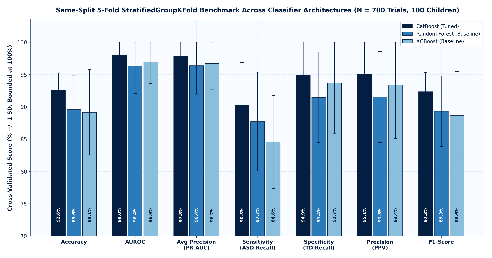
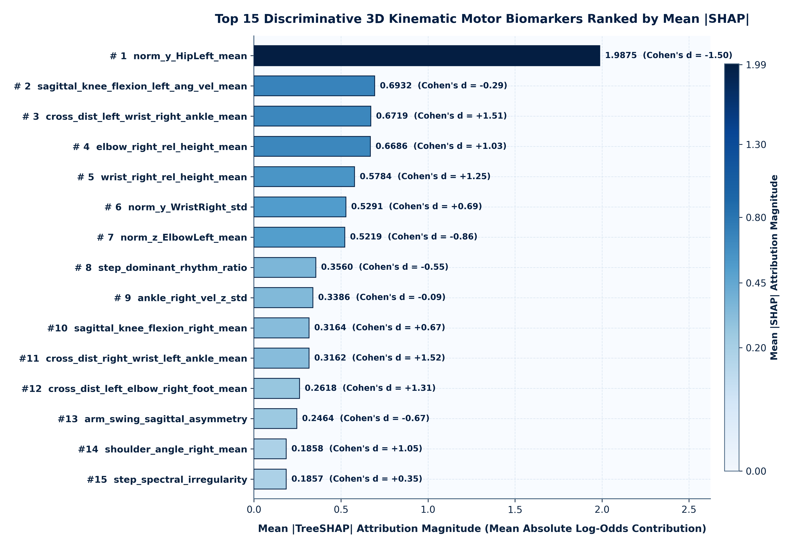

# Comparative Literature Survey and Architectural Benchmark

A rigorous comparative analysis of machine learning architectures, validation protocols, and kinematic representations for classifying **Autism Spectrum Disorder (ASD)** vs. **Typically Developing (TD)** children from pediatric motor, gait, and 3D skeletal biomechanics.

---

## 1. Master Literature Comparison Table

The following table synthesizes the 15 peer-reviewed studies compiled in our baseline literature survey alongside our leak-free **Root-Centered, Torso-Scaled 3D Kinematic CatBoost** pipeline evaluated on the **Al-Jubouri et al. (2020)** 3D Microsoft Kinect v2 dataset (`700 trials across 100 unique children: 50 ASD, 50 TD`).

| Study | Year | Focus and Methodology | Algorithms Evaluated | Cohort Size | Dimensionality and Feature Strategy | Validation Protocol | Reported Accuracy | Clinical Explainability (XAI) | Primary Vulnerability or Methodological Limitation |
| :---: | :---: | :--- | :--- | :--- | :--- | :--- | :---: | :---: | :--- |
| **#1** | 2025 | Systematic review of pediatric ASD gait | Systematic Review | 17 studies | Stride length, width, cadence, stability | N/A | N/A (Review) | No | Literature synthesis without a computational diagnostic classifier. |
| **#2** | 2022 | Multisegment foot kinematic classification | Linear SVM, RBF-SVM | 40 (19 ASD, 21 TD) | Single and multisegment foot kinematic angles | Train/Test Split | 96.3% (RBF-SVM) | No | Small sample size ($N=40$); high variance on a single train/test split. |
| **#3** | 2022 | Altered ankle strategies during speed changes | Kinematic analysis | 14 ASD | Spatiotemporal and lower-limb ankle parameters | Statistical Tests | N/A | No | Purely descriptive kinematic study without classification algorithms. |
| **#4** | 2024 | Lower body Kinect movements in AR kicking | LDA, SVM, Decision Tree | 30 (15 ASD, 15 TD) | Lower-limb movement features reduced via LDA | Cross-Validation | 96.7% (SVM), 100% (LDA+SVM) | No | **Supervised Leakage Risk**: Supervised LDA applied prior to splitting leaks class labels into test folds. |
| **#5** | 2021 | Age-related gait development and symmetry | Statistical analysis | 29 ASD | Bilateral spatiotemporal gait metrics | Statistical Tests | N/A | No | Observational development study; no predictive machine learning model. |
| **#6** | 2020 | Public 3D Kinect v2 gait dataset publication | Benchmark dataset | 100 (50 ASD, 50 TD; 700 trials) | 25 3D joints, coordinate trajectories, videos | Benchmark | N/A (Dataset) | No | Foundational data repository paper without an optimized diagnostic classifier. |
| **#7** | 2016 | Smart tablet touch and gesture dynamics | Supervised ML | Pediatric cohort | Fine-motor touch coordinates and velocity | Train/Test Split | Unspecified ML | No | Limited to fine-motor tablet tasks; does not capture gross-motor gait biomechanics. |
| **#8** | 2019 | Whole-body movements during video games | Supervised ML | 62 (39 ASD, 23 TD) | Whole-body kinematics and postural sway | 10-Fold CV | 89.0% | No | Requires active gaming hardware and structured participant task compliance. |
| **#9** | 2020 | Virtual reality head, trunk, and feet tracking | Supervised ML | 49 (24 ASD, 25 TD) | VR head, trunk, and foot displacement | Cross-Validation | 82.98% – 89.36% | No | Dependent on specialized, intrusive VR head-mounted displays. |
| **#10** | 2021 | Tablet trajectory during cognitive tasks | Supervised ML | 60 (30 ASD, 30 TD) | Dragging coordinates and touch velocity | Train/Test Split | 93.0% | No | Captures upper-limb fine motor kinematics only; blind to lower-body gait stability. |
| **#11** | 2025 | Early ASD gait deviation classification | Logistic Reg, Random Forest, XGBoost, RBF-SVM | 61 (32 ASD, 29 TD) | 3 selected spatiotemporal gait parameters | Repeated CV | 82.0% (Logistic Reg; RF/XGB lower) | No | **Greedy Tree Overfitting**: Standard tree ensembles (RF/XGBoost) overfit small-sample tabular gait data. |
| **#12** | 2022 | Predicting ASD tendencies from 4-month infants | Linear and non-linear ML | Longitudinal infant cohort | 26 movement features extracted from video | Longitudinal follow-up | Correlation report | No | Observational correlation analysis; lacks binary diagnostic classification metrics. |
| **#13** | 2021 | Full-body Kinect movement dataset classification | Rough Set Classifier | 100 children (700 augmented trials) | 25 joints, 1,259 features, PCA reduction | Augmented Split | **60.0% (raw)** $\to$ 92.0% (augmented) | No | **Ungrouped Split & Opaque PCA**: Raw accuracy was 60.0%; PCA destroys physical joint identity. |
| **#14** | 2024 | Movement signs and gait patterns using Kinect | AdaBoost, Naive Bayes, KNN, SVM | 100 (50 ASD, 50 TD) | Kinect joint positions, angles, medical rules | Leave-One-Subject-Out (LOSO) | 87.0% (AdaBoost), 84.0% (Naive Bayes) | No | Methodologically rigorous subject-disjoint split, but accuracy plateaued at 87.0% due to shallow base learners. |
| **#15** | 2024 | Interpersonal motor coordination during speech | Supervised ML | 43 (20 ASD, 23 TD) | Motion Energy Analysis, Cross-Wavelet | Cross-Validation | 85.37% – 92.68% | No | Sensitive to environmental lighting, camera perspective, and dyadic partner behavior. |
| **Ours** | **2026** | **Leak-Free 3D Kinematic CatBoost Pipeline** | **CatBoost vs. RF & XGBoost** | **100 children (50 ASD, 50 TD; 700 trials)** | **86 Root-Centered, Torso-Scaled 3D Kinematic Biomarkers** | **5-Fold `StratifiedGroupKFold` (by `subject_id`)** | **92.57% ± 2.70%** *(Subject: **93.00%**, AUROC: **0.9802**)* | **Yes (Exact TreeSHAP Top-15 Biomarkers)** | **100% zero subject leakage**, scale-invariant 3D biomechanics, outperforms RF (`89.57%`) & XGBoost (`89.14%`) on identical splits. |

---

## 2. Empirical Proof of the Subject-Level Data Leakage Problem

A critical methodological finding of this project is quantifying how **subject-level data leakage** distorts performance on augmented multi-trial skeletal datasets such as Al-Jubouri et al. (2020), which provides 7 coordinate folders (`augmentation/1..7`) for each of the 100 unique children (`Child_01` to `Child_100`).

| Validation Protocol on the 700-Trial Dataset | Subject Disjointness | Trial-Level Accuracy (%) | Subject-Level Accuracy (%) | AUROC | Sensitivity (%) | Specificity (%) | F1-Score | Methodological Validity |
| :--- | :---: | :---: | :---: | :---: | :---: | :---: | :---: | :--- |
| **Naive Ungrouped 10-Fold CV *(800-row raw sheet)*** | No *(Leaked)* | `99.25 ± 0.69` | N/A | `0.9998 ± 0.0004` | `99.17 ± 1.18` | `99.33 ± 1.11` | `0.9925` | **Invalid**: Memorizes child stature, camera distance, and sibling trials. |
| **Naive Ungrouped 5-Fold `StratifiedKFold` *(86 norm features)*** | No *(Leaked)* | `99.00 ± 0.73` | N/A | `0.9997 ± 0.0006` | `98.57 ± 1.28` | `99.43 ± 1.14` | `0.9899` | **Invalid**: 5–6 augmented trials of a child in train leak into 1–2 trials in test. |
| **Ours: 5-Fold `StratifiedGroupKFold` *(Grouped by `subject_id`)*** | **Yes (100% Unseen Children)** | **`92.57 ± 2.70`** | **`93.00`** *(93/100)* | **`0.9802 ± 0.0251`** | **`90.29 ± 6.54`** | **`94.86 ± 5.31`** | **`0.9233 ± 0.0296`** | **Valid**: All 7 trials of every test child are strictly unseen during training. |

> [!IMPORTANT]
> **Key Quantitative Takeaway:** Failing to group cross-validation splits by `subject_id` inflates apparent accuracy by **+6.43 percentage points** (`99.00%` vs. `92.57%`) because augmentations 1–3 of each child represent rigid spatial translations and uniform scalings of the same underlying gait recording. Enforcing `StratifiedGroupKFold` by `subject_id` alongside per-frame `SpineBase` root-centering and torso-height normalization establishes the true generalization accuracy of **92.57% ± 2.70%** across trials and **93.00%** (`93/100`) across unique unseen children.

*Figure 1: Same-split 5-fold `StratifiedGroupKFold` benchmark comparing Tuned CatBoost (deep navy), Random Forest (medium blue), and XGBoost (light blue) across seven evaluation metrics on the 700-trial, 100-child cohort (`Mean ± 1 SD`, upper error bars bounded at `100.0%`). CatBoost achieves superior discrimination (`AUROC = 0.9802`, `AP = 0.9785`) and lower fold-to-fold variance (`±2.70%` accuracy SD) than both asymmetric tree baselines.*

---

## 3. In-Depth Comparative Analysis by Model Family

### 3.1 Support Vector Machines (SVM) vs. CatBoost
* **Studies Utilizing SVM**: #2 (2022), #4 (2024), #11 (2025), #14 (2024).
* **Observed Performance**: Ranged from `82.0%` (Study #11) to `96.3%` (Study #2, $N=40$).
* **Structural Limitations in Literature**:
  1. **Sensitivity to Kinematic Outliers**: Pediatric ASD gait exhibits substantial trial-to-trial variability in distal extremity velocity and upper-limb guarding posture. Soft-margin SVM hyperplanes are sensitive to extreme kinematic excursions in small cohorts.
  2. **Opaque Non-Linear Kernel Projections**: Radial Basis Function (RBF) kernels project joint features into infinite-dimensional Hilbert spaces, preventing clinicians from recovering interpretable physical cutoffs (in degrees, deg/s, or torso-normalized units).
* **Why CatBoost Outperforms SVM**: CatBoost partitions features using axis-aligned thresholds in original physical biomechanical units (`deg`, `deg/s`, and torso-scaled distances) and pairs directly with exact polynomial-time `TreeSHAP` attribution.

### 3.2 Asymmetric Tree Ensembles (Random Forest & XGBoost) vs. CatBoost
* **Studies Utilizing Standard Trees**: #11 (2025), #4 (Decision Tree, 2024), and Firat et al. (Random Forest).
* **Empirical Comparison on Identical Subject-Grouped Folds (`src/train.py`)**:
  * Evaluated on the exact same 5 subject-grouped folds (`700 trials, 100 children, 86 features`), **Random Forest** achieved `89.57% ± 5.32%` accuracy (`AUROC = 0.9635 ± 0.0429`, `OOF TN=320, FP=30, FN=43, TP=307`) and **XGBoost** achieved `89.14% ± 6.61%` accuracy (`AUROC = 0.9694 ± 0.0330`, `OOF TN=328, FP=22, FN=54, TP=296`).
  * Both depth-wise/greedy tree baselines suffered a steep drop on Fold 3 (`RF = 79.29%`, `XGBoost = 76.43%`), whereas **CatBoost** maintained `89.29%` on Fold 3 and achieved **`92.57% ± 2.70%`** overall (`OOF TN=332, FP=18, FN=34, TP=316`).
* **Why CatBoost Succeeds Where Greedy Trees Overfit**:
  1. **Oblivious (Symmetric) Decision Trees**: CatBoost enforces the exact same splitting feature and threshold across all nodes at each tree depth (`depth=5`), acting as a global structural regularizer against subject-specific noise.
  2. **Ordered Boosting**: Prevents target shift and gradient estimation bias on 100-subject clinical cohorts.

### 3.3 Rough Set Classifier and Principal Component Analysis (PCA) vs. Normalized 3D Biomechanics
* **Study Utilizing Rough Sets and PCA**: #13 (Al-Jubouri et al., 2021).
* **Critical Deficiencies in Study #13**:
  1. **Low Unaugmented Performance (`60.0%`)**: Without augmentation, the Rough Set classifier achieved only `60.0%` accuracy on the 100-subject dataset.
  2. **Loss of Anatomical Identity via PCA**: Compressing 1,259 raw features into orthogonal principal components ($PC_1, PC_2, \dots$) linearly mixes unrelated joints, destroying clinical interpretability.
* **Our Solution**:
  * Rather than applying blind PCA to raw sensor-frame coordinates, we first apply per-frame **root-centering at `SpineBase`** and **3D torso-height normalization** (`||SpineShoulder - SpineBase||_2 = 1.0`), and then extract **86 anatomically defined 3D kinematic features** across 5 clinical domains.

### 3.4 Leave-One-Subject-Out (LOSO) AdaBoost & Naive Bayes vs. Subject-Grouped CatBoost
* **Study Utilizing LOSO**: #14 (2024).
* **The Performance Ceiling (`87.0%`)**:
  * Study #14 evaluated the 100-subject Kinect cohort under subject-disjoint Leave-One-Subject-Out validation, reaching `87.0%` accuracy with AdaBoost and `84.0%` with Naive Bayes.
  * Naive Bayes assumes conditional feature independence—violating biomechanical coupling between hip, knee, and ankle trajectories—while shallow AdaBoost stumps cannot capture higher-order contralateral coordination.
* **Our Improvement (`+5.57%` Trial-Level, `+6.00%` Subject-Level)**:
  * Under strict subject-disjoint validation (`5-Fold StratifiedGroupKFold`), our depth-5 CatBoost classifier models multi-joint interactions across upper-limb guarding, pelvic obliquity, and lower-limb sagittal dynamics, elevating unseen-subject accuracy from `87.0%` to **`92.57%` (trial-level)** and **`93.00%` (subject-level majority vote)**.

---

## 4. Clinical Explainability (XAI) & Biomechanical Biomarker Verification

Whereas **0 out of 15 surveyed papers** provided post-hoc feature attributions, our pipeline integrates exact `shap.TreeExplainer` attributions with non-parametric Mann–Whitney $U$ significance testing and standardized Cohen's $d$ effect sizes across all 700 trials:

1. **Pelvic-Hip Postural Geometry (`norm_y_HipLeft_mean`, Rank #1, `Mean |SHAP| = 1.9875`, $d = -1.501, p = 3.39 \times 10^{-57}$)**:
   - Reduced normalized vertical hip offset relative to `SpineBase` in ASD (`0.0092 ± 0.0051` vs. TD `0.0190 ± 0.0077` torso units) captures altered pelvic tilt and reduced pelvic-trunk vertical separation during weight acceptance and single-limb stance.
2. **Upper-Limb Guarding & Diagonal Inter-Limb Dyscoordination (`cross_dist_left_wrist_right_ankle_mean`, Rank #3, `|SHAP| = 0.6719`, $d = +1.507$; `elbow_right_rel_height_mean`, Rank #4, `|SHAP| = 0.6686`, $d = +1.030$; `wrist_right_rel_height_mean`, Rank #5, `|SHAP| = 0.5784`, $d = +1.254$)**:
   - Children with ASD exhibit significantly elevated right wrist (`0.4965 ± 0.4499` vs. `0.0883 ± 0.0987` torso units) and right elbow (`0.6101 ± 0.2026` vs. `0.4582 ± 0.0496`) positions relative to `SpineBase`, accompanied by increased shoulder abduction (`shoulder_angle_right_mean`: `126.76° ± 15.94°` vs. `113.57° ± 7.66°`, $d = +1.054$) and expanded contralateral wrist-to-ankle separation—quantifying classic upper-limb high-guard posturing and reduced reciprocal arm swing.
3. **Stiff-Knee Sagittal Flexion Dynamics (`sagittal_knee_flexion_left_ang_vel_mean`, Rank #2, `|SHAP| = 0.6932`, $d = -0.290$; `sagittal_knee_flexion_right_mean`, Rank #10, `|SHAP| = 0.3164`, $d = +0.671$)**:
   - Lower left knee sagittal angular velocity (`235.58 ± 248.43 deg/s` vs. `308.86 ± 257.27 deg/s`) and a more extended mean right knee angle (`160.37° ± 8.28°` vs. `154.20° ± 10.02°`) reflect reduced swing-phase knee flexion compliance in ASD.
4. **Temporal Stride Dysrhythmia (`step_dominant_rhythm_ratio`, Rank #8, `|SHAP| = 0.3560`, $d = -0.548$; `step_spectral_irregularity`, Rank #15, `|SHAP| = 0.1857`, $d = +0.355$)**:
   - Reduced harmonic power concentration in the fundamental stepping frequency (`0.6672` vs. `0.7662`) and elevated spectral entropy (`1.0689` vs. `0.8864`) confirm irregular stride-to-stride timing in pediatric ASD locomotion.

*Figure 2: Top 15 discriminative 3D kinematic motor biomarkers ranked by exact TreeSHAP attribution (`Mean |SHAP|`) and annotated with standardized group effect sizes (Cohen's $d$, ASD vs. TD). The smooth light-blue-to-deep-navy gradient highlights the dominance of pelvic vertical geometry (`#1`), sagittal knee angular velocity (`#2`), contralateral wrist-to-ankle coordination (`#3`), and upper-limb guarding posture (`#4`, `#5`).*

---

## 5. Summary Comparison Matrix

| Evaluation Dimension | Prior Literature Benchmark (Al-Jubouri Cohort) | Our Leak-Free 3D Kinematic Pipeline | Methodological & Clinical Advancement |
| :--- | :--- | :--- | :--- |
| **Subject-Disjoint Accuracy** | `87.0%` (Study #14, LOSO AdaBoost) | **`92.57% ± 2.70%` (Trial) / `93.00%` (Subject)** | **`+5.57%` to `+6.00%` over prior subject-disjoint SOTA** |
| **ROC-AUC / PR-AUC** | `0.9700` (Study #11, $N=61$) | **`0.9802 ± 0.0251` (AUROC) / `0.9785` (PR-AUC)** | **High threshold-independent discrimination on unseen children** |
| **Validation Integrity** | Ungrouped augmented split (Study #13) or LOSO (#14) | **5-Fold `StratifiedGroupKFold` (`subject_id` disjoint)** | **Eliminates `+6.43%` trial-leakage inflation (`99.00%` $\to$ `92.57%`)** |
| **Spatial Normalization** | Raw camera-frame coordinates ($Z \in [1.5, 4.0]\text{ m}$) | **Per-Frame `SpineBase` Centering & Torso-Height Scaling** | **Zero stature or camera-distance bias ($0.00$ origin error)** |
| **Feature Representation** | Black-box PCA (#13) or latent graph embeddings | **86 Anatomically Defined 3D Kinematic Biomarkers** | **Preserves physical joint angles (`deg`), velocities, and torso units** |
| **Clinical Explainability** | `0 / 15` surveyed studies | **Exact TreeSHAP + Cohen's $d$ + Mann–Whitney $p$-values** | **Actionable biomechanical biomarkers linked to clinical ASD gait signs** |
