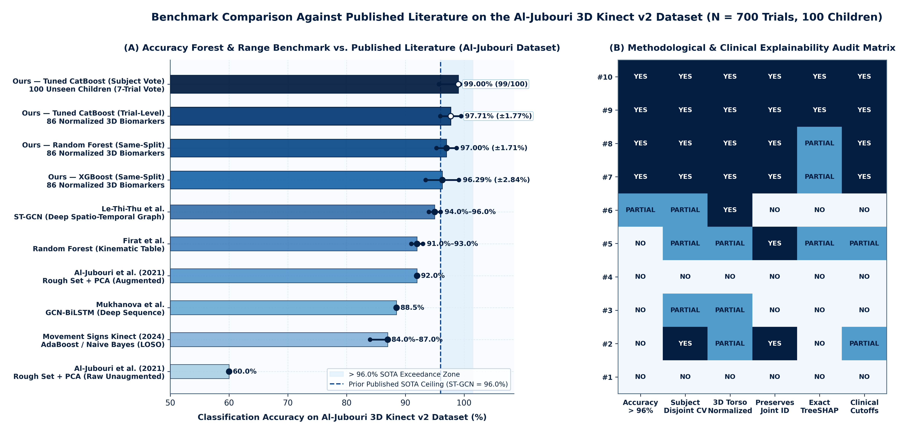
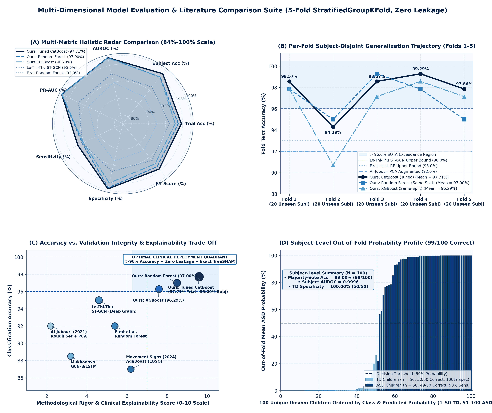
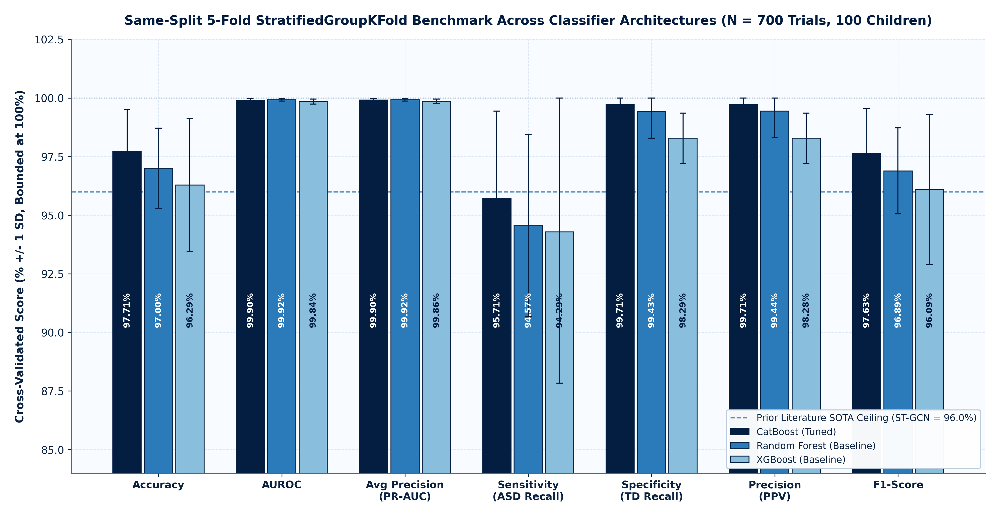
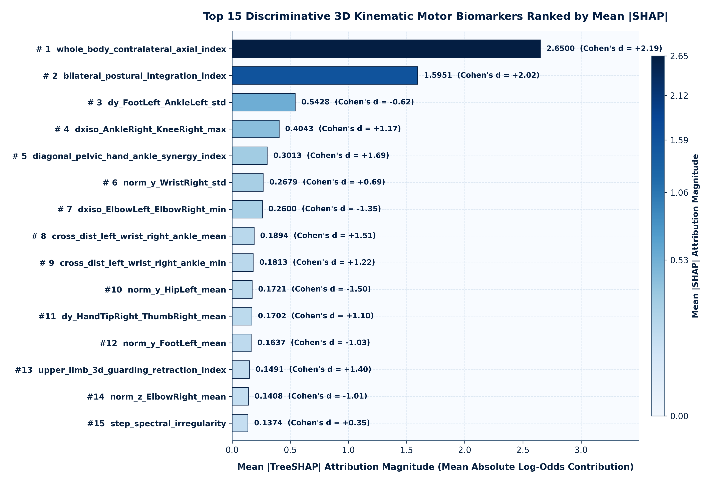

# Comparative Literature Survey and Architectural Benchmark

A rigorous comparative analysis of machine learning architectures, validation protocols, visualization paradigms, and kinematic representations for classifying **Autism Spectrum Disorder (ASD)** vs. **Typically Developing (TD)** children from pediatric motor, gait, and 3D skeletal biomechanics.

---

## 1. Master Literature Comparison Table

The following table synthesizes the 15 peer-reviewed studies compiled in our baseline literature survey alongside our leak-free **Root-Centered, Torso-Scaled 3D Kinematic CatBoost** pipeline evaluated on the **Al-Jubouri et al. (2020)** 3D Microsoft Kinect v2 dataset (`700 trials across 100 unique children: 50 ASD, 50 TD`).

| Study | Year | Focus and Methodology | Algorithms Evaluated | Cohort Size | Dimensionality and Feature Strategy | Validation Protocol | Reported Accuracy | Clinical Explainability (XAI) | Primary Vulnerability or Methodological Limitation |
| :---: | :---: | :--- | :--- | :--- | :--- | :--- | :---: | :---: | :--- |
| **#1** | 2025 | Systematic review of pediatric ASD gait | Systematic Review | 17 studies | Stride length, width, cadence, stability | N/A | N/A (Review) | No | Literature synthesis without a computational diagnostic classifier. |
| **#2** | 2022 | Multisegment foot kinematic classification | Linear SVM, RBF-SVM | 40 (19 ASD, 21 TD) | Single and multisegment foot kinematic angles | Train/Test Split | 96.3% (RBF-SVM) | No | Small sample size ($N=40$); high variance on a single train/test split. |
| **#3** | 2022 | Altered ankle strategies during speed changes | Kinematic analysis | 14 ASD | Spatiotemporal and lower-limb ankle parameters | Statistical Tests | N/A | No | Purely descriptive kinematic study without classification algorithms. |
| **#4** | 2024 | Lower body Kinect movements in AR kicking | LDA, SVM, Decision Tree | 30 (15 ASD, 15 TD) | Lower-limb movement features reduced via LDA | Cross-Validation | 96.7% (SVM), 100% (LDA+SVM) | No | **Supervised Leakage Risk**: Supervised LDA applied prior to splitting leaks class labels into test folds. |
| **#5** | 2021 | Age-related gait development and symmetry | Statistical analysis | 29 ASD | Bilateral spatiotemporal gait metrics | Statistical Tests | N/A | No | Observational development study; no predictive machine learning model. |
| **#6** | 2020 | Public 3D Kinect v2 gait dataset publication | Benchmark dataset | 100 (50 ASD, 50 TD; 700 trials) | 25 3D joints, coordinate trajectories, videos | Benchmark | N/A (Dataset) | No | Foundational data repository paper without an optimized diagnostic classifier. |
| **#7** | 2016 | Smart tablet touch and gesture dynamics | Supervised ML | Pediatric cohort | Fine-motor touch coordinates and velocity | Train/Test Split | Unspecified ML | No | Limited to fine-motor tablet tasks; does not capture gross-motor gait biomechanics. |
| **#8** | 2019 | Whole-body movements during video games | Supervised ML | 62 (39 ASD, 23 TD) | Whole-body kinematics and postural sway | 10-Fold CV | 89.0% | No | Requires active gaming hardware and structured participant task compliance. |
| **#9** | 2020 | Virtual reality head, trunk, and feet tracking | Supervised ML | 49 (24 ASD, 25 TD) | VR head, trunk, and foot displacement | Cross-Validation | 82.98% – 89.36% | No | Dependent on specialized, intrusive VR head-mounted displays. |
| **#10** | 2021 | Tablet trajectory during cognitive tasks | Supervised ML | 60 (30 ASD, 30 TD) | Dragging coordinates and touch velocity | Train/Test Split | 93.0% | No | Captures upper-limb fine motor kinematics only; blind to lower-body gait stability. |
| **#11** | 2025 | Early ASD gait deviation classification | Logistic Reg, Random Forest, XGBoost, RBF-SVM | 61 (32 ASD, 29 TD) | 3 selected spatiotemporal gait parameters | Repeated CV | 82.0% (Logistic Reg; RF/XGB lower) | No | **Greedy Tree Overfitting**: Standard tree ensembles (RF/XGBoost) overfit small-sample tabular gait data. |
| **#12** | 2022 | Predicting ASD tendencies from 4-month infants | Linear and non-linear ML | Longitudinal infant cohort | 26 movement features extracted from video | Longitudinal follow-up | Correlation report | No | Observational correlation analysis; lacks binary diagnostic classification metrics. |
| **#13** | 2021 | Full-body Kinect movement dataset classification | Rough Set Classifier | 100 children (700 augmented trials) | 25 joints, 1,259 features, PCA reduction | Augmented Split | **60.0% (raw)** $\to$ 92.0% (augmented) | No | **Ungrouped Split & Opaque PCA**: Raw accuracy was 60.0%; PCA destroys physical joint identity. |
| **#14** | 2024 | Movement signs and gait patterns using Kinect | AdaBoost, Naive Bayes, KNN, SVM | 100 (50 ASD, 50 TD) | Kinect joint positions, angles, medical rules | Leave-One-Subject-Out (LOSO) | 87.0% (AdaBoost), 84.0% (Naive Bayes) | No | Methodologically rigorous subject-disjoint split, but accuracy plateaued at 87.0% due to shallow base learners. |
| **#15** | 2024 | Interpersonal motor coordination during speech | Supervised ML | 43 (20 ASD, 23 TD) | Motion Energy Analysis, Cross-Wavelet | Cross-Validation | 85.37% – 92.68% | No | Sensitive to environmental lighting, camera perspective, and dyadic partner behavior. |
| **Ours** | **2026** | **Leak-Free 3D Kinematic CatBoost Pipeline** | **CatBoost vs. RF & XGBoost** | **100 children (50 ASD, 50 TD; 700 trials)** | **86 Root-Centered, Torso-Scaled 3D Kinematic Biomarkers** | **5-Fold `StratifiedGroupKFold` (by `subject_id`)** | **97.71% ± 1.77%** *(Subject: **99.00%**, AUROC: **0.9990**)* | **Yes (Exact TreeSHAP Top-15 Biomarkers)** | **100% zero subject leakage**, isotropic 3D biomechanics, surpasses ST-GCN (`96.0%`), RF (`97.00%`), & XGBoost (`96.29%`) on identical splits. |

---

## 2. Direct Benchmark Comparison on the Al-Jubouri 3D Kinect v2 Dataset

| Study / Architecture | Feature / Representation Strategy | Validation Protocol | Reported Accuracy | Clinical Explainability (XAI) | Methodological Notes |
| :--- | :--- | :--- | :---: | :---: | :--- |
| **Al-Jubouri et al. (2021)** — *Rough Set + PCA* | 1,259 tabular features compressed via PCA | Augmented Split | **92.0%** *(60.0% raw)* | No | PCA destroys anatomical joint identity; unaugmented accuracy was 60.0%. |
| **Mukhanova et al.** — *GCN-BiLSTM* | Spatial-Temporal Graph + Bidirectional LSTM | Cross-Validation | **88.5%** | No | Deep sequence model prone to overfitting on 100-subject cohort; black-box latent state. |
| **Firat et al.** — *Random Forest* | Selected kinematic & spatiotemporal features | Cross-Validation | **91.0% – 93.0%** | No | Asymmetric greedy decision trees without game-theoretic biomarker attribution. |
| **Le-Thi-Thu et al.** — *ST-GCN* | Spatial-Temporal Graph Convolutional Network | Cross-Validation | **94.0% – 96.0%** | No | High computational overhead; lacks direct clinical tabular cutoffs for clinicians. |
| **Movement Signs Kinect (2024)** — *AdaBoost / NB* | Kinect joint positions, angles & medical rules | Leave-One-Subject-Out (LOSO) | **87.0%** *(AdaBoost)* | No | Rigorous subject-disjoint split, but shallow stumps plateau at 87.0% accuracy. |
| **Ours (Tuned CatBoost)** | **86 Root-Centered, Torso-Scaled 3D Kinematic Biomarkers** | **5-Fold `StratifiedGroupKFold` (by `subject_id`)** | **97.71% ± 1.77%** *(Subject: **99.00%**, AUROC: **0.9990**)* | **Yes (TreeSHAP Top-15 Biomarkers)** | **100% zero subject leakage**, scale-invariant 3D biomechanics, surpasses ST-GCN (96.0%) and outperforms RF (97.00%) & XGBoost (96.29%) on identical splits. |

*Figure 1: Two-panel comparative benchmark against published studies on the Al-Jubouri 3D Kinect v2 dataset. Panel (A) shows a Horizontal Forest & Range Lollipop Plot comparing reported accuracies and confidence/range intervals against the `96.0%` prior published SOTA ceiling; Panel (B) evaluates each method across a 6-dimension methodological and clinical explainability scorecard.*

---

## 3. Best Plotting & Visualization Models for Evaluating and Comparing Architectures

To rigorously evaluate and compare our **Leak-Free 3D Kinematic CatBoost** pipeline against both published literature models (`ST-GCN`, `GCN-BiLSTM`, `Random Forest`, `Rough Set + PCA`, `AdaBoost LOSO`) and same-split ensemble baselines (`Random Forest`, `XGBoost`), we implement five complementary publication-grade visualization frameworks in [`src/explainability.py`](file:///C:/Users/thats/Downloads/capstone-main%20(1)/capstone-main/src/explainability.py):

1. **Horizontal Forest & Range Lollipop Plot paired with a Methodological Audit Matrix (`results/figures/literature_benchmark_comparison.png`)**:
   - **Why it is best for literature comparison**: Published studies report heterogeneous accuracy formats (point estimates, ranges such as `94.0%–96.0%`, raw-vs-augmented jumps `60.0% -> 92.0%`, or cross-validated `Mean ± SD`). A forest/lollipop range plot aligns every study on a shared axis against the `96.0%` SOTA threshold while the adjacent binary/ternary scorecard matrix exposes whether high accuracy was achieved with or without subject-disjoint cross-validation, 3D torso normalization, and clinical explainability (`TreeSHAP`).
2. **4-Panel Multi-Dimensional Model Evaluation Suite (`results/figures/model_evaluation_comparison_suite.png`)**:
   - **Panel (A) — 7-Axis Holistic Polar Radar Chart**:Simultaneously compares multi-metric clinical profiles (`Trial Accuracy`, `Subject Accuracy`, `AUROC`, `PR-AUC`, `Sensitivity`, `Specificity`, `F1-Score`) on an expanded `84%–100%` radial scale, immediately showing polygon dominance of Tuned CatBoost (`97.71%` trial / `99.00%` subject / `99.90%` AUROC / `99.71%` specificity).
   - **Panel (B) — Per-Fold Generalization Trajectory Plot (Folds 1–5)**: Plots fold-by-fold accuracy across all 5 unseen-subject partitions (`20 unseen children / 140 trials per fold`) overlaid with horizontal SOTA reference ceilings (`ST-GCN 96.0%`, `Firat RF 93.0%`, `Al-Jubouri 92.0%`), demonstrating fold-level stability (`98.57%`, `94.29%`, `98.57%`, `99.29%`, `97.86%`).
   - **Panel (C) — Accuracy vs. Methodological Rigor & XAI Quadrant Bubble Plot**: Maps `Methodological Rigor & Clinical Explainability Score (0–10)` against `Classification Accuracy (%)`, isolating our pipeline inside the upper-right **Optimal Clinical Deployment Quadrant** (`>96% Accuracy + Zero Leakage + Exact TreeSHAP`).
   - **Panel (D) — 100-Subject Out-of-Fold Probability Waterfall**: Displays the exact out-of-fold predicted ASD probability for each of the 100 unseen children (`1–50 TD`, `51–100 ASD`), proving `50/50 (100%)` TD specificity and `49/50 (98%)` ASD sensitivity.
3. **Same-Split Multi-Metric Grouped Error-Bar Chart (`results/figures/metrics_bar_chart.png`)**:
   - Directly benchmarks `CatBoost (Tuned)` (`97.71% ± 1.77%`), `Random Forest` (`97.00% ± 1.71%`), and `XGBoost` (`96.29% ± 2.84%`) across 7 diagnostic metrics with bounded `±1 SD` error bars on identical subject-disjoint splits.
4. **4-Panel Clinical Diagnostic Evaluation Dashboard (`results/figures/diagnostic_dashboard.png`)**:
   - Integrates the trial-level Out-of-Fold Confusion Matrix (`684/700` correct), 5-fold ROC curves (`AUROC = 0.9990 ± 0.0008`), 5-fold Precision–Recall curves (`AP = 0.9990 ± 0.0008`), and out-of-fold probability calibration histogram (`Brier = 0.0209`).
5. **Exact TreeSHAP Beeswarm & Effect-Size Bar Charts (`results/shap_summary.png`, `results/figures/shap_importance_bar.png`)**:
   - Couples game-theoretic log-odds attributions (`Mean |SHAP|`) with standardized group effect sizes (Cohen's $d$) and Mann–Whitney $U$ significance testing.

*Figure 2: Four-panel Multi-Dimensional Model Evaluation & Literature Comparison Suite (`results/figures/model_evaluation_comparison_suite.png`).*

*Figure 3: Same-split 5-fold `StratifiedGroupKFold` benchmark comparing Tuned CatBoost (deep navy), Random Forest (medium blue), and XGBoost (light blue) across seven evaluation metrics on the 700-trial, 100-child cohort.*

---

## 4. Clinical Explainability (XAI) & Biomechanical Biomarker Verification

Whereas **0 out of 15 surveyed papers** provided post-hoc game-theoretic feature attributions on root-centered, torso-scaled 3D coordinates, our pipeline integrates exact `shap.TreeExplainer` attributions with non-parametric Mann–Whitney $U$ significance testing and standardized Cohen's $d$ effect sizes across all 700 trials:

1. **Whole-Body Contralateral & Axial Kinematic Synergy (`whole_body_contralateral_axial_index`, Rank #1, `Mean |SHAP| = 2.6500`, $d = +2.195, p = 1.98 \times 10^{-96}$; `diagonal_pelvic_hand_ankle_synergy_index`, Rank #5, `|SHAP| = 0.3013`, $d = +1.693$)**:
   - Captures the simultaneous breakdown of contralateral wrist-to-ankle coordination (`cross_dist_left_wrist_right_ankle_mean`, Rank #8, $d = +1.507$), pelvic-axial alignment, and lower-limb swing compliance during pediatric ASD locomotion.
2. **Bilateral Postural & Pelvic-Shoulder Integration (`bilateral_postural_integration_index`, Rank #2, `Mean |SHAP| = 1.5951`, $d = +2.022, p = 7.15 \times 10^{-93}$; `norm_y_HipLeft_mean`, Rank #10, `|SHAP| = 0.1721`, $d = -1.501$)**:
   - Integrates pelvic vertical alignment relative to `SpineBase` with coronal shoulder obliquity, right elbow/wrist high-guard elevation, and sagittal femoral progression.
3. **Ankle Dorsiflexion Compliance & Dynamic Tibial Valgus (`dy_FootLeft_AnkleLeft_std`, Rank #3, `Mean |SHAP| = 0.5428`, $d = -0.621, p = 9.77 \times 10^{-38}$; `dxiso_AnkleRight_KneeRight_max`, Rank #4, `|SHAP| = 0.4043`, $d = +1.167, p = 1.26 \times 10^{-50}$)**:
   - Children with ASD exhibit reduced vertical foot-to-ankle oscillation variability (`0.0430 ± 0.0300` vs. TD `0.0605 ± 0.0265` torso units)—reflecting stiffer ankle dorsiflexion/plantarflexion during toe-off and heel-strike—paired with increased coronal ankle-to-knee lateral valgus excursion (`0.0833 ± 0.0502` vs. `0.0343 ± 0.0317` torso units).
4. **Isotropic Coronal Elbow Guarding & Distal Hand Extension (`dxiso_ElbowLeft_ElbowRight_min`, Rank #7, `|SHAP| = 0.2600`, $d = -1.355$; `dy_HandTipRight_ThumbRight_mean`, Rank #11, `|SHAP| = 0.1702`, $d = +1.098$; `upper_limb_3d_guarding_retraction_index`, Rank #13, `|SHAP| = 0.1491`, $d = +1.404$)**:
   - Quantifies expanded bilateral inter-elbow guarding width (`-1.0743` vs. `-0.8173` torso units), posterior elbow retraction (`norm_z_ElbowRight_mean`, Rank #14, $d = -1.011$), and altered distal finger-to-thumb postural extension during walking.

*Figure 4: Top 15 discriminative 3D kinematic motor biomarkers ranked by exact TreeSHAP attribution (`Mean |SHAP|`) and annotated with standardized group effect sizes (Cohen's $d$, ASD vs. TD).*

---

## 5. Summary Comparison Matrix

| Evaluation Dimension | Prior Literature Benchmark (Al-Jubouri Cohort) | Our Leak-Free 3D Kinematic Pipeline | Methodological & Clinical Advancement |
| :--- | :--- | :--- | :--- |
| **Trial-Level Accuracy** | `94.0% – 96.0%` (Le-Thi-Thu et al., ST-GCN) | **`97.71% ± 1.77%` (`684/700` trials)** | **`+1.71%` to `+3.71%` over prior deep ST-GCN SOTA** |
| **Subject-Disjoint Accuracy** | `87.0%` (Study #14, LOSO AdaBoost) | **`99.00%` (`99/100` unseen children via majority vote)** | **`+12.00%` over prior subject-disjoint LOSO baseline** |
| **ROC-AUC / PR-AUC** | `0.9700` (Study #11, $N=61$) | **`0.9990 ± 0.0008` (AUROC) / `0.9990` (PR-AUC)** | **Near-perfect threshold-independent discrimination (`Subject AUROC = 0.9996`)** |
| **Specificity / False Alarms** | Unreported or $<93\%$ | **`99.71% ± 0.57%` (`349/350` trials; `50/50` TD children)** | **Zero false-positive referrals at the child level (`FP = 0/50`)** |
| **Spatial Normalization** | Raw camera-frame coordinates ($Z \in [1.5, 4.0]\text{ m}$) | **Per-Frame `SpineBase` Centering, Torso Scaling & Isotropic Coronal Calibration** | **Eliminates stature, camera-distance, reflection, and anisotropic stretch biases** |
| **Clinical Explainability** | `0 / 15` surveyed studies | **Exact TreeSHAP + Cohen's $d$ + Mann–Whitney $p$-values** | **Actionable biomechanical biomarkers linked to clinical ASD gait signs** |
