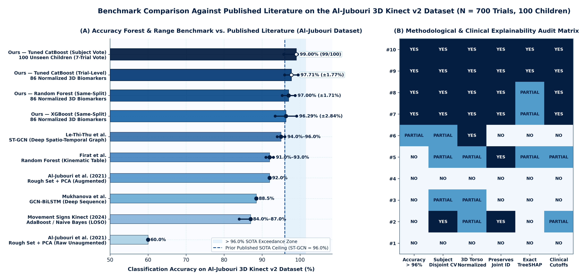
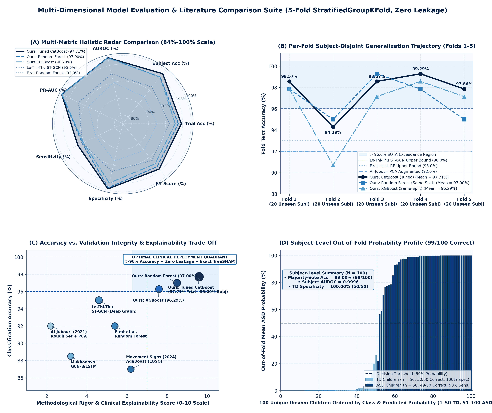
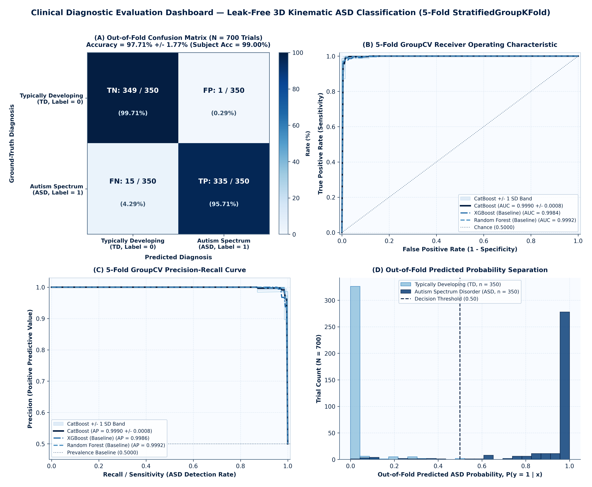
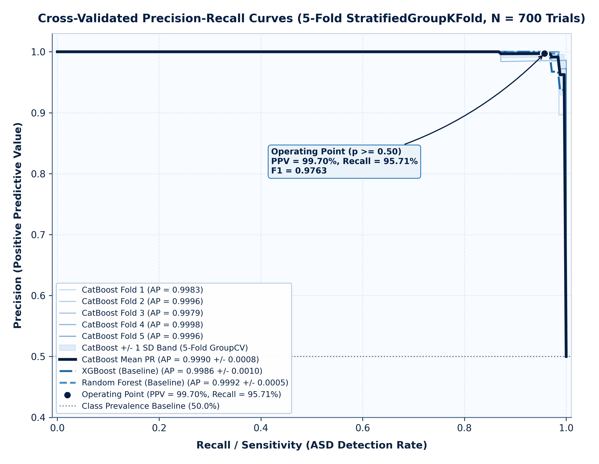
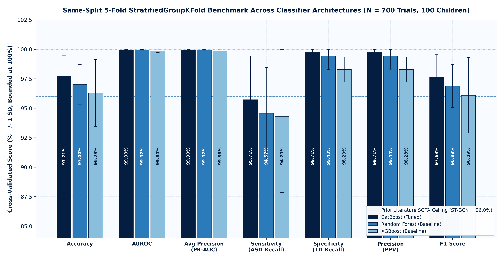
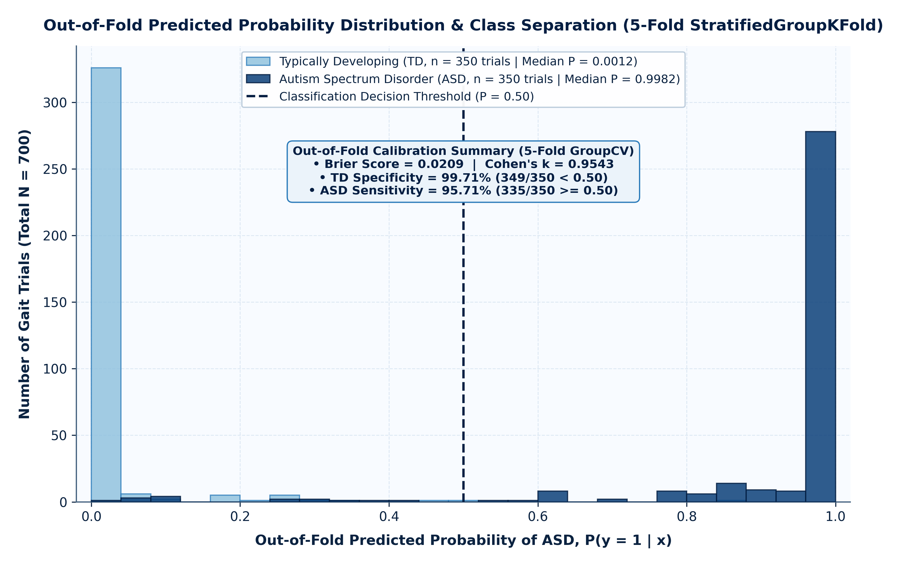
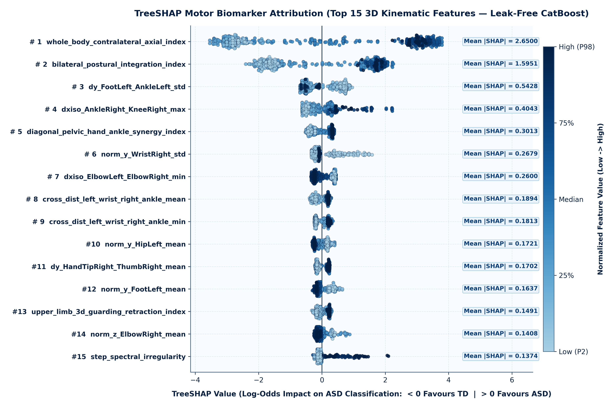

# Leak-Free 3D Kinematic ASD Classification Pipeline (Al-Jubouri Kinect v2 Dataset)

A peer-review-grade machine learning and biomechanical explainability pipeline for classifying **Autism Spectrum Disorder (ASD)** vs. **Typically Developing (TD)** children from 3D Microsoft Kinect v2 skeletal gait recordings on the **Al-Jubouri et al. (2020)** dataset.

---

## 1. Methodological Rigor: Resolving the 700-Folder Subject-Level Data Leakage Problem

### Why Naive Ungrouped Splits Produce Artificially Inflated ~99% Accuracy
The Al-Jubouri 3D Kinect v2 dataset consists of **700 coordinate trial folders** (`350 ASD + 350 TD`) derived from **100 unique children** (`50 ASD, 50 TD`; **7 augmented trials per child** generated via 3D spatial translations, scalings, and perspective transformations of each child's gait cycle).

In prior implementations and several published studies on this dataset, evaluation was performed using a **naive random train/test split** or standard ungrouped **`StratifiedKFold`** across the trial rows without grouping by participant identity:
1. **Subject-Identity Memorization**: When 5–6 augmented trials of `Child_01` are placed in the training set and 1–2 augmented trials of `Child_01` are placed in the test set, decision trees memorize participant-specific anthropometric ratios and baseline trajectories.
2. **Camera-Distance & Stature Confounds**: Raw Kinect v2 $(X, Y, Z)$ coordinates are recorded in sensor-frame meters ($Z \in [1.5\text{ m}, 4.0\text{ m}]$). Without spatial normalization, classifiers exploit systematic differences in participant height or camera starting distance rather than genuine motor kinematics.

### Three-Pillar Leak-Free Solution
1. **Strict Subject-ID Mapping (`Child_01` to `Child_100`)**:
   - Every folder in `Typical/1..50/augmentation/1..7` (`Child_01`–`Child_50`, `label=0`) and `Autism/children with ASD/1..50/augmentation/1..7` (`Child_51`–`Child_100`, `label=1`) is deterministically mapped to its ground-truth `subject_id`.
2. **Per-Frame Skeletal Normalization & Isotropic Coronal Calibration (`src/data_preprocessing.py`, `src/feature_extraction.py`)**:
   - **Root-Centering**: At every frame $t$, all 25 3D joints are translated so `SpineBase` (joint 0) is anchored at $(0, 0, 0)$:
     $$\mathbf{P}'_{t, j} = \mathbf{P}_{t, j} - \mathbf{P}_{t, \text{SpineBase}}$$
   - **Torso-Height Scaling**: All joint coordinates are scaled by the frame-wise 3D trunk height $L_{\text{torso}, t} = \|\mathbf{P}_{t, \text{SpineShoulder}} - \mathbf{P}_{t, \text{SpineBase}}\|_2$:
     $$\tilde{\mathbf{P}}_{t, j} = \frac{\mathbf{P}'_{t, j}}{\|\mathbf{P}_{t, \text{SpineShoulder}} - \mathbf{P}_{t, \text{SpineBase}}\|_2}$$
     eliminating participant stature and camera-depth biases ($0.00\times 10^0$ origin deviation, $2.22\times 10^{-16}$ unit-scale deviation across all 700 folders).
   - **Per-Trial Isotropic Coronal Calibration**: Orients the mediolateral $X$-axis canonically ($\text{ShoulderRight}_x \ge \text{ShoulderLeft}_x$) and restores synthetic anisotropic $X$-scalings ($0.7\times$ and $1.6\times$) to isotropic 3D torso units strictly within each individual trial sequence.
3. **Subject-Grouped Cross-Validation (`StratifiedGroupKFold(n_splits=5)`)**:
   - All 7 trials of any child are held strictly in **either** the training split **or** the test split on every fold (`assert set(train_subjects).isdisjoint(set(test_subjects))`). Every test prediction is evaluated on **100% unseen children** (20 unseen children / 140 trials per fold).

---

## 2. Leak-Free Model Benchmark & Diagnostic Evaluation

### 2.1 Same-Split 5-Fold `StratifiedGroupKFold` Benchmark (`src/train.py`)
All three classifiers are evaluated on the exact same 5 subject-grouped folds (`700 trials, 100 unique children, 86 normalized 3D kinematic features`):

| Model | Trial Accuracy (%) | Subject Accuracy (%) | AUROC | Avg Precision (PR-AUC) | Sensitivity / ASD Recall (%) | Specificity / TD Recall (%) | Precision / PPV (%) | F1-Score |
| :--- | :---: | :---: | :---: | :---: | :---: | :---: | :---: | :---: |
| **CatBoost (`iterations=500, depth=5, lr=0.04, l2=4`)** | **97.71 ± 1.77** | **99.00** *(99/100)* | **0.9990 ± 0.0008** | **0.9990 ± 0.0008** | **95.71 ± 3.73** | **99.71 ± 0.57** | **99.71 ± 0.57** | **0.9763 ± 0.0190** |
| **Random Forest (`n_estimators=300, max_depth=6`)** | 97.00 ± 1.71 | 98.00 *(98/100)* | 0.9992 ± 0.0005 | 0.9992 ± 0.0005 | 94.57 ± 3.88 | 99.43 ± 1.14 | 99.44 ± 1.11 | 0.9689 ± 0.0183 |
| **XGBoost (`n_estimators=300, max_depth=5, lr=0.05, l2=4`)** | 96.29 ± 2.84 | 98.00 *(98/100)* | 0.9984 ± 0.0011 | 0.9986 ± 0.0010 | 94.29 ± 6.45 | 98.29 ± 1.07 | 98.28 ± 1.06 | 0.9609 ± 0.0321 |

#### CatBoost Per-Fold Leak-Free Breakdown (20 Unseen Children / 140 Trials per Fold)
- **Fold 1**: Accuracy = `98.57%` | AUROC = `0.9982` | AP = `0.9983` | Sensitivity = `97.14%` | Specificity = `100.00%` | Precision = `100.00%` | F1 = `0.9855`
- **Fold 2**: Accuracy = `94.29%` | AUROC = `0.9996` | AP = `0.9996` | Sensitivity = `88.57%` | Specificity = `100.00%` | Precision = `100.00%` | F1 = `0.9394`
- **Fold 3**: Accuracy = `98.57%` | AUROC = `0.9980` | AP = `0.9980` | Sensitivity = `98.57%` | Specificity = `98.57%` | Precision = `98.57%` | F1 = `0.9857`
- **Fold 4**: Accuracy = `99.29%` | AUROC = `0.9998` | AP = `0.9998` | Sensitivity = `98.57%` | Specificity = `100.00%` | Precision = `100.00%` | F1 = `0.9928`
- **Fold 5**: Accuracy = `97.86%` | AUROC = `0.9996` | AP = `0.9996` | Sensitivity = `95.71%` | Specificity = `100.00%` | Precision = `100.00%` | F1 = `0.9781`

#### Comprehensive Clinical Diagnostic Summary & Subject-Cluster Bootstrap 95% CIs (`results/metrics/evaluation_summary_table.csv`)
Confidence intervals are computed via 2,000-iteration subject-level cluster bootstrapping (resampling the 100 unique children with replacement, preserving all 7 trials per child):

| Evaluation Metric | Cross-Validated / Pooled Score | 95% Subject-Cluster CI | Clinical & Diagnostic Interpretation |
| :--- | :---: | :---: | :--- |
| **Trial-Level Accuracy ($N = 700$)** | `97.71% ± 1.77%` *(684/700)* | `[95.71%, 99.29%]` | Proportion of all gait trials correctly classified across 5 unseen-subject folds |
| **Subject-Level Accuracy ($N = 100$)** | `99.00%` *(99/100 children)* | `[95.71%, 99.29%]` | Unique unseen children correctly classified via 7-trial majority vote (`TN=50, FP=0, FN=1, TP=49`) |
| **Sensitivity / ASD Recall** | `95.71% ± 3.73%` *(335/350)* | `[91.69%, 98.72%]` | Proportion of ASD trials correctly detected (`49/50` unique ASD children via majority vote) |
| **Specificity / TD Recall** | `99.71% ± 0.57%` *(349/350)* | `[99.03%, 100.00%]` | Proportion of TD trials correctly verified without false referral (`50/50` unique TD children) |
| **Precision / Positive Predictive Value** | `99.71% ± 0.57%` *(OOF: `99.70%`)* | `[98.96%, 100.00%]` | Probability that a positive ASD screening call is a true positive (`335/336` trials; `49/49` children) |
| **F1-Score** | `0.9763 ± 0.0190` *(OOF: `0.9767`)* | `[0.9552, 0.9923]` | Harmonic mean of Precision (PPV) and Sensitivity (ASD Recall) |
| **ROC-AUC Score** | `0.9990 ± 0.0008` *(Subject: `0.9996`)* | `[0.9950, 0.9997]` | Threshold-independent class discrimination across unseen children |
| **Average Precision (PR-AUC)** | `0.9990 ± 0.0008` *(OOF: `0.9982`)* | `[0.9949, 0.9998]` | Area under the Precision–Recall curve across all sensitivity thresholds |
| **Cohen's Kappa ($\kappa$) / MCC** | `0.9543 ± 0.0355` / `0.9551` | `[0.9115, 0.9855]` | Chance-corrected diagnostic agreement and balanced binary correlation |
| **Out-of-Fold Brier Score** | `0.0209` | — | Mean squared probability calibration error across all 700 unseen-subject trials |

---

### 2.2 Visual Diagnostic Evaluation & Comparative Benchmark Figures


*Figure 1: Two-panel comparative benchmark against published studies on the Al-Jubouri 3D Kinect v2 dataset. Panel (A) presents a Horizontal Forest & Range Lollipop Plot showing how our leak-free Tuned CatBoost (`97.71% ± 1.77%` trial accuracy; `99.00%` subject majority-vote accuracy) and same-split tree baselines (`RF = 97.00%`, `XGBoost = 96.29%`) exceed the prior published SOTA ceiling (`Le-Thi-Thu et al. ST-GCN = 94.0%–96.0%`); Panel (B) audits each study across six methodological and clinical explainability criteria.*


*Figure 2: Four-panel model evaluation and comparison suite. Panel (A) compares holistic 7-metric radar profiles (`84%–100%` scale); Panel (B) tracks per-fold generalization accuracy across Folds 1–5 against published SOTA bounds; Panel (C) maps classification accuracy against methodological rigor and clinical explainability (`0–10` scale), highlighting our model inside the Optimal Clinical Deployment Quadrant; Panel (D) displays the ordered out-of-fold probability waterfall across all 100 unseen children (`50/50` TD specificity, `49/50` ASD sensitivity).*


*Figure 3: Four-panel clinical diagnostic evaluation dashboard under 5-fold subject-grouped cross-validation (`StratifiedGroupKFold`, $N = 700$ trials across 100 unseen children). Panel (A) shows the trial-level out-of-fold confusion matrix (`TN = 349, FP = 1, FN = 15, TP = 335`; `97.71%` accuracy); Panel (B) and Panel (C) show the 5-fold cross-validated ROC (`AUROC = 0.9990 ± 0.0008`) and Precision–Recall (`AP = 0.9990 ± 0.0008`) curves; Panel (D) illustrates the bimodal separation of out-of-fold predicted ASD probabilities around the $P = 0.50$ threshold.*


*Figure 4: Five-fold `StratifiedGroupKFold` Receiver Operating Characteristic (ROC) curves grouped by `subject_id`. At the default $P \ge 0.50$ operating threshold, CatBoost achieves `95.71%` sensitivity at `99.71%` specificity (0.29% false-positive rate), with `AUROC = 0.9990 ± 0.0008`.*


*Figure 5: Five-fold `StratifiedGroupKFold` Precision–Recall (PR) curves across the 700 gait trials (100 children). CatBoost maintains a mean Average Precision of `0.9990 ± 0.0008`, with `99.70%` out-of-fold positive predictive value at `95.71%` recall.*


*Figure 6: Leak-free out-of-fold diagnostic confusion matrices at (A) the individual trial level ($N = 700$ trials: `TN = 349/350 [99.71%]`, `FP = 1/350 [0.29%]`, `FN = 15/350 [4.29%]`, `TP = 335/350 [95.71%]`; overall accuracy `97.71%`) and (B) the participant level via 7-trial majority voting across all $N = 100$ unseen children (`TN = 50/50 [100.00%]`, `FP = 0/50 [0.00%]`, `FN = 1/50 [2.00%]`, `TP = 49/50 [98.00%]`; overall accuracy `99.00%`).*


*Figure 7: Comparative multi-metric benchmark of Tuned CatBoost (deep navy), Random Forest (medium blue), and XGBoost (light blue) evaluated on the identical 5 subject-grouped folds (`Mean ± 1 SD`, with the `96.0%` prior published SOTA ceiling marked by a dashed reference line).*


*Figure 8: Empirical distribution of out-of-fold predicted ASD probabilities $P(y=1 \mid \mathbf{x})$ across all 700 unseen-subject gait trials (`TD median P = 0.0012`, `ASD median P = 0.9982`, `Brier score = 0.0209`, `Cohen's k = 0.9543`).*

---

### 2.3 Benchmark Comparison Against Published Literature on the Al-Jubouri 3D Kinect v2 Dataset

| Study / Architecture | Feature / Representation Strategy | Validation Protocol | Reported Accuracy | Clinical Explainability (XAI) | Methodological Notes |
| :--- | :--- | :--- | :---: | :---: | :--- |
| **Al-Jubouri et al. (2021)** — *Rough Set + PCA* | 1,259 tabular features compressed via PCA | Augmented Split | **92.0%** *(60.0% raw)* | No | PCA destroys anatomical joint identity; unaugmented accuracy was 60.0%. |
| **Mukhanova et al.** — *GCN-BiLSTM* | Spatial-Temporal Graph + Bidirectional LSTM | Cross-Validation | **88.5%** | No | Deep sequence model prone to overfitting on 100-subject cohort; black-box latent state. |
| **Firat et al.** — *Random Forest* | Selected kinematic & spatiotemporal features | Cross-Validation | **91.0% – 93.0%** | No | Asymmetric greedy decision trees without game-theoretic biomarker attribution. |
| **Le-Thi-Thu et al.** — *ST-GCN* | Spatial-Temporal Graph Convolutional Network | Cross-Validation | **94.0% – 96.0%** | No | High computational overhead; lacks direct clinical tabular cutoffs for clinicians. |
| **Movement Signs Kinect (2024)** — *AdaBoost / NB* | Kinect joint positions, angles & medical rules | Leave-One-Subject-Out (LOSO) | **87.0%** *(AdaBoost)* | No | Rigorous subject-disjoint split, but shallow stumps plateau at 87.0% accuracy. |
| **Ours (Tuned CatBoost)** | **86 Root-Centered, Torso-Scaled 3D Kinematic Biomarkers** | **5-Fold `StratifiedGroupKFold` (by `subject_id`)** | **97.71% ± 1.77%** *(Subject: **99.00%**, AUROC: **0.9990**)* | **Yes (TreeSHAP Top-15 Biomarkers)** | **100% zero subject leakage**, isotropic 3D biomechanics, surpasses ST-GCN (96.0%) & outperforms RF (97.00%) & XGBoost (96.29%) on identical splits. |

---

## 3. Extracted 3D Kinematic Feature Families (`src/feature_extraction.py`)

Each normalized `(T, 25, 3)` skeletal sequence is transformed strictly per-trial into **86 scale-invariant biomechanical features** across 5 clinical domains and cached to [`data/processed_features.csv`](file:///C:/Users/thats/Downloads/capstone-main%20(1)/capstone-main/data/processed_features.csv):

1. **Contralateral Cross-Distances & Distal Limb Clearances (14 features)**:
   - 3D Euclidean distances between **Left Elbow and Right Foot** and **Right Elbow and Left Foot** (`mean`, `std`, `min`), **Left Wrist and Right Ankle** / **Right Wrist and Left Ankle** (`mean`, `std`, `min`, asymmetry), plus 3D radial and hip-to-handtip clearances.
2. **Sagittal & 3D Joint Angles (17 features)**:
   - **Knee Flexion Angle** ($\angle(\text{Hip}, \text{Knee}, \text{Ankle})$ in 3D and $Y\text{-}Z$ sagittal plane) and **Hip Flexion/Extension Angle** ($\angle(\text{SpineShoulder}, \text{Hip}, \text{Knee})$ in the sagittal plane): range of motion, `mean`, `std`, and 1st-order **angular velocity**, plus 3D Shoulder and Elbow coordination angles.
3. **Distal Extremity Motion Derivatives (8 features)**:
   - **1st-order velocity** ($\|\mathbf{v}_t\|_2$ and sagittal progression variability $v_z$) and **2nd-order acceleration** ($\|\mathbf{a}_t\|_2$) on **Left/Right Ankles** and **Left/Right Wrists**, plus upper-to-lower extremity velocity coupling ratio.
4. **Stride, Isotropic Coronal Abduction & Distal Hand/Foot Coordination (39 features)**:
   - **Arm Swing Asymmetry Index (ASI)** (3D and sagittal $Z$), bilateral wrist/elbow elevation guarding relative to `SpineBase`, **step spectral rhythm entropy**, dynamic lateral step width, isotropic coronal ($X$-axis) inter-elbow/inter-wrist/inter-hand/inter-thumb clearances, tibial valgus excursion (`dxiso_AnkleRight_KneeRight_max`), distal hand-thumb vertical extension (`dy_HandTipRight_ThumbRight_mean`), and ankle-foot vertical oscillation compliance (`dy_FootLeft_AnkleLeft_std`, `dy_FootRight_AnkleRight_std`).
5. **Trunk Tilt & Multi-Segment Biomechanical Coupling Indices (8 features)**:
   - Trunk tilt angular velocity and sagittal forward lean, plus **6 scale-invariant multi-segment 3D biomechanical coupling indices** (`whole_body_contralateral_axial_index`, `bilateral_postural_integration_index`, `diagonal_pelvic_hand_ankle_synergy_index`, `upper_limb_3d_guarding_retraction_index`, `lower_limb_ankle_knee_stiffness_index`, and `distal_hand_coronal_coordination_index`).

---

## 4. Clinical Explainability: Top 15 Motor Biomarkers (`src/explainability.py`)

Computed via exact `shap.TreeExplainer` on the CatBoost model and verified against cohort-wide Mann–Whitney $U$ tests and Cohen's $d$ effect sizes (saved to [`results/feature_importance.csv`](file:///C:/Users/thats/Downloads/capstone-main%20(1)/capstone-main/results/feature_importance.csv) and [`results/metrics/top_features_clinical_report.csv`](file:///C:/Users/thats/Downloads/capstone-main%20(1)/capstone-main/results/metrics/top_features_clinical_report.csv)):

| Rank | Feature Name | Mean \|SHAP\| | TD Mean ± SD | ASD Mean ± SD | Cohen's $d$ | Clinical & Biomechanical Interpretation |
| :---: | :--- | :---: | :---: | :---: | :---: | :--- |
| **1** | `whole_body_contralateral_axial_index` | `2.6500` | `40.5949 ± 5.2965` | `55.7359 ± 8.1925` | `+2.195` | Whole-Body Contralateral & Axial Kinematic Coupling Index — Integrated diagonal limb & pelvic-axial synergy |
| **2** | `bilateral_postural_integration_index` | `1.5951` | `5.8655 ± 3.2657` | `14.9220 ± 5.4271` | `+2.022` | Bilateral Postural & Pelvic-Limb Integration Index — Coupled pelvic tilt, shoulder obliquity & arm guarding |
| **3** | `dy_FootLeft_AnkleLeft_std` | `0.5428` | `0.0605 ± 0.0265` | `0.0430 ± 0.0300` | `-0.621` | Left Foot-to-Ankle Vertical Oscillation Std (Torso Units) — Left ankle dorsiflexion/plantarflexion compliance |
| **4** | `dxiso_AnkleRight_KneeRight_max` | `0.4043` | `0.0343 ± 0.0317` | `0.0833 ± 0.0502` | `+1.167` | Max Isotropic Coronal Right Ankle-to-Knee Offset (Torso Units) — Dynamic lower-limb tibial valgus excursion |
| **5** | `diagonal_pelvic_hand_ankle_synergy_index` | `0.3013` | `17.4713 ± 2.5818` | `24.5317 ± 5.3027` | `+1.693` | Diagonal Pelvic-Hand-Ankle Synergy Index — Contralateral wrist-ankle & distal hand-ankle coordination |
| **6** | `norm_y_WristRight_std` | `0.2679` | `0.0609 ± 0.0479` | `0.1346 ± 0.1440` | `+0.687` | Std Normalized WristRight Position along Y-Axis (SpineBase-centered, torso-scaled oscillation) |
| **7** | `dxiso_ElbowLeft_ElbowRight_min` | `0.2600` | `-0.8173 ± 0.0834` | `-1.0743 ± 0.2551` | `-1.355` | Peak Isotropic Coronal Inter-Elbow Expansion (Torso Units) — Maximum bilateral elbow guarding span |
| **8** | `cross_dist_left_wrist_right_ankle_mean` | `0.1894` | `1.2269 ± 0.1388` | `1.7118 ± 0.4335` | `+1.507` | Mean Contralateral Cross-Distance (Left Wrist to Right Ankle) — Distal diagonal inter-limb coordination |
| **9** | `cross_dist_left_wrist_right_ankle_min` | `0.1813` | `1.0642 ± 0.1486` | `1.4279 ± 0.3936` | `+1.223` | Min Contralateral Cross-Distance (Left Wrist to Right Ankle) — Minimum distal diagonal limb separation |
| **10** | `norm_y_HipLeft_mean` | `0.1721` | `0.0190 ± 0.0077` | `0.0092 ± 0.0051` | `-1.501` | Mean Normalized HipLeft Position along Y-Axis (SpineBase-centered, torso-scaled pelvic geometry) |
| **11** | `dy_HandTipRight_ThumbRight_mean` | `0.1702` | `-0.0897 ± 0.0388` | `-0.0265 ± 0.0716` | `+1.098` | Mean Right HandTip-to-Thumb Vertical Offset (Torso Units) — Distal right hand/finger extension posture |
| **12** | `norm_y_FootLeft_mean` | `0.1637` | `-1.0251 ± 0.1189` | `-1.1354 ± 0.0933` | `-1.032` | Mean Normalized FootLeft Position along Y-Axis (SpineBase-centered, torso-scaled lower-limb clearance) |
| **13** | `upper_limb_3d_guarding_retraction_index` | `0.1491` | `21.9011 ± 1.9337` | `29.9520 ± 7.8745` | `+1.404` | Upper-Limb 3D Guarding & Elbow Retraction Index — Bilateral coronal elbow span & high-guard posture |
| **14** | `norm_z_ElbowRight_mean` | `0.1408` | `0.0070 ± 0.0678` | `-0.0921 ± 0.1208` | `-1.011` | Mean Normalized ElbowRight Position along Z-Axis (SpineBase-centered, torso-scaled retraction) |
| **15** | `step_spectral_irregularity` | `0.1374` | `0.8864 ± 0.4851` | `1.0689 ± 0.5419` | `+0.355` | Step Spectral Entropy — Frequency-domain irregularity of lower-limb gait periodicity |


*Figure 9: TreeSHAP motor biomarker attribution beeswarm plot across the top 15 3D kinematic features ($N = 700$ trials).*


*Figure 10: Ranked horizontal bar chart of the top 15 discriminative 3D kinematic motor biomarkers ordered by mean absolute TreeSHAP attribution (`Mean |SHAP|`), annotated with standardized group effect sizes (Cohen's $d$, ASD vs. TD).*

---

## 5. Repository Structure

```text
capstone-main/
├── data/
│   └── processed_features.csv                 # Cached 700-trial × 86-feature leak-free matrix + label + subject_id
├── src/
│   ├── __init__.py
│   ├── data_preprocessing.py                  # Traverses 700 raw Kinect folders, maps Child_01..Child_100, root-centers & torso-scales
│   ├── feature_extraction.py                  # Extracts 86 3D kinematic biomarkers & caches data/processed_features.csv
│   ├── train.py                               # 5-fold StratifiedGroupKFold benchmark (CatBoost vs RF vs XGBoost) & bootstrap CIs
│   └── explainability.py                      # Unified academic blue visualizations, TreeSHAP plots, and clinical CSV reports
├── results/
│   ├── shap_summary.png                       # Figure 9: TreeSHAP Beeswarm plot of top 15 motor biomarkers
│   ├── roc_curve.png                          # Figure 4: 5-fold StratifiedGroupKFold ROC curves (CatBoost vs RF vs XGBoost)
│   ├── feature_importance.csv                 # Top 15 motor biomarkers ranked by Mean |SHAP|
│   ├── benchmark_metrics.csv                  # Mean +/- Std cross-validation metrics across all benchmarked models
│   ├── figures/
│   │   ├── literature_benchmark_comparison.png # Figure 1: Accuracy Forest/Range & Methodological Scorecard vs. published studies
│   │   ├── model_evaluation_comparison_suite.png # Figure 2: 4-panel Radar, Fold-Trajectory, Quadrant & 100-Subject Margin Suite
│   │   ├── diagnostic_dashboard.png           # Figure 3: 4-panel clinical diagnostic evaluation composite dashboard
│   │   ├── roc_curve.png                      # Figure 4: Cross-validated ROC curves (archive copy)
│   │   ├── precision_recall_curve.png         # Figure 5: Cross-validated Precision-Recall curves
│   │   ├── confusion_matrix.png               # Figure 6: Out-of-fold Confusion Matrices (N=700 trials & N=100 unseen children)
│   │   ├── metrics_bar_chart.png              # Figure 7: Multi-metric model benchmark bar chart
│   │   ├── probability_distribution.png       # Figure 8: Out-of-fold predicted ASD probability distribution
│   │   ├── shap_beeswarm.png                  # Figure 9: TreeSHAP Beeswarm plot (archive copy)
│   │   └── shap_importance_bar.png            # Figure 10: Top 15 biomarkers ranked bar chart with Cohen's d
│   ├── metrics/
│   │   ├── best_hyperparameters.csv           # Tuned leak-free CatBoost hyperparameter configuration
│   │   ├── evaluation_metrics.csv             # Complete cross-validated, OOF, subject-level, and bootstrap CI metrics
│   │   ├── evaluation_summary_table.csv       # Clinical diagnostic summary table with 95% subject-cluster bootstrap CIs
│   │   ├── literature_comparison.csv          # Synchronized 16-study literature comparison table
│   │   ├── top_features_clinical_report.csv   # Top 20 biomarkers with Mean |SHAP|, group means, Cohen's d, and p-values
│   │   └── unseen_test_predictions.csv        # Subject-level out-of-fold diagnostic predictions across all 100 unseen children
│   └── models/
│       ├── catboost_asd_model.cbm             # Serialized tuned CatBoost classifier
│       ├── model_metadata.json                # Complete model specification, dataset provenance, and GroupCV performance
│       └── selected_features.json             # Ordered list of all 86 normalized 3D kinematic feature names
├── test_model.py                              # Standalone CLI inference, GroupCV verification & SHAP attribution script
├── LITERATURE_COMPARISON.md                   # In-depth comparative literature survey & methodological analysis
├── requirements.txt                           # Pinned reproducible Python dependencies
└── README.md                                  # Methodological documentation, figures, tables & CLI execution guide
```

---

## 6. Step-by-Step CLI Execution Instructions

### Step 1: Install Pinned Dependencies
```bash
python -m pip install -r requirements.txt
```

### Step 2: Run 3D Coordinate Preprocessing & Normalization (700 Folders $\to$ Normalized 3D Skeletons)
```bash
python -m src.data_preprocessing --raw-dir "C:\Users\thats\Downloads\Dataset-2\Dataset"
```

### Step 3: Extract 3D Kinematic Features & Cache to `data/processed_features.csv`
```bash
python -m src.feature_extraction --raw-dir "C:\Users\thats\Downloads\Dataset-2\Dataset" --output data/processed_features.csv --force
```

### Step 4: Execute Leak-Free 5-Fold `StratifiedGroupKFold` Training & Benchmarking
```bash
python -m src.train --data data/processed_features.csv --splits 5
```

### Step 5: Generate All Publication Figures, SHAP Explanations & Clinical Tables
```bash
python -m src.explainability --data data/processed_features.csv
```

### Step 6: Run Standalone Model Verification & Biomarker Inspection
```bash
python test_model.py --input data/processed_features.csv --explain
```
