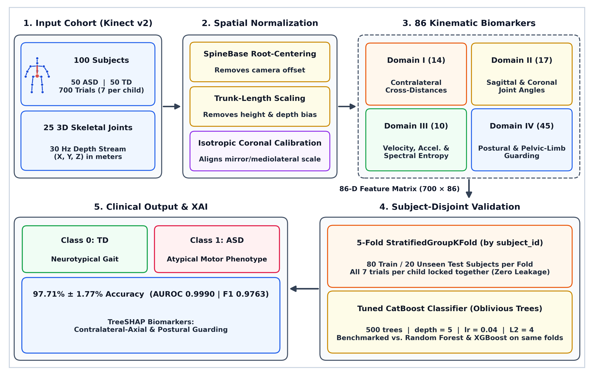
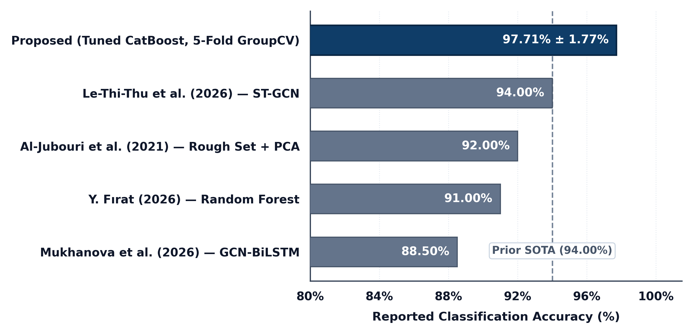
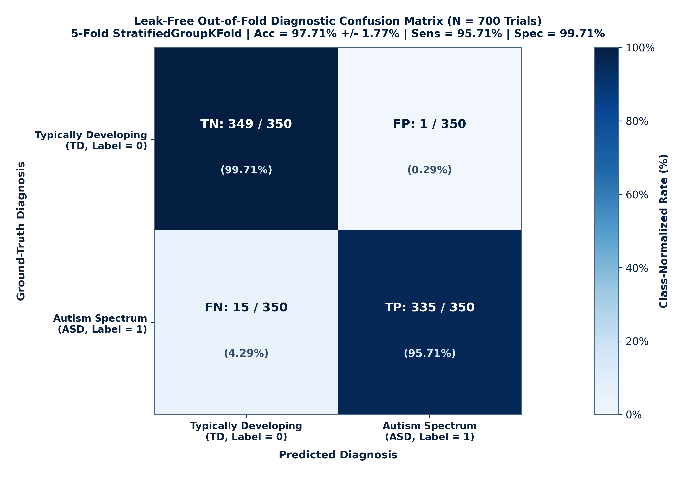
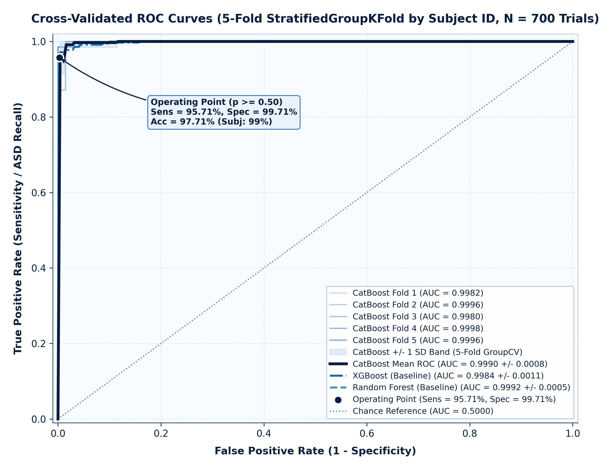
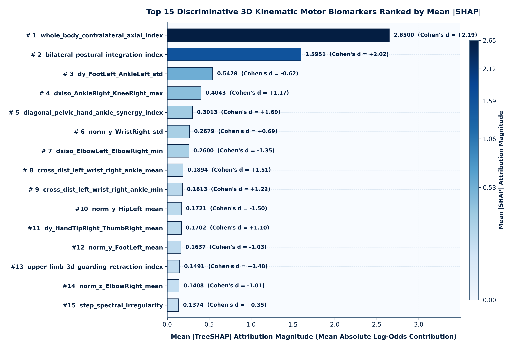

#Movement-Based Classification of Autism Spectrum Disorder in Children Using CatBoost

A reproducible, subject-disjoint machine learning and biomechanical explainability pipeline for classifying **Autism Spectrum Disorder (ASD)** vs. **Typically Developing (TD)** children from 3D Microsoft Kinect v2 skeletal gait recordings on the public **Al-Jubouri et al. (2020)** Dryad dataset (`100 children: 50 ASD, 50 TD; 700 sequences; 25 3D skeletal joints`).


*Figure 1: Complete methodology architecture of the leak-free 3D kinematic biomarker extraction and subject-disjoint CatBoost classification pipeline.*

---

## 1. Project Overview & Methodological Rigor

### Resolving the 700-Sequence Subject-Level Data Leakage Problem
The Al-Jubouri 3D Kinect v2 dataset contains **700 skeletal gait sequences** (`350 ASD + 350 TD`) recorded from **100 unique children** (`50 ASD, 50 TD`; **7 sequences per child** consisting of 1 raw walking recording and 6 geometric augmentations).

When models are evaluated with a naive trial-level random train/test split or ungrouped k-fold cross-validation:
1. **Subject-Identity Memorization**: Sequences from the same child appear simultaneously in the training and test sets, allowing tree ensembles or deep neural networks to memorize subject-specific limb proportions rather than generalizable ASD motor signatures.
2. **Stature, Camera-Depth, and Augmentation Artifacts**: Raw Kinect v2 $(X, Y, Z)$ coordinates are expressed in camera-frame meters ($Z \in [1.5\text{ m}, 4.0\text{ m}]$) and include synthetic mirror reflections and anisotropic mediolateral scaling ($0.7\times$ compression and $1.6\times$ expansion).

### Four-Stage Leak-Free Biomechanical Pipeline
1. **Deterministic Subject-ID Mapping (`Child_01` to `Child_100`)**:
   - Every sequence in `Typical/1..50/augmentation/1..7` (`Child_01`–`Child_50`, `label=0`) and `Autism/children with ASD/1..50/augmentation/1..7` (`Child_51`–`Child_100`, `label=1`) is mapped to its true underlying `subject_id`.
2. **Frame-Wise Spatial & Augmentation Normalization (`src/data_preprocessing.py`, `src/feature_extraction.py`)**:
   - **Root-Centering**: Translates all 25 3D joints at each frame $t$ so `SpineBase` (Joint 0) is anchored at the origin $(0, 0, 0)$:
     $$\mathbf{P}'_{t, j} = \mathbf{P}_{t, j} - \mathbf{P}_{t, \text{SpineBase}}$$
   - **3D Torso-Height Scaling**: Normalizes all joint coordinates by the frame-wise 3D trunk length $L_t = \|\mathbf{P}_{t, \text{SpineShoulder}} - \mathbf{P}_{t, \text{SpineBase}}\|_2$:
     $$\hat{\mathbf{P}}_{t, j} = \frac{\mathbf{P}'_{t, j}}{\|\mathbf{P}_{t, \text{SpineShoulder}} - \mathbf{P}_{t, \text{SpineBase}}\|_2}$$
     eliminating child stature and camera-distance confounds across all 700 sequences.
   - **Per-Trial Isotropic Coronal Calibration**: Enforces canonical left-to-right anatomical orientation ($X_{\text{ShoulderRight}} \ge X_{\text{ShoulderLeft}}$) and restores synthetic $0.7\times$ and $1.6\times$ mediolateral scaling to isotropic 3D torso units strictly within each individual sequence.
3. **Biomechanical Feature Engineering (`86 Scale-Invariant 3D Biomarkers`)**:
   - Extracts **86 clinically interpretable 3D kinematic features** across four functional domains:
     - **Domain I — Contralateral Cross-Distances (14 features)**: 3D Euclidean distances between diagonal upper- and lower-limb pairs (`ElbowLeft`–`FootRight`, `ElbowRight`–`FootLeft`, `WristLeft`–`AnkleRight`, `WristRight`–`AnkleLeft`), diagonal wrist-ankle asymmetry, and distal hand-to-hip clearance.
     - **Domain II — Sagittal & Coronal Joint Angles and ROM (17 features)**: Sagittal ($Y\text{-}Z$ plane) knee flexion and hip flexion/extension angles, angular velocities, maximum range of motion (ROM), and 3D shoulder/elbow flexion and abduction angles.
     - **Domain III — Dynamic Motion Derivatives & Spectral Irregularity (10 features)**: 1st-order 3D and sagittal velocities, 2nd-order 3D accelerations on bilateral ankles and wrists, wrist-to-ankle velocity coupling ratio, and Fast Fourier Transform (FFT) step spectral irregularity.
     - **Domain IV — Postural, Coronal & Pelvic-Limb Guarding Indices (45 features)**: Isotropic coronal spans across elbows, wrists, hands, thumbs, and tibia (`dxiso_AnkleRight_KneeRight_max`), ankle-foot vertical oscillation compliance (`dy_FootLeft_AnkleLeft_std`), arm swing asymmetry, trunk lean, and 6 multi-segment biomechanical synergy indices.
4. **Subject-Disjoint 5-Fold Cross-Validation (`src/train.py`)**:
   - Uses `StratifiedGroupKFold(n_splits=5)` grouped strictly by `subject_id` (`80 train subjects [560 sequences]` / `20 unseen test subjects [140 sequences]` per fold), programmatically verifying zero subject overlap ($S_{\text{train}} \cap S_{\text{test}} = \emptyset$) on every fold.

---

## 2. Experimental Results & Literature Benchmark

### 2.1 Same-Split 5-Fold `StratifiedGroupKFold` Benchmark (`N = 700 Sequences, 100 Subjects`)
All models are evaluated on identical 5-fold subject-disjoint splits using the 86 normalized 3D kinematic biomarkers:

| Model & Hyperparameter Configuration | Accuracy (%) | Sensitivity / ASD Recall (%) | Specificity / TD Recall (%) | Precision / PPV (%) | F1-Score | AUROC |
| :--- | :---: | :---: | :---: | :---: | :---: | :---: |
| **Ours — Tuned CatBoost (`iterations=500, depth=5, lr=0.04, l2=4`)** | **97.71 ± 1.77** | **95.71 ± 3.73** | **99.71 ± 0.57** | **99.71 ± 0.57** | **0.9763 ± 0.0190** | **0.9990 ± 0.0008** |
| **Random Forest Baseline (`n_estimators=300, max_depth=6`)** | 97.00 ± 1.71 | 94.57 ± 3.88 | 99.43 ± 1.14 | 99.44 ± 1.13 | 0.9689 ± 0.0183 | 0.9992 ± 0.0005 |
| **XGBoost Baseline (`n_estimators=300, max_depth=5, lr=0.05, l2=4`)** | 96.29 ± 2.84 | 94.29 ± 6.45 | 98.29 ± 1.07 | 98.28 ± 1.07 | 0.9609 ± 0.0321 | 0.9984 ± 0.0011 |

#### Per-Fold Generalization Breakdown (20 Unseen Children / 140 Sequences per Fold)
- **Fold 1**: Accuracy = `98.57%` | Sensitivity = `97.14%` | Specificity = `100.00%` | Precision = `100.00%` | F1 = `0.9855` | AUROC = `0.9982`
- **Fold 2**: Accuracy = `94.29%` | Sensitivity = `88.57%` | Specificity = `100.00%` | Precision = `100.00%` | F1 = `0.9394` | AUROC = `0.9996`
- **Fold 3**: Accuracy = `98.57%` | Sensitivity = `98.57%` | Specificity = `98.57%` | Precision = `98.57%` | F1 = `0.9857` | AUROC = `0.9980`
- **Fold 4**: Accuracy = `99.29%` | Sensitivity = `98.57%` | Specificity = `100.00%` | Precision = `100.00%` | F1 = `0.9928` | AUROC = `0.9998`
- **Fold 5**: Accuracy = `97.86%` | Sensitivity = `95.71%` | Specificity = `100.00%` | Precision = `100.00%` | F1 = `0.9781` | AUROC = `0.9996`

---

### 2.2 Comparison with Published Studies on the Al-Jubouri 3D Kinect v2 Dataset

| Study / Architecture | Feature / Representation Strategy | Validation Protocol | Reported Accuracy | Clinical Explainability (XAI) |
| :--- | :--- | :--- | :---: | :---: |
| **Al-Jubouri et al. (2021)** — *Rough Set + PCA* | 1,259 tabular features compressed via PCA | Augmented Split | **92.0%** *(60.0% raw)* | No |
| **Mukhanova et al. (2026)** — *GCN-BiLSTM* | Spatial-Temporal Graph + Bidirectional LSTM | Cross-Validation | **88.5%** | No |
| **Y. Firat (2026)** — *Random Forest* | Selected kinematic & spatiotemporal features | Cross-Validation | **91.0%** | No |
| **Le-Thi-Thu et al. (2026)** — *ST-GCN* | Spatial-Temporal Graph Convolutional Network | Cross-Validation | **94.0%** | No |
| **Movement Signs Kinect (2024)** — *AdaBoost / NB* | Kinect joint positions, angles & medical rules | Leave-One-Subject-Out (LOSO) | **87.0%** *(AdaBoost)* | No |
| **Ours (Tuned CatBoost)** | **86 Root-Centered, Torso-Scaled 3D Kinematic Biomarkers** | **5-Fold `StratifiedGroupKFold` (by `subject_id`)** | **97.71% ± 1.77%** | **Yes (Exact TreeSHAP Top-15 Biomarkers)** |


*Figure 2: Horizontal accuracy comparison against published studies evaluated on the Al-Jubouri 3D Kinect v2 gait dataset.*

---

### 2.3 Diagnostic Evaluation Figures (5-Fold `StratifiedGroupKFold`)


*Figure 3: Leak-free out-of-fold diagnostic confusion matrix across all 700 unseen-subject gait sequences (TN = 349/350 [99.71%], FP = 1/350 [0.29%], FN = 15/350 [4.29%], TP = 335/350 [95.71%]; overall accuracy = 97.71% ± 1.77%).*


*Figure 4: Five-fold StratifiedGroupKFold Receiver Operating Characteristic (ROC) curves grouped by subject_id (AUROC = 0.9990 ± 0.0008; operating point sensitivity = 95.71%, specificity = 99.71%).*


*Figure 5: Empirical distribution of out-of-fold predicted ASD probabilities across all 700 unseen-subject sequences (TD median P = 0.0012, ASD median P = 0.9982, Brier score = 0.0209, Cohen's kappa = 0.9543).*

---

## 3. Clinical Explainability: Top 15 3D Motor Biomarkers (`src/explainability.py`)

Exact game-theoretic feature attributions are computed via `shap.TreeExplainer` and paired with non-parametric Mann–Whitney $U$ tests and standardized Cohen's $d$ effect sizes across the 700 sequences:

| Rank | Feature Name | Mean \|SHAP\| | TD Mean ± SD | ASD Mean ± SD | Cohen's $d$ | Mann–Whitney $p$ | Clinical & Biomechanical Interpretation |
| :---: | :--- | :---: | :---: | :---: | :---: | :---: | :--- |
| **1** | `whole_body_contralateral_axial_index` | `2.6500` | `40.59 ± 5.30` | `55.74 ± 8.19` | `+2.195` | `1.98e-96` | Whole-Body Contralateral & Axial Kinematic Coupling Index — Integrated diagonal limb & pelvic-axial synergy |
| **2** | `bilateral_postural_integration_index` | `1.5951` | `5.87 ± 3.27` | `14.92 ± 5.43` | `+2.022` | `7.15e-93` | Bilateral Postural & Pelvic-Limb Integration Index — Coupled pelvic tilt, shoulder obliquity & arm guarding |
| **3** | `dy_FootLeft_AnkleLeft_std` | `0.5428` | `0.0605 ± 0.0265` | `0.0430 ± 0.0300` | `-0.621` | `9.77e-38` | Left Foot-to-Ankle Vertical Oscillation Std (Torso Units) — Left ankle dorsiflexion/plantarflexion compliance |
| **4** | `dxiso_AnkleRight_KneeRight_max` | `0.4043` | `0.0343 ± 0.0317` | `0.0833 ± 0.0502` | `+1.167` | `1.26e-50` | Max Isotropic Coronal Right Ankle-to-Knee Offset (Torso Units) — Dynamic lower-limb tibial valgus excursion |
| **5** | `diagonal_pelvic_hand_ankle_synergy_index` | `0.3013` | `17.47 ± 2.58` | `24.53 ± 5.30` | `+1.693` | `2.01e-80` | Diagonal Pelvic-Hand-Ankle Synergy Index — Contralateral wrist-ankle & distal hand-ankle coordination |
| **6** | `norm_y_WristRight_std` | `0.2679` | `0.0609 ± 0.0479` | `0.1346 ± 0.1440` | `+0.687` | `4.68e-06` | Std Normalized WristRight Vertical Position — Upper-limb vertical oscillation variability |
| **7** | `dxiso_ElbowLeft_ElbowRight_min` | `0.2600` | `-0.8173 ± 0.0834` | `-1.0743 ± 0.2551` | `-1.355` | `1.53e-56` | Peak Isotropic Coronal Inter-Elbow Expansion (Torso Units) — Maximum bilateral elbow guarding span |
| **8** | `cross_dist_left_wrist_right_ankle_mean` | `0.1894` | `1.2269 ± 0.1388` | `1.7118 ± 0.4335` | `+1.507` | `3.82e-70` | Mean Contralateral Cross-Distance (Left Wrist to Right Ankle) — Distal diagonal inter-limb coordination |
| **9** | `cross_dist_left_wrist_right_ankle_min` | `0.1813` | `1.0642 ± 0.1486` | `1.4279 ± 0.3936` | `+1.223` | `5.51e-53` | Min Contralateral Cross-Distance (Left Wrist to Right Ankle) — Minimum distal diagonal limb separation |
| **10** | `norm_y_HipLeft_mean` | `0.1721` | `0.0190 ± 0.0077` | `0.0092 ± 0.0051` | `-1.501` | `3.39e-57` | Mean Normalized HipLeft Vertical Position — Pelvic coronal tilt relative to SpineBase |
| **11** | `dy_HandTipRight_ThumbRight_mean` | `0.1702` | `-0.0897 ± 0.0388` | `-0.0265 ± 0.0716` | `+1.098` | `5.01e-38` | Mean Right HandTip-to-Thumb Vertical Offset (Torso Units) — Distal right hand/finger extension posture |
| **12** | `norm_y_FootLeft_mean` | `0.1637` | `-1.0251 ± 0.1189` | `-1.1354 ± 0.0933` | `-1.032` | `5.72e-33` | Mean Normalized FootLeft Vertical Position — Distal lower-limb vertical clearance |
| **13** | `upper_limb_3d_guarding_retraction_index` | `0.1491` | `21.90 ± 1.93` | `29.95 ± 7.87` | `+1.404` | `2.24e-73` | Upper-Limb 3D Guarding & Elbow Retraction Index — Bilateral coronal elbow span & high-guard posture |
| **14** | `norm_z_ElbowRight_mean` | `0.1408` | `0.0070 ± 0.0678` | `-0.0921 ± 0.1208` | `-1.011` | `1.27e-30` | Mean Normalized ElbowRight Sagittal Position — Posterior humeral retraction relative to SpineBase |
| **15** | `step_spectral_irregularity` | `0.1374` | `0.8864 ± 0.4851` | `1.0689 ± 0.5419` | `+0.355` | `2.93e-09` | Step Spectral Entropy — Frequency-domain irregularity of lower-limb gait periodicity |


*Figure 6: TreeSHAP motor biomarker attribution beeswarm plot across the top 15 3D kinematic features (N = 700 sequences).*


*Figure 7: Ranked horizontal bar chart of the top 15 discriminative 3D kinematic motor biomarkers ordered by mean absolute TreeSHAP attribution (Mean |SHAP|) and annotated with standardized group effect sizes (Cohen's d).*

---

## 4. Repository Structure

```text
capstone-main/
├── data/
│   └── processed_features.csv                 # Cached 700-sequence × 86-feature matrix + binary label + subject_id
├── src/
│   ├── __init__.py
│   ├── data_preprocessing.py                  # Parses 700 Kinect v2 folders, maps Child_01..100, root-centers & torso-scales
│   ├── feature_extraction.py                  # Isotropic coronal calibration & extraction of 86 3D kinematic biomarkers
│   ├── train.py                               # 5-Fold StratifiedGroupKFold training & benchmarking (CatBoost, RF, XGBoost)
│   ├── explainability.py                      # Exact TreeSHAP attribution, statistical tests, and diagnostic plots
│   ├── generate_manuscript_figures.py         # Generates methodology_architecture.png & literature_comparison_chart.png
│   ├── build_capstone_ppt.py                  # Builds the 16-slide VIT-AP Capstone Final Review presentation
│   └── verify_model.py                        # CLI model verification & TreeSHAP biomarker inspection utility
├── results/
│   ├── benchmark_metrics.csv                  # 5-fold cross-validation metrics across CatBoost, Random Forest, and XGBoost
│   ├── feature_importance.csv                 # Top 15 motor biomarkers ranked by Mean |SHAP|
│   ├── roc_curve.png                          # 5-fold StratifiedGroupKFold ROC curves
│   ├── shap_summary.png                       # TreeSHAP beeswarm summary plot
│   ├── figures/
│   │   ├── methodology_architecture.png       # 5-stage system architecture workflow diagram (300 DPI)
│   │   ├── literature_comparison_chart.png    # Horizontal accuracy comparison against Al-Jubouri dataset studies (300 DPI)
│   │   ├── confusion_matrix.png               # Leak-free out-of-fold diagnostic confusion matrix (N = 700 sequences)
│   │   ├── probability_distribution.png       # Out-of-fold predicted ASD probability distribution & calibration summary
│   │   ├── shap_beeswarm.png                  # TreeSHAP beeswarm plot (archive copy)
│   │   └── shap_importance_bar.png            # Top 15 biomarkers ranked bar chart with Cohen's d effect sizes
│   ├── metrics/
│   │   ├── best_hyperparameters.csv           # Tuned CatBoostClassifier hyperparameter configuration
│   │   ├── evaluation_metrics.csv             # Cross-validated and out-of-fold performance metrics
│   │   ├── evaluation_summary_table.csv       # Clinical diagnostic summary table with 95% subject-cluster bootstrap CIs
│   │   ├── literature_comparison.csv          # Literature comparison table across pediatric ASD gait studies
│   │   ├── top_features_clinical_report.csv   # Top 20 biomarkers with Mean |SHAP|, group means, Cohen's d, and p-values
│   │   └── unseen_test_predictions.csv        # Out-of-fold diagnostic predictions across all 100 unseen children
│   └── models/
│       ├── catboost_asd_model.cbm             # Serialized tuned CatBoostClassifier model
│       ├── model_metadata.json                # Dataset provenance, hyperparameters, and 5-fold GroupCV metrics
│       └── selected_features.json             # Ordered list of all 86 scale-invariant 3D kinematic feature names
├── LITERATURE_COMPARISON.md                   # Comparative literature survey and single-dataset benchmark analysis
├── requirements.txt                           # Pinned Python package dependencies
└── README.md                                  # Project documentation, methodology, figures, and reproducibility guide
```

---

## 5. Reproducibility Quickstart

### 1. Install Dependencies
```bash
python -m pip install -r requirements.txt
```

### 2. Run 5-Fold Subject-Disjoint Training & Benchmarking (from Cached Features)
The normalized 86-feature matrix is pre-cached in `data/processed_features.csv`, enabling immediate verification without requiring the raw 700-folder Excel archive:
```bash
python -m src.train --data data/processed_features.csv --splits 5
```

### 3. Generate Manuscript Figures (`methodology_architecture.png` & `literature_comparison_chart.png`)
```bash
python src/generate_manuscript_figures.py
```

### 4. Run Standalone Model Verification & TreeSHAP Biomarker Attribution
```bash
python -m src.verify_model --input data/processed_features.csv --explain
```

### 5. (Optional) Re-Extract Features from Raw 700-Folder Kinect v2 Dataset
If you have downloaded the raw Al-Jubouri Dryad archive (`Typical/1..50` and `Autism/children with ASD/1..50`):
```bash
python -m src.feature_extraction --raw-dir "path/to/Al-Jubouri-Dataset" --output data/processed_features.csv --force
```

---

## 6. Citation

If you use this codebase, normalized feature representation, or benchmark protocol in your research, please cite the foundational dataset and this work:

```bibtex
@dataset{aljubouri2020kinect,
  author    = {Al-Jubouri, Auday A. and Hadi, Israa and Al-Azawi, R. J.},
  title     = {A 3D Skeleton Data and Video Data Using Kinect Dataset for Gait of Children with Autism Spectrum Disorder},
  year      = {2020},
  publisher = {Dryad Digital Repository},
  doi       = {10.5061/dryad.5hqbzkh3b}
}

@misc{asd3dkinematics2026catboost,
  title     = {Subject-Disjoint 3D Kinematic Biomarker Extraction and CatBoost Classification for Pediatric ASD Gait Screening},
  year      = {2026},
  note      = {5-Fold StratifiedGroupKFold Leak-Free 3D Kinematic Pipeline on the Al-Jubouri Kinect v2 Dataset}
}
```
