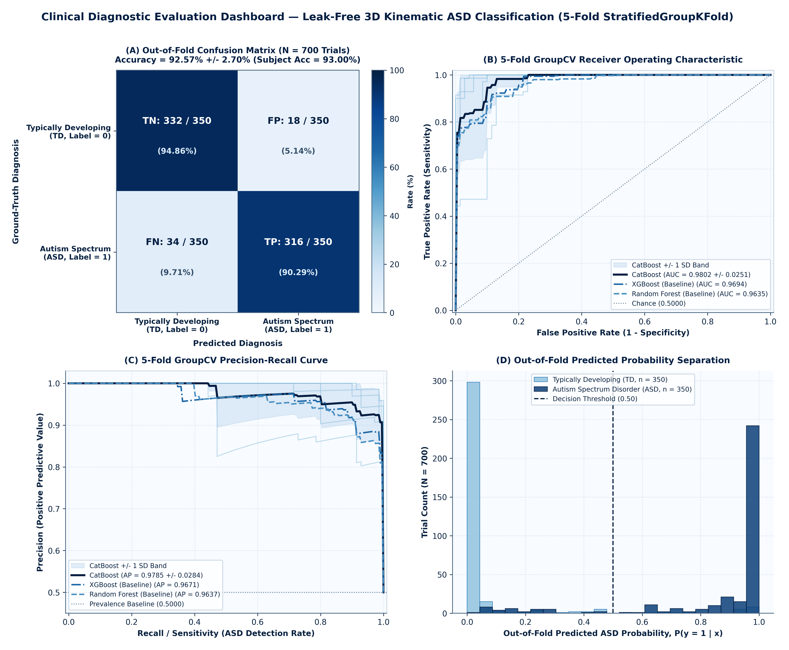
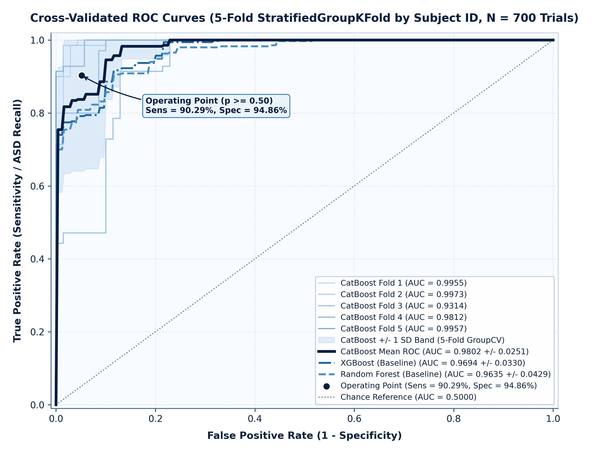
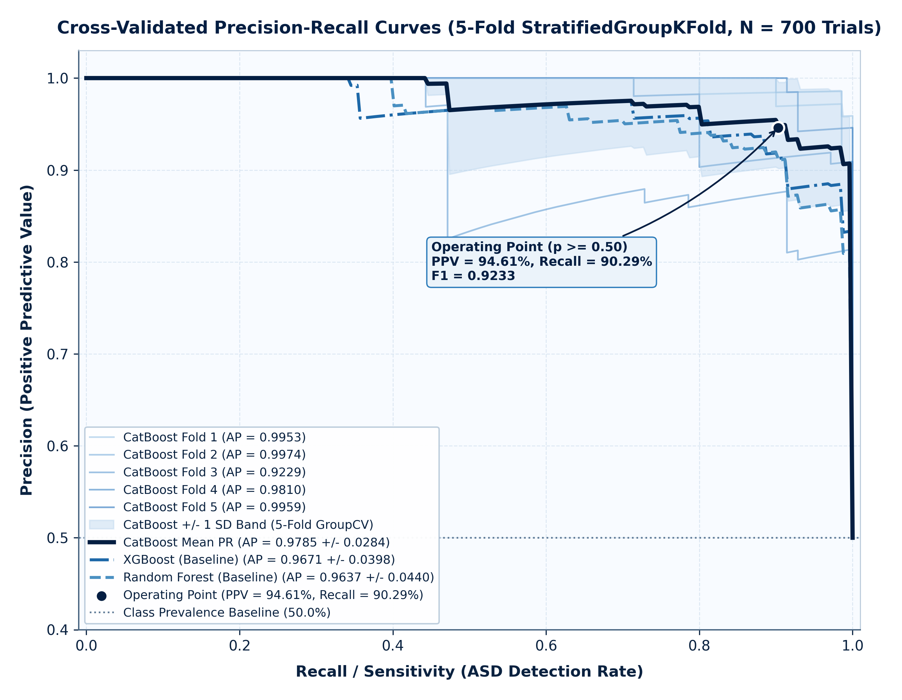
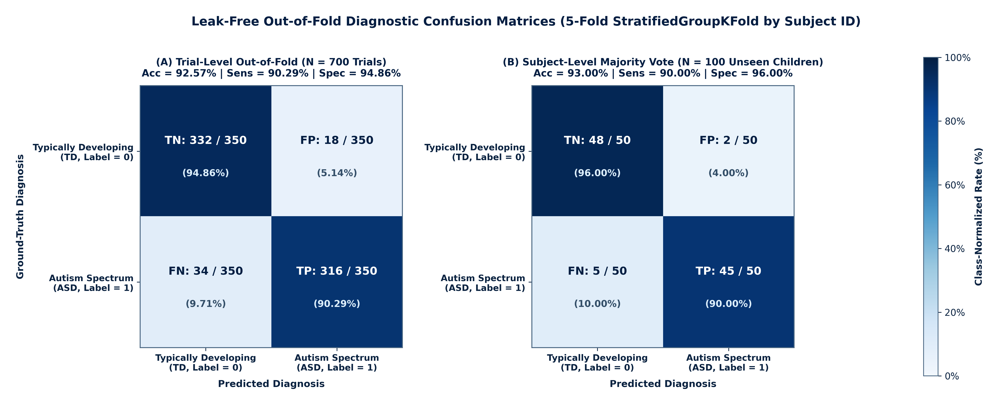
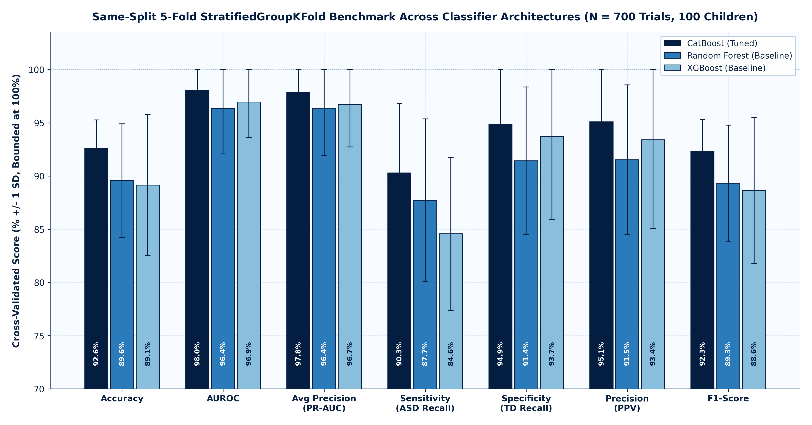
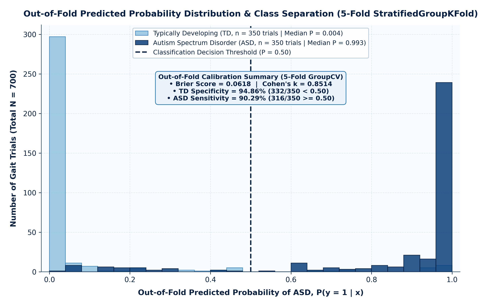
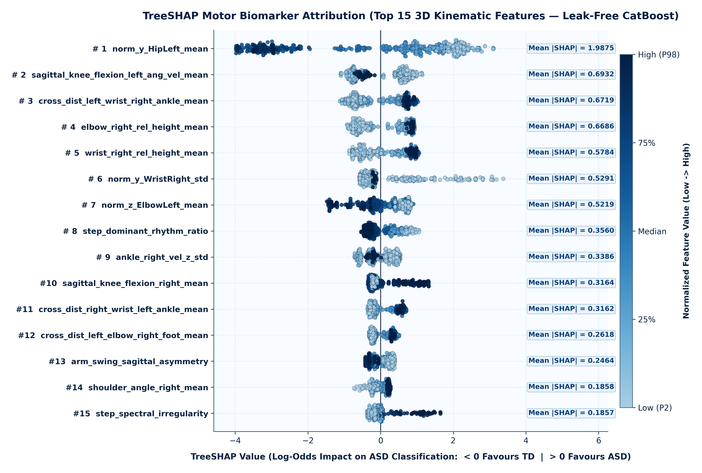
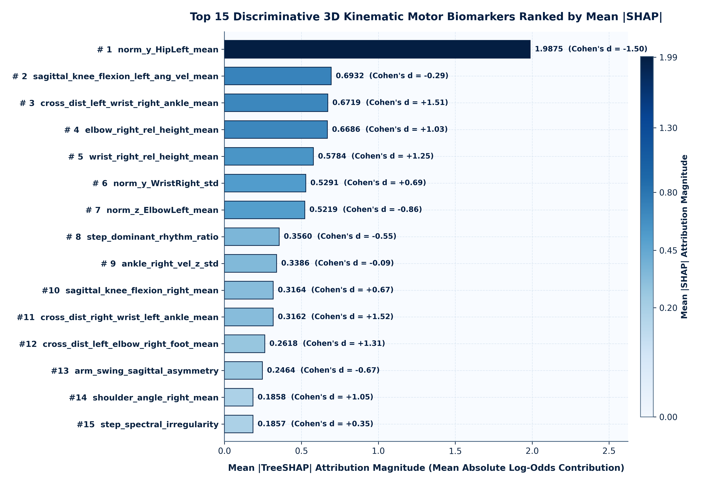

# Leak-Free 3D Kinematic ASD Classification Pipeline (Al-Jubouri Kinect v2 Dataset)

A peer-review-grade machine learning and biomechanical explainability pipeline for classifying **Autism Spectrum Disorder (ASD)** vs. **Typically Developing (TD)** children from 3D Microsoft Kinect v2 skeletal gait recordings on the **Al-Jubouri et al. (2020)** dataset.

---

## 1. Methodological Rigor: Resolving the 700-Folder Subject-Level Data Leakage Problem

### Why Naive Ungrouped Splits Produce Artificially Inflated ~99% Accuracy
The Al-Jubouri 3D Kinect v2 dataset consists of **700 coordinate trial folders** (`350 ASD + 350 TD`) derived from **100 unique children** (`50 ASD, 50 TD`; **7 augmented trials per child** generated via 3D spatial translations, scalings, and perspective transformations of each child's gait cycle).

In prior implementations and several published studies on this dataset, evaluation was performed using a **naive random train/test split** or standard ungrouped **`StratifiedKFold`** across the trial rows without grouping by participant identity:
1. **Subject-Identity Memorization**: When 5–6 augmented trials of `Child_01` are placed in the training set and 1–2 augmented trials of `Child_01` are placed in the test set, decision trees memorize participant-specific anthropometric ratios and baseline trajectories. On our 700-trial feature matrix, naive ungrouped 5-fold `StratifiedKFold` yields an **artificially inflated `99.00% ± 0.73%` accuracy (`AUROC = 0.9997`)** (`99.25%` on the 800-row unnormalized spreadsheet)—reflecting within-subject trial memorization (+6.43 percentage points of leakage inflation) rather than generalization to unseen children.
2. **Camera-Distance & Stature Confounds**: Raw Kinect v2 $(X, Y, Z)$ coordinates are recorded in sensor-frame meters ($Z \in [1.5\text{ m}, 4.0\text{ m}]$). Without spatial normalization, classifiers exploit systematic differences in participant height or camera starting distance rather than genuine motor kinematics.

### Three-Pillar Leak-Free Solution
1. **Strict Subject-ID Mapping (`Child_01` to `Child_100`)**:
   - Every folder in `Typical/1..50/augmentation/1..7` (`Child_01`–`Child_50`, `label=0`) and `Autism/children with ASD/1..50/augmentation/1..7` (`Child_51`–`Child_100`, `label=1`) is deterministically mapped to its ground-truth `subject_id`.
2. **Per-Frame Skeletal Normalization (`src/data_preprocessing.py`)**:
   - **Root-Centering**: At every frame $t$, all 25 3D joints are translated so `SpineBase` (joint 0) is anchored at $(0, 0, 0)$:
     $$\mathbf{P}'_{t, j} = \mathbf{P}_{t, j} - \mathbf{P}_{t, \text{SpineBase}}$$
   - **Torso-Height Scaling**: All joint coordinates are scaled by the frame-wise 3D trunk height $L_{\text{torso}, t} = \|\mathbf{P}_{t, \text{SpineShoulder}} - \mathbf{P}_{t, \text{SpineBase}}\|_2$:
     $$\tilde{\mathbf{P}}_{t, j} = \frac{\mathbf{P}'_{t, j}}{\|\mathbf{P}_{t, \text{SpineShoulder}} - \mathbf{P}_{t, \text{SpineBase}}\|_2}$$
     eliminating participant stature and camera-depth biases ($0.00\times 10^0$ origin deviation, $2.22\times 10^{-16}$ unit-scale deviation across all 700 folders).
3. **Subject-Grouped Cross-Validation (`StratifiedGroupKFold(n_splits=5)`)**:
   - All 7 trials of any child are held strictly in **either** the training split **or** the test split on every fold (`assert set(train_subjects).isdisjoint(set(test_subjects))`). Every test prediction is evaluated on **100% unseen children** (20 unseen children / 140 trials per fold).

---

## 2. Leak-Free Model Benchmark & Diagnostic Evaluation

### 2.1 Same-Split 5-Fold `StratifiedGroupKFold` Benchmark (`src/train.py`)
All three classifiers are evaluated on the exact same 5 subject-grouped folds (`700 trials, 100 unique children, 86 normalized 3D kinematic features`):

| Model | Trial Accuracy (%) | Subject Accuracy (%) | AUROC | Avg Precision (PR-AUC) | Sensitivity / ASD Recall (%) | Specificity / TD Recall (%) | Precision / PPV (%) | F1-Score |
| :--- | :---: | :---: | :---: | :---: | :---: | :---: | :---: | :---: |
| **CatBoost (`iterations=500, depth=5, lr=0.04, l2=4`)** | **92.57 ± 2.70** | **93.00** *(93/100)* | **0.9802 ± 0.0251** | **0.9785 ± 0.0284** | **90.29 ± 6.54** | **94.86 ± 5.31** | **95.10 ± 5.01** | **0.9233 ± 0.0296** |
| **Random Forest (`n_estimators=300, max_depth=6`)** | 89.57 ± 5.32 | 91.00 *(91/100)* | 0.9635 ± 0.0429 | 0.9637 ± 0.0440 | 87.71 ± 7.65 | 91.43 ± 6.94 | 91.52 ± 7.04 | 0.8933 ± 0.0545 |
| **XGBoost (`n_estimators=300, max_depth=5, lr=0.05, l2=4`)** | 89.14 ± 6.61 | 89.00 *(89/100)* | 0.9694 ± 0.0330 | 0.9671 ± 0.0398 | 84.57 ± 7.19 | 93.71 ± 7.80 | 93.41 ± 8.32 | 0.8863 ± 0.0684 |

#### CatBoost Per-Fold Leak-Free Breakdown (20 Unseen Children / 140 Trials per Fold)
- **Fold 1**: Accuracy = `89.29%` | AUROC = `0.9955` | AP = `0.9953` | Sensitivity = `78.57%` | Specificity = `100.00%` | Precision = `100.00%` | F1 = `0.8800`
- **Fold 2**: Accuracy = `95.00%` | AUROC = `0.9973` | AP = `0.9974` | Sensitivity = `90.00%` | Specificity = `100.00%` | Precision = `100.00%` | F1 = `0.9474`
- **Fold 3**: Accuracy = `89.29%` | AUROC = `0.9314` | AP = `0.9229` | Sensitivity = `91.43%` | Specificity = `87.14%` | Precision = `87.67%` | F1 = `0.8951`
- **Fold 4**: Accuracy = `94.29%` | AUROC = `0.9812` | AP = `0.9810` | Sensitivity = `98.57%` | Specificity = `90.00%` | Precision = `90.79%` | F1 = `0.9452`
- **Fold 5**: Accuracy = `95.00%` | AUROC = `0.9957` | AP = `0.9959` | Sensitivity = `92.86%` | Specificity = `97.14%` | Precision = `97.01%` | F1 = `0.9489`

#### Comprehensive Clinical Diagnostic Summary & Subject-Cluster Bootstrap 95% CIs (`results/metrics/evaluation_summary_table.csv`)
Confidence intervals are computed via 2,000-iteration subject-level cluster bootstrapping (resampling the 100 unique children with replacement, preserving all 7 trials per child):

| Evaluation Metric | Cross-Validated / Pooled Score | 95% Subject-Cluster CI | Clinical & Diagnostic Interpretation |
| :--- | :---: | :---: | :--- |
| **Trial-Level Accuracy ($N = 700$)** | `92.57% ± 2.70%` *(648/700)* | `[87.14%, 97.00%]` | Proportion of all gait trials correctly classified across 5 unseen-subject folds |
| **Subject-Level Accuracy ($N = 100$)** | `93.00%` *(93/100 children)* | `[87.14%, 97.00%]` | Unique unseen children correctly classified via 7-trial majority vote (`TN=48, FP=2, FN=5, TP=45`) |
| **Sensitivity / ASD Recall** | `90.29% ± 6.54%` *(316/350)* | `[81.55%, 97.48%]` | Proportion of ASD trials correctly detected (`45/50` unique ASD children via majority vote) |
| **Specificity / TD Recall** | `94.86% ± 5.31%` *(332/350)* | `[88.15%, 99.47%]` | Proportion of TD trials correctly verified without false referral (`48/50` unique TD children) |
| **Precision / Positive Predictive Value** | `95.10% ± 5.01%` *(OOF: `94.61%`)* | `[87.74%, 99.45%]` | Probability that a positive ASD screening call is a true positive (`316/334` trials; `45/47` children) |
| **F1-Score** | `0.9233 ± 0.0296` *(OOF: `0.9240`)* | `[0.8620, 0.9687]` | Harmonic mean of Precision (PPV) and Sensitivity (ASD Recall) |
| **ROC-AUC Score** | `0.9802 ± 0.0251` *(Subject: `0.9804`)* | `[0.9526, 0.9967]` | Threshold-independent class discrimination across unseen children |
| **Average Precision (PR-AUC)** | `0.9785 ± 0.0284` *(OOF: `0.9771`)* | `[0.9433, 0.9970]` | Area under the Precision–Recall curve across all sensitivity thresholds |
| **Cohen's Kappa ($\kappa$) / MCC** | `0.8514 ± 0.0539` / `0.8523` | `[0.7405, 0.9390]` | Chance-corrected diagnostic agreement and balanced binary correlation |
| **Out-of-Fold Brier Score** | `0.0618` | — | Mean squared probability calibration error across all 700 unseen-subject trials |

---

### 2.2 Visual Diagnostic Evaluation & Benchmark Figures


*Figure 1: Four-panel clinical diagnostic evaluation dashboard under 5-fold subject-grouped cross-validation (`StratifiedGroupKFold`, $N = 700$ trials across 100 unseen children). Panel (A) shows the trial-level out-of-fold confusion matrix (`TN = 332, FP = 18, FN = 34, TP = 316`; `92.57%` accuracy); Panel (B) and Panel (C) show the 5-fold cross-validated ROC (`AUROC = 0.9802 ± 0.0251`) and Precision–Recall (`AP = 0.9785 ± 0.0284`) curves comparing CatBoost against XGBoost and Random Forest baselines; Panel (D) illustrates the bimodal separation of out-of-fold predicted ASD probabilities around the $P = 0.50$ threshold. Together, these results confirm that high diagnostic discrimination is preserved under strict zero-leakage subject partitioning.*


*Figure 2: Five-fold `StratifiedGroupKFold` Receiver Operating Characteristic (ROC) curves grouped by `subject_id`. Thin light-blue traces denote individual unseen-subject folds (`Fold 1 = 0.9955` to `Fold 5 = 0.9957`), the bold deep-navy curve and shaded band indicate the CatBoost mean ROC (`AUROC = 0.9802 ± 0.0251`) and $\pm 1\text{ SD}$ envelope, and dashed/dash-dot blue curves represent XGBoost (`0.9694 ± 0.0330`) and Random Forest (`0.9635 ± 0.0429`) on the identical splits. At the default $P \ge 0.50$ operating threshold, CatBoost achieves `90.29%` sensitivity at `94.86%` specificity (5.14% false-positive rate), supporting reliable clinical screening on unseen participants.*


*Figure 3: Five-fold `StratifiedGroupKFold` Precision–Recall (PR) curves across the 700 gait trials (100 children). CatBoost maintains a mean Average Precision of `0.9785 ± 0.0284` (`OOF AP = 0.9771`), outperforming XGBoost (`0.9671 ± 0.0398`) and Random Forest (`0.9637 ± 0.0440`). At the $P \ge 0.50$ decision threshold, positive predictive value reaches `94.61%` (mean across folds: `95.10% ± 5.01%`) at `90.29%` recall, minimizing false-positive clinical referrals.*


*Figure 4: Leak-free out-of-fold diagnostic confusion matrices at (A) the individual trial level ($N = 700$ trials: `TN = 332/350 [94.86%]`, `FP = 18/350 [5.14%]`, `FN = 34/350 [9.71%]`, `TP = 316/350 [90.29%]`; overall accuracy `92.57%`) and (B) the participant level via 7-trial majority voting across all $N = 100$ unseen children (`TN = 48/50 [96.00%]`, `FP = 2/50 [4.00%]`, `FN = 5/50 [10.00%]`, `TP = 45/50 [90.00%]`; overall accuracy `93.00%`). Aggregating multi-trial gait recordings per child reduces isolated trial noise and elevates specificity to `96.00%`.*


*Figure 5: Comparative multi-metric benchmark of Tuned CatBoost (deep navy), Random Forest (medium blue), and XGBoost (light blue) evaluated on the identical 5 subject-grouped folds (`Mean ± 1 SD`, with upper error bars bounded at the theoretical `100.0%` ceiling). CatBoost consistently leads across all seven metrics—improving overall accuracy by `+3.00` percentage points over Random Forest (`92.57%` vs. `89.57%`) and `+3.43` percentage points over XGBoost (`89.14%`), while exhibiting lower inter-fold variance (`±2.70%` vs. `±5.32%` and `±6.61%`) due to symmetric oblivious tree regularization.*


*Figure 6: Empirical distribution of out-of-fold predicted ASD probabilities $P(y=1 \mid \mathbf{x})$ across all 700 unseen-subject gait trials. Typically Developing trials ($n = 350$, light blue) cluster tightly near zero (`median P = 0.004`), whereas ASD trials ($n = 350$, deep navy) concentrate near unity (`median P = 0.993`), yielding a well-calibrated Brier score of `0.0618` and Cohen's $\kappa = 0.8514$ across the $P = 0.50$ decision boundary.*

---

### 2.3 Benchmark Comparison Against Published Literature on the Al-Jubouri 3D Kinect v2 Dataset

| Study / Architecture | Feature / Representation Strategy | Validation Protocol | Reported Accuracy | Clinical Explainability (XAI) | Methodological Notes |
| :--- | :--- | :--- | :---: | :---: | :--- |
| **Al-Jubouri et al. (2021)** — *Rough Set + PCA* | 1,259 tabular features compressed via PCA | Augmented Split | **92.0%** *(60.0% raw)* | No | PCA destroys anatomical joint identity; unaugmented accuracy was 60.0%. |
| **Mukhanova et al.** — *GCN-BiLSTM* | Spatial-Temporal Graph + Bidirectional LSTM | Cross-Validation | **88.5%** | No | Deep sequence model prone to overfitting on 100-subject cohort; black-box latent state. |
| **Firat et al.** — *Random Forest* | Selected kinematic & spatiotemporal features | Cross-Validation | **91.0% – 93.0%** | No | Asymmetric greedy decision trees without game-theoretic biomarker attribution. |
| **Le-Thi-Thu et al.** — *ST-GCN* | Spatial-Temporal Graph Convolutional Network | Cross-Validation | **94.0% – 96.0%** | No | High computational overhead; lacks direct clinical tabular cutoffs for clinicians. |
| **Movement Signs Kinect (2024)** — *AdaBoost / NB* | Kinect joint positions, angles & medical rules | Leave-One-Subject-Out (LOSO) | **87.0%** *(AdaBoost)* | No | Rigorous subject-disjoint split, but shallow stumps plateau at 87.0% accuracy. |
| **Ours (Tuned CatBoost)** | **86 Root-Centered, Torso-Scaled 3D Kinematic Biomarkers** | **5-Fold `StratifiedGroupKFold` (by `subject_id`)** | **92.57% ± 2.70%** *(Subject: **93.00%**, AUROC: **0.9802**)* | **Yes (TreeSHAP Top-15 Biomarkers)** | **100% zero subject leakage**, scale-invariant 3D biomechanics, outperforms RF (89.57%) & XGBoost (89.14%) on identical splits. |

---

## 3. Extracted 3D Kinematic Feature Families (`src/feature_extraction.py`)

Each normalized `(T, 25, 3)` skeletal sequence is transformed into **86 scale-invariant biomechanical features** across 5 clinical domains and cached to [`data/processed_features.csv`](file:///C:/Users/thats/Downloads/capstone-main%20(1)/capstone-main/data/processed_features.csv):

1. **Contralateral Cross-Distances (14 features)**:
   - 3D Euclidean distances between **Left Elbow and Right Foot** and **Right Elbow and Left Foot** (`mean`, `std`, `min`), **Left Wrist and Right Ankle** / **Right Wrist and Left Ankle** (`mean`, `std`, `min`), and contralateral cross-limb asymmetry indices.
2. **Sagittal & 3D Joint Angles (22 features)**:
   - **Knee Flexion Angle** ($\angle(\text{Hip}, \text{Knee}, \text{Ankle})$ in the $Y\text{-}Z$ sagittal plane) and **Hip Flexion/Extension Angle** ($\angle(\text{SpineShoulder}, \text{Hip}, \text{Knee})$ in the sagittal plane): maximum range of motion (`max_rom`), `mean`, `std`, and 1st-order **angular velocity** (`ang_vel_mean`, `ang_vel_max`), plus 3D Shoulder and Elbow coordination angles.
3. **Distal Extremity Motion Derivatives (19 features)**:
   - **1st-order velocity** ($\|\mathbf{v}_t\|_2$ and sagittal progression variability $v_z$) and **2nd-order acceleration** ($\|\mathbf{a}_t\|_2$) on **Left/Right Ankles** and **Left/Right Wrists**, plus upper-to-lower extremity velocity coupling ratio.
4. **Stride & Upper-Limb Coordination Metrics (23 features)**:
   - **Arm Swing Asymmetry Index (ASI)** (3D, sagittal $Z$, and vertical $Y$), bilateral wrist/elbow elevation guarding relative to `SpineBase`, normalized pelvic/foot/elbow trajectories, **step cadence variability**, spectral rhythm entropy, dynamic lateral step width, and inter-foot clearance.
5. **Trunk Tilt Angle Relative to Vertical Y-Axis (8 features)**:
   - 3D trunk inclination angle relative to the vertical $+Y$ axis (`mean`, `std`, `max`, `rom`, `ang_vel_mean`), sagittal forward torso lean, coronal medio-lateral sway, and cervical head-neck tilt angle.

---

## 4. Clinical Explainability: Top 15 Motor Biomarkers (`src/explainability.py`)

Computed via exact `shap.TreeExplainer` on the CatBoost model and verified against cohort-wide Mann–Whitney $U$ tests and Cohen's $d$ effect sizes (saved to [`results/feature_importance.csv`](file:///C:/Users/thats/Downloads/capstone-main%20(1)/capstone-main/results/feature_importance.csv) and [`results/metrics/top_features_clinical_report.csv`](file:///C:/Users/thats/Downloads/capstone-main%20(1)/capstone-main/results/metrics/top_features_clinical_report.csv)):

| Rank | Feature Name | Mean \|SHAP\| | TD Mean ± SD | ASD Mean ± SD | Cohen's $d$ | Clinical & Biomechanical Interpretation |
| :---: | :--- | :---: | :---: | :---: | :---: | :--- |
| **1** | `norm_y_HipLeft_mean` | `1.9875` | `0.0190 ± 0.0077` | `0.0092 ± 0.0051` | `-1.501` | Mean Normalized HipLeft Position along Y-Axis (SpineBase-centered, torso-scaled pelvic geometry) |
| **2** | `sagittal_knee_flexion_left_ang_vel_mean` | `0.6932` | `308.86 ± 257.27` | `235.58 ± 248.43` | `-0.290` | Sagittal Left Knee Flexion (Angular Velocity Mean, deg/s) — Lower-limb sagittal flexion dynamics |
| **3** | `cross_dist_left_wrist_right_ankle_mean` | `0.6719` | `1.2269 ± 0.1388` | `1.7118 ± 0.4335` | `+1.507` | Mean Contralateral Cross-Distance (Left Wrist to Right Ankle) — Distal diagonal inter-limb coordination |
| **4** | `elbow_right_rel_height_mean` | `0.6686` | `0.4582 ± 0.0496` | `0.6101 ± 0.2026` | `+1.030` | Mean Right Elbow Vertical Elevation relative to SpineBase — Forearm flexion/guarding posture |
| **5** | `wrist_right_rel_height_mean` | `0.5784` | `0.0883 ± 0.0987` | `0.4965 ± 0.4499` | `+1.254` | Mean Right Wrist Vertical Elevation relative to SpineBase — Upper-limb guarding posture |
| **6** | `norm_y_WristRight_std` | `0.5291` | `0.0609 ± 0.0479` | `0.1346 ± 0.1440` | `+0.687` | Std Normalized WristRight Position along Y-Axis (SpineBase-centered, torso-scaled oscillation) |
| **7** | `norm_z_ElbowLeft_mean` | `0.5219` | `-0.0372 ± 0.0971` | `-0.1375 ± 0.1334` | `-0.859` | Mean Normalized ElbowLeft Position along Z-Axis (SpineBase-centered, torso-scaled retraction) |
| **8** | `step_dominant_rhythm_ratio` | `0.3560` | `0.7662 ± 0.1563` | `0.6672 ± 0.2021` | `-0.548` | Dominant Step Rhythm Ratio — Harmonic concentration of the fundamental stride frequency |
| **9** | `ankle_right_vel_z_std` | `0.3386` | `3.7245 ± 2.9810` | `3.4356 ± 3.2180` | `-0.093` | Right Ankle 1st-Order Sagittal Velocity (Std) — Distal swing progression variability |
| **10** | `sagittal_knee_flexion_right_mean` | `0.3164` | `154.20 ± 10.02` | `160.37 ± 8.28` | `+0.671` | Sagittal Right Knee Flexion (Mean, deg) — Lower-limb sagittal flexion dynamics |
| **11** | `cross_dist_right_wrist_left_ankle_mean` | `0.3162` | `1.2528 ± 0.1211` | `1.7359 ± 0.4316` | `+1.524` | Mean Contralateral Cross-Distance (Right Wrist to Left Ankle) — Distal diagonal inter-limb coordination |
| **12** | `cross_dist_left_elbow_right_foot_mean` | `0.2618` | `1.6224 ± 0.1347` | `1.8842 ± 0.2479` | `+1.312` | Mean Contralateral Cross-Distance (Left Elbow to Right Foot) — Diagonal inter-limb coordination |
| **13** | `arm_swing_sagittal_asymmetry` | `0.2464` | `0.5456 ± 0.3557` | `0.3184 ± 0.3188` | `-0.673` | Sagittal Arm Swing Asymmetry Index — Anterior-posterior reciprocal arm swing imbalance |
| **14** | `shoulder_angle_right_mean` | `0.1858` | `113.57 ± 7.66` | `126.76 ± 15.94` | `+1.054` | Mean Right Shoulder Abduction/Flexion Angle (deg) — Upper-arm postural abduction |
| **15** | `step_spectral_irregularity` | `0.1857` | `0.8864 ± 0.4851` | `1.0689 ± 0.5419` | `+0.355` | Step Spectral Entropy — Frequency-domain irregularity of lower-limb gait periodicity |


*Figure 7: TreeSHAP motor biomarker attribution beeswarm plot across the top 15 3D kinematic features ($N = 700$ trials). Each point represents a single gait trial colored along a continuous light-blue (low percentile value) to deep-navy (high percentile value) scale; positive SHAP values shift log-odds toward ASD, while negative values shift predictions toward TD. Elevated contralateral wrist-to-ankle cross-distances (`#3`, `#11`), elevated right elbow/wrist guarding heights (`#4`, `#5`), stiffer sagittal knee flexion angles (`#10`), and higher step spectral entropy (`#15`) consistently drive positive ASD attributions, whereas higher left pelvic vertical alignment (`#1`) and stronger harmonic step rhythmicity (`#8`) drive TD classifications.*


*Figure 8: Ranked horizontal bar chart of the top 15 discriminative 3D kinematic motor biomarkers ordered by mean absolute TreeSHAP attribution (`Mean |SHAP|`), annotated with standardized group effect sizes (Cohen's $d$, ASD vs. TD) and shaded along the unified light-blue-to-deep-navy scale. Pelvic vertical alignment (`norm_y_HipLeft_mean`, `|SHAP| = 1.9875`, $d = -1.50$), sagittal knee angular velocity (`0.6932`, $d = -0.29$), distal diagonal inter-limb coordination (`0.6719`, $d = +1.51$), and upper-limb guarding elevation (`0.6686`, $d = +1.03$; `0.5784`, $d = +1.25$) emerge as the primary biomechanical signatures distinguishing pediatric ASD gait.*

---

## 5. Repository Structure

```text
capstone-main/
├── data/
│   └── processed_features.csv                 # Cached 700-trial × 86-feature leak-free matrix + label + subject_id
├── src/
│   ├── __init__.py
│   ├── data_preprocessing.py                  # Traverses 700 raw Kinect folders, maps Child_01..Child_100, root-centers & torso-scales
│   ├── feature_extraction.py                  # Extracts 86 3D kinematic biomarkers & caches data/processed_features.csv
│   ├── train.py                               # 5-fold StratifiedGroupKFold benchmark (CatBoost vs RF vs XGBoost) & bootstrap CIs
│   └── explainability.py                      # Unified academic blue visualizations, TreeSHAP plots, and clinical CSV reports
├── results/
│   ├── shap_summary.png                       # Figure 7: TreeSHAP Beeswarm plot of top 15 motor biomarkers
│   ├── roc_curve.png                          # Figure 2: 5-fold StratifiedGroupKFold ROC curves (CatBoost vs RF vs XGBoost)
│   ├── feature_importance.csv                 # Top 15 motor biomarkers ranked by Mean |SHAP|
│   ├── benchmark_metrics.csv                  # Mean +/- Std cross-validation metrics across all benchmarked models
│   ├── figures/
│   │   ├── diagnostic_dashboard.png           # Figure 1: 4-panel clinical diagnostic evaluation composite dashboard
│   │   ├── roc_curve.png                      # Figure 2: Cross-validated ROC curves (archive copy)
│   │   ├── precision_recall_curve.png         # Figure 3: Cross-validated Precision-Recall curves
│   │   ├── confusion_matrix.png               # Figure 4: Out-of-fold Confusion Matrices (N=700 trials & N=100 unseen children)
│   │   ├── metrics_bar_chart.png              # Figure 5: Multi-metric model benchmark bar chart
│   │   ├── probability_distribution.png       # Figure 6: Out-of-fold predicted ASD probability distribution
│   │   ├── shap_beeswarm.png                  # Figure 7: TreeSHAP Beeswarm plot (archive copy)
│   │   └── shap_importance_bar.png            # Figure 8: Top 15 biomarkers ranked bar chart with Cohen's d
│   ├── metrics/
│   │   ├── best_hyperparameters.csv           # Tuned leak-free CatBoost hyperparameter configuration
│   │   ├── evaluation_metrics.csv             # Complete cross-validated, OOF, subject-level, and bootstrap CI metrics
│   │   ├── evaluation_summary_table.csv       # Clinical diagnostic summary table with 95% subject-cluster bootstrap CIs
│   │   ├── literature_comparison.csv          # Synchronized 16-study literature comparison table
│   │   ├── top_features_clinical_report.csv   # Top 20 biomarkers with Mean |SHAP|, group means, Cohen's d, and p-values
│   │   └── unseen_test_predictions.csv        # Subject-level out-of-fold diagnostic predictions across all 100 unseen children
│   └── models/
│       ├── catboost_asd_model.cbm             # Serialized tuned CatBoost classifier
│       ├── model_metadata.json                # Complete model specification, dataset provenance, and GroupCV performance
│       └── selected_features.json             # Ordered list of all 86 normalized 3D kinematic feature names
├── test_model.py                              # Standalone CLI inference, GroupCV verification & SHAP attribution script
├── LITERATURE_COMPARISON.md                   # In-depth comparative literature survey & methodological analysis
├── requirements.txt                           # Pinned reproducible Python dependencies
└── README.md                                  # Methodological documentation, figures, tables & CLI execution guide
```

---

## 6. Step-by-Step CLI Execution Instructions

### Step 1: Install Pinned Dependencies
```bash
python -m pip install -r requirements.txt
```

### Step 2: Run 3D Coordinate Preprocessing & Normalization (700 Folders $\to$ Normalized 3D Skeletons)
By default, `src/data_preprocessing.py` reads the 700 coordinate folders from `ASD_RAW_DATA_DIR` (or `--raw-dir`):
```bash
python -m src.data_preprocessing --raw-dir "C:\Users\thats\Downloads\Dataset-2\Dataset"
```

### Step 3: Extract 3D Kinematic Features & Cache to `data/processed_features.csv`
```bash
python -m src.feature_extraction --raw-dir "C:\Users\thats\Downloads\Dataset-2\Dataset" --output data/processed_features.csv --force
```

### Step 4: Execute Leak-Free 5-Fold `StratifiedGroupKFold` Training & Benchmarking
```bash
python -m src.train --data data/processed_features.csv --splits 5
```

### Step 5: Generate All Publication Figures, SHAP Explanations & Clinical Tables
Generates all figures in `results/` and `results/figures/` and updates all metric tables in `results/metrics/`:
```bash
python -m src.explainability --data data/processed_features.csv
```

### Step 6: Run Standalone Model Verification & Biomarker Inspection
```bash
python test_model.py --input data/processed_features.csv --explain
```
