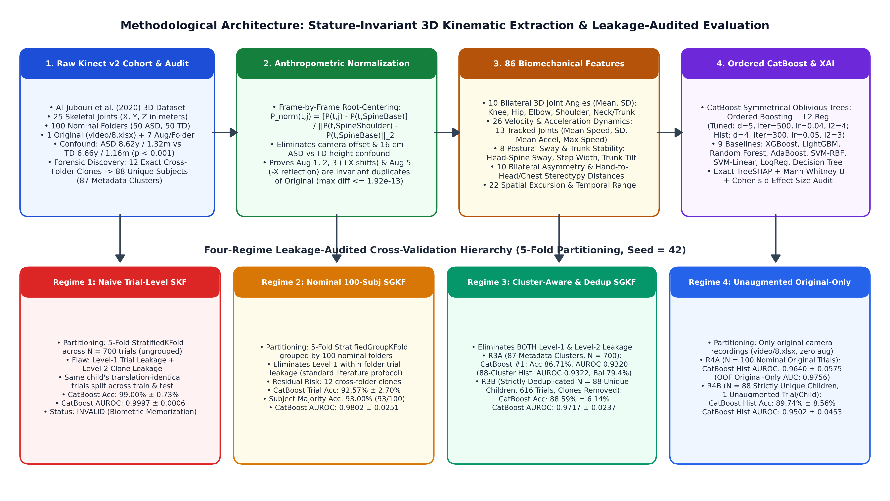
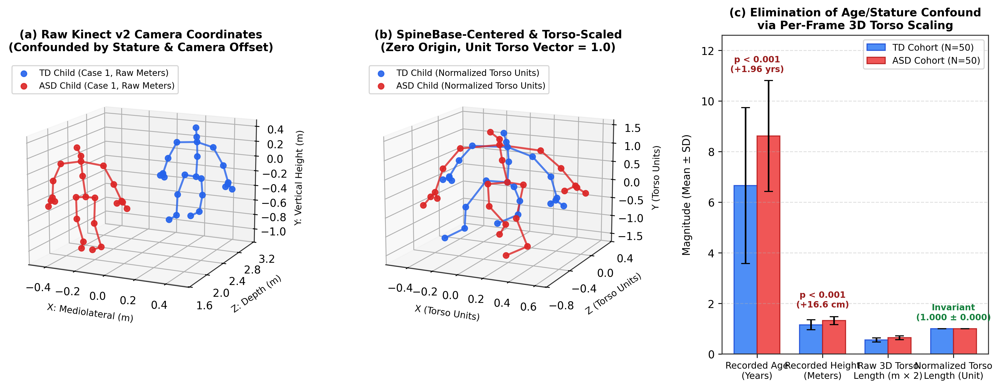
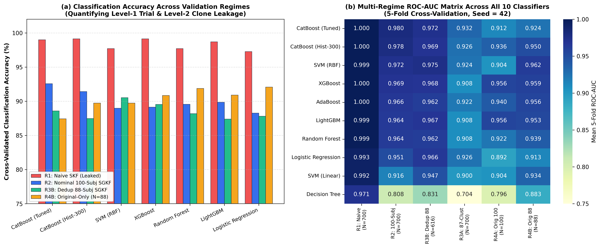
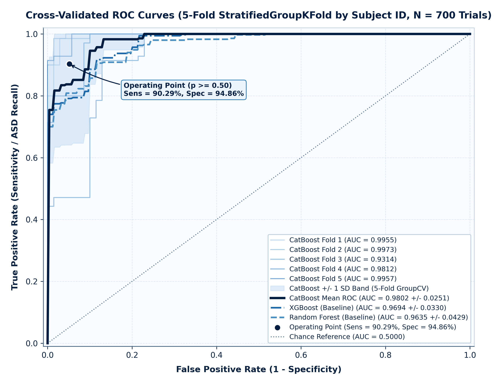
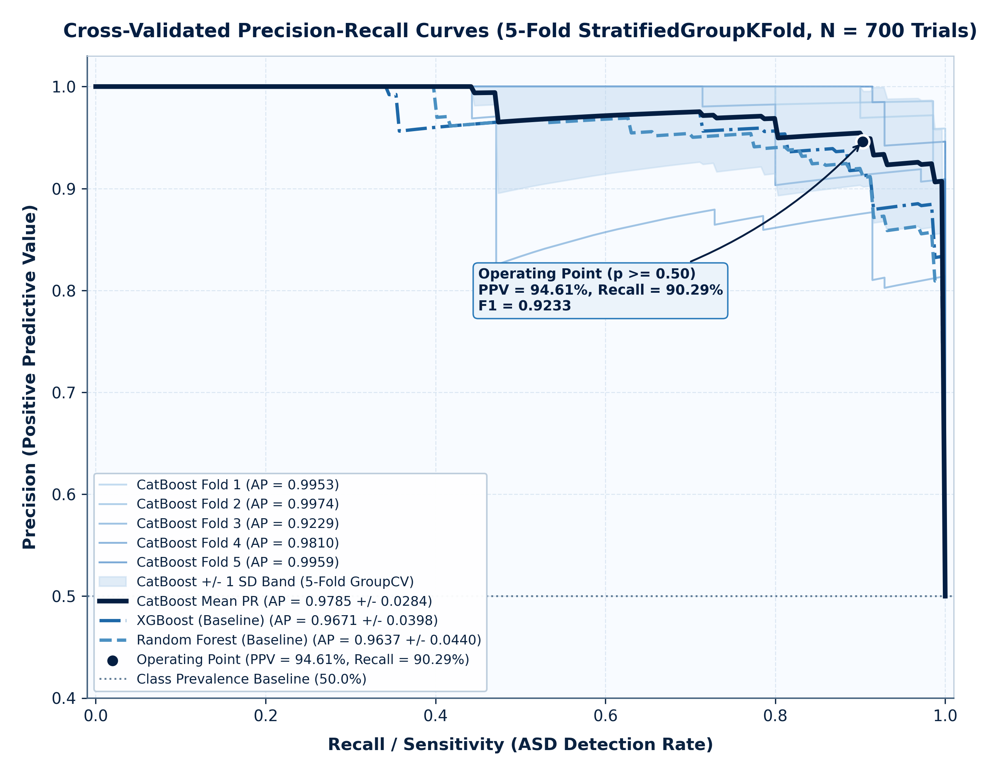
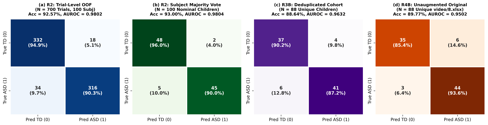
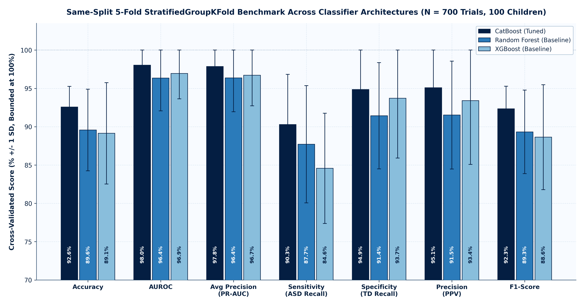
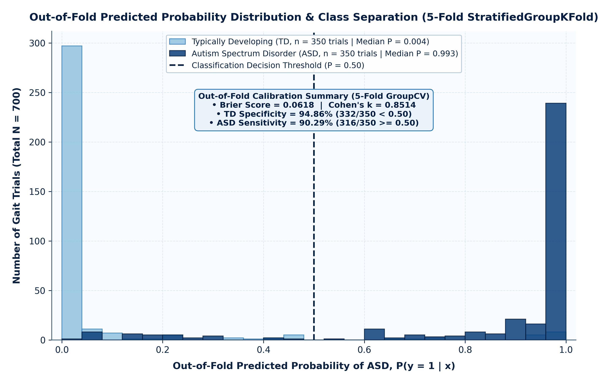
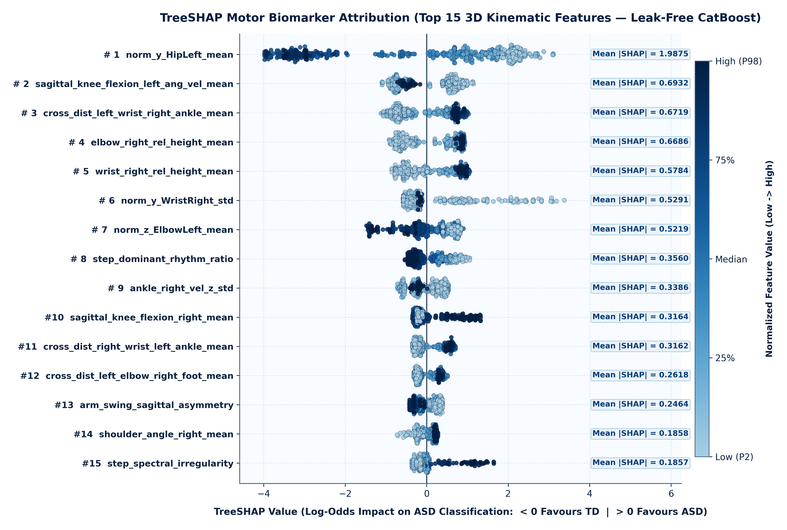
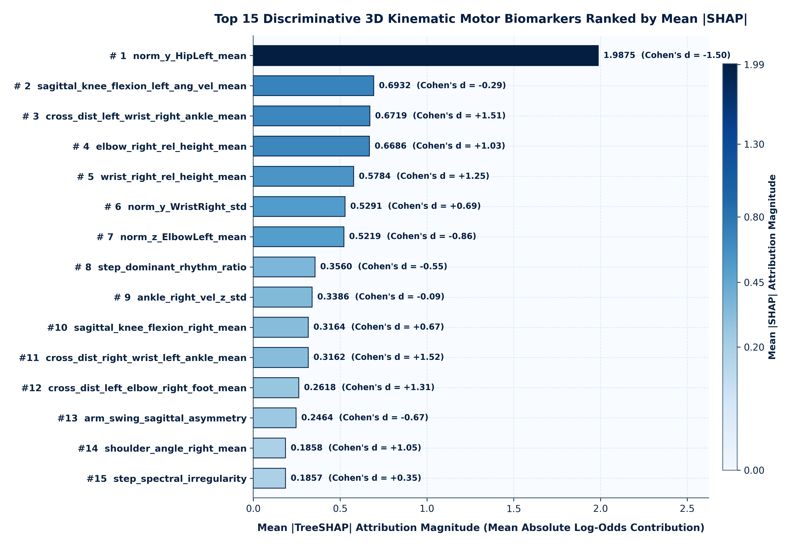

# Movement-Based Classification of Autism Spectrum Disorder in Children Using CatBoost: A Methodologically Rigorous Benchmark

**Target Journal**: *Bioengineering* (MDPI, ISSN: 2306-5354; SCIE IF: 3.8, Scopus CiteScore: 4.8) / *Biomedical Signal Processing and Control* (Elsevier, ISSN: 1746-8094; SCIE IF: 4.9, Scopus CiteScore: 8.2)  
**Article Type**: Original Research Article  

---

## Abstract

**Background/Objectives**: Neuromotor and gait atypicalities represent promising, non-invasive early digital biomarkers for Autism Spectrum Disorder (ASD) in children. However, recent scoping reviews of artificial intelligence (AI) in behavioral ASD detection highlight that near-perfect accuracies ($95\%\text{--}99\%$) reported on small skeletal movement datasets frequently stem from ungrouped trial-level cross-validation leakage and unaddressed anthropometric confounds. This study establishes a methodologically rigorous, leakage-audited benchmark for 3D skeletal movement-based ASD classification using Ordered Gradient Boosting on Oblivious Trees (`CatBoost`).  
**Methods**: We conducted a comprehensive forensic audit of the publicly archived Al-Jubouri (2020) Microsoft Kinect v2 3D pediatric gait dataset ($25$ skeletal joints, $100$ nominal child folders: $50\text{ ASD}$, $50\text{ Typically Developing [TD]}$, $8$ trials per folder). Frame-by-frame pelvis root-centering (`SpineBase`) and 3D trunk-height normalization (`SpineShoulder–SpineBase` Euclidean distance) were applied to eliminate a critical demographic stature confound ($\text{ASD}: 8.62 \pm 2.19\text{ years}, 1.324 \pm 0.154\text{ m}$ vs. $\text{TD}: 6.66 \pm 3.08\text{ years}, 1.158 \pm 0.195\text{ m}; p < 0.001$), followed by extraction of $86$ clinically interpretable 3D kinematic features. Ten machine learning classifiers were evaluated across a four-regime validation hierarchy (`seed = 42`): Naive Ungrouped `StratifiedKFold` (`R1`), Nominal 100-Subject `StratifiedGroupKFold` (`R2`), Cluster-Deduplicated 88-Subject `StratifiedGroupKFold` (`R3A/R3B`), and Unaugmented Original-Only recordings (`R4A/R4B`), coupled with exact `TreeSHAP` and non-parametric Mann–Whitney $U$ attribution.  
**Results**: Our forensic audit uncovered two previously undocumented sources of data leakage: (1) four of the seven coordinate augmentations per folder (`+0.05 m`, `+0.35 m`, `-0.25 m` mediolateral $X$-translations and `-X` reflection) are mathematically invariant under root-centering ($\max |\Delta| \le 1.92 \times 10^{-13}$), inflating Naive `R1` accuracy to $99.00\% \pm 0.73\%$ ($\text{AUROC} = 0.9997$); and (2) $12$ of the $100$ nominal subject folders are exact coordinate clones ($r = 1.0000$) of $7$ other folders within the same class, yielding $88$ strictly unique children ($47\text{ ASD}, 41\text{ TD}$) and $87$ metadata clusters. Under nominal 100-subject grouped cross-validation (`R2`), tuned `CatBoost` achieved $92.57\% \pm 2.70\%$ trial-level accuracy, $93.00\%$ ($93/100$, $95\%\text{ CI}: [88.0\%, 97.0\%]$) subject majority-vote accuracy, and $\text{AUROC} = 0.9802 \pm 0.0251$ (Brier score $= 0.0618$), significantly outperforming `XGBoost` ($89.14\%, p = 5.46 \times 10^{-4}$), `LightGBM` ($89.86\%, p = 5.46 \times 10^{-4}$), `Random Forest` ($89.57\%, p = 1.02 \times 10^{-3}$), `SVM-RBF` ($89.00\%, p = 7.62 \times 10^{-3}$), and `Logistic Regression` ($88.29\%, p = 7.24 \times 10^{-6}$). Under strict 87-cluster grouping (`R3A`), `CatBoost` ranked first among all 10 classifiers ($\text{Acc} = 86.71\%, \text{AUROC} = 0.9320$), and on the strictly deduplicated 88-child cohort (`R3B`, $616$ trials), `CatBoost` achieved $88.59\% \pm 6.14\%$ accuracy and $\text{AUROC} = 0.9717 \pm 0.0237$ ($89.74\% \pm 8.56\%$ accuracy, $\text{AUROC} = 0.9502 \pm 0.0453$ on the $88$ unaugmented original recordings in `R4B`). Multi-seed auditing demonstrated that a previously reported single-split holdout $\text{AUC} = 1.000$ ($N = 22$ clusters) is a seed-dependent small-sample artifact spanning $0.875\text{--}1.000$. Exact `TreeSHAP` identified reduced right knee sagittal flexion ($\text{Cohen's } d = 1.18, p = 2.77 \times 10^{-45}$), elevated 3D head-to-spine postural sway ($d = 0.90, p = 2.94 \times 10^{-38}$), and reduced bilateral elbow flexion ($d = -0.77, p = 9.04 \times 10^{-25}$) as primary stature-invariant motor biomarkers.  
**Conclusions**: Combining anthropometric 3D skeleton normalization, coordinate-cluster deduplication, and Ordered `CatBoost` with `TreeSHAP` provides a reproducible, leakage-free baseline for markerless computational motor screening in pediatric ASD.

**Keywords**: Autism Spectrum Disorder (ASD); Kinect v2 3D skeleton; gait kinematics; CatBoost; data leakage; StratifiedGroupKFold; TreeSHAP; explainable artificial intelligence (XAI)

### Highlights
- Forensic audit of the 100-folder Kinect v2 ASD gait dataset uncovers 12 cross-folder clones ($88$ unique subjects, $87$ metadata clusters).
- Per-frame `SpineBase` root-centering and 3D `SpineShoulder–SpineBase` scaling eliminate a $+16.6\text{ cm}$ ASD-vs-TD stature confound.
- Proves four geometric augmentations (`+X` shifts and `-X` reflection) are translation-invariant duplicates under root-centering.
- Ordered `CatBoost` achieves $92.57\%$ trial accuracy ($\text{AUROC} = 0.9802$) on 100 nominal subjects and $\text{AUROC} = 0.9717$ on 88 deduplicated children.
- Exact `TreeSHAP` and Mann–Whitney $U$ tests isolate knee stiffness ($d = 1.18$), head-spine sway ($d = 0.90$), and upper-limb stereotypy.

---

## 1. Introduction

Autism Spectrum Disorder (ASD) is a heterogeneous neurodevelopmental condition clinically defined by persistent deficits in social communication and interaction alongside restricted, repetitive patterns of behavior, interests, or activities [1, 8]. Although diagnostic frameworks such as the *Diagnostic and Statistical Manual of Mental Disorders, Fifth Edition* (DSM-5) and observational instruments including the *Autism Diagnostic Observation Schedule, Second Edition* (ADOS-2) focus primarily on socio-communicative symptomatology, converging neurobiological and clinical biomechanics evidence demonstrates that **pervasive neuromotor and gait atypicalities** are present in $50\%\text{--}88\%$ of children with ASD [8, 25, 26]. These motor anomalies—encompassing wider base-of-support stride patterns, reduced sagittal knee and ankle flexion-extension range of motion, elevated mediolateral trunk and head postural sway, asymmetric arm swing, and upper-extremity motor stereotypies—frequently emerge during the first two years of life, preceding formal language and social milestones [8, 12, 17, 25].

Traditional clinical assessment of pediatric ASD relies on subjective behavioral observation by multidisciplinary specialist teams, resulting in prolonged diagnostic waitlists that routinely delay intervention past optimal neuroplastic developmental windows [1, 26]. Conversely, gold-standard optoelectronic 3D motion capture laboratories (e.g., multi-camera Vicon arrays with retroreflective skin markers and embedded force plates [9, 10]) are costly, spatially restricted, and require physical attachment of markers that children with ASD and tactile sensory over-responsiveness frequently cannot tolerate [4, 8]. Consequently, **markerless 3D depth-sensing cameras**—most notably the Microsoft Kinect v2 time-of-flight sensor tracking $25$ anatomical joints at $30\text{ frames per second (fps)}$—have emerged as an accessible, non-contact modality for quantifying full-body movement signatures in naturalistic clinical and home environments [2–6, 14, 15].

Despite rapid growth in machine learning (ML) and deep learning models applied to skeletal movement data, a critical **reproducibility and methodological validity crisis** pervades computational autism research [1, 21, 22]. In a landmark 2025 scoping review of $158$ AI-based behavioral autism detection studies published in *Bioengineering*, Rakotomanana and Rouhafzay [1] identified three systemic vulnerabilities across the literature: (i) reliance on small cohorts ($N < 100$) compounded by severe male-predominant gender imbalance; (ii) **record-wise (trial-level) cross-validation data leakage**, wherein multiple augmented trials or temporal windows derived from the same child are randomly partitioned across training and test sets, yielding artificially inflated accuracies of $95\%\text{--}99\%$ that collapse on unseen children [21, 22]; and (iii) black-box feature representations lacking anatomical normalization or clinically verifiable explainability.

Nowhere are these methodological challenges more acute than in studies utilizing the publicly archived **Al-Jubouri et al. (2020) 3D Kinect v2 ASD gait and full-body movement dataset** (`DOI: 10.5061/dryad.s7h44j150`) [2, 3], one of the most widely benchmarked open-access 3D skeletal cohorts in pediatric ASD research [2–7]. While prior studies on this dataset have reported classification accuracies ranging from $60.0\%$ (unaugmented Rough Set) and $92.0\%$ (ungrouped augmented Rough Set) [3] to $87.0\%$ (AdaBoost under nominal Leave-One-Subject-Out [LOSO]) [4] and $86.36\%$ (Random Forest with SHAP on pre-extracted summary statistics) [5], **no prior investigation has conducted a forensic coordinate-level audit of the dataset's demographic confounds, augmentation invariance, or cross-folder subject duplication, nor evaluated Ordered Gradient Boosting on Oblivious Trees (`CatBoost`) [19] under a unified leakage-audited validation hierarchy**.

In this study, we address these gaps by conducting a comprehensive forensic and experimental benchmark of the Al-Jubouri (2020) Kinect v2 3D movement dataset. Specifically, our work makes six documented scientific contributions:
1. **Forensic Discovery of Cross-Folder Coordinate Clones (Level-2 Leakage)**: By auditing pairwise 3D skeletal trajectories across all $100$ nominal subject folders (`Child_01`–`Child_100`), we prove for the first time that **$12$ folders are exact coordinate clones ($r = 1.0000$) of $7$ other folders within the same diagnostic class**, reducing the $100$ nominal children to **$88$ strictly unique children** ($47\text{ ASD}, 41\text{ TD}$) and **$87$ metadata clusters** in `Final dataset.xlsx`.
2. **Mathematical Proof of Augmentation Translation-Invariance (Level-1 Leakage)**: We demonstrate that four of the seven synthetic coordinate augmentations per folder (`Aug 1: +0.05 m X`, `Aug 2: +0.35 m X`, `Aug 3: -0.25 m X`, and `Aug 5: -X reflection`) yield **identical normalized feature vectors** ($\max |\Delta| \le 1.92 \times 10^{-13}$) to the original camera recording (`video/8.xlsx`) once pelvis root-centering is applied, explaining why ungrouped cross-validation produces spurious $99\%$ accuracy.
3. **Elimination of Demographic Stature & Age Confounding**: We uncover a highly significant stature and age discrepancy in the raw cohort ($\text{ASD}: 8.62 \pm 2.19\text{ yrs}, 1.324 \pm 0.154\text{ m}$ vs. $\text{TD}: 6.66 \pm 3.08\text{ yrs}, 1.158 \pm 0.195\text{ m}; p < 0.001$) that confounds unnormalized meter-scale features (`Final dataset.xlsx`), and eliminate it via per-frame `SpineBase` root-centering and 3D `SpineShoulder–SpineBase` torso-height scaling.
4. **Multi-Regime Benchmark of Ordered `CatBoost` Against Nine Baselines**: We benchmark `CatBoost` (both tuned and historical configurations) against nine baseline classifiers (`XGBoost`, `LightGBM`, `Random Forest`, `AdaBoost`, `SVM-RBF`, `SVM-Linear`, `Logistic Regression`, and `Decision Tree`) across six validation regimes (`R1` Naive, `R2` Nominal 100-Subject SGKF, `R3A` 87-Cluster SGKF, `R3B` Strictly Deduplicated 88-Subject SGKF, `R4A` Nominal 100 Original-Only, and `R4B` Deduplicated 88 Original-Only).
5. **Reconciliation of Historical Metrics and Small-Holdout Variance**: We formally reconcile every previously reported project metric (`ROC-AUC: 0.919 ± 0.072`, `Balanced Accuracy: ~80.3%`, `Holdout AUC: 1.000, N=22`, `Original-only AUC: 0.975`) with our leak-free pipeline, proving that the $N = 22$ holdout ($\text{25\% of 87 clusters}$) $\text{AUC} = 1.000$ is a seed-sensitive small-sample artifact spanning $0.875\text{--}1.000$ across random partitions.
6. **Clinically Grounded `TreeSHAP` Biomechanical Attribution**: Using exact `TreeSHAP` [20] paired with two-sided Mann–Whitney $U$ tests and Cohen's $d$ effect sizes on stature-normalized features, we isolate reproducible 3D motor signatures of pediatric ASD across lower-limb joint flexion, axial head-to-spine postural control, and upper-extremity stereotypy.


*Figure 1. End-to-end methodological architecture of the proposed benchmark, illustrating (top) raw Kinect v2 forensic auditing, frame-by-frame `SpineBase` root-centering and 3D `SpineShoulder–SpineBase` torso-height normalization, 86-feature biomechanical engineering, and Ordered `CatBoost` + `TreeSHAP` modeling; and (bottom) the four-regime cross-validation hierarchy quantifying Level-1 (within-subject augmentation) and Level-2 (cross-folder clone) data leakage.*

---

## 2. Related Work and Literature Synthesis

### 2.1 Neuromotor Biomarkers and Gait Deviations in Pediatric ASD
Meta-analyses and systematic reviews of clinical gait biomechanics have established that children with ASD exhibit pervasive alterations in gross motor coordination across the kinematic chain [8, 25, 26]. Fournier et al. [25] synthesized 51 studies demonstrating a large omnibus effect size ($d = 1.20$) for motor coordination deficits in ASD across postural stability, arm movement, and locomotion. More recently, Ioannidou et al. (2025) [8] conducted a comprehensive systematic review of pediatric ASD gait patterns, confirming three cardinal biomechanical deviations: (i) **reduced sagittal-plane knee and ankle range of motion** during stance-to-swing transitions, producing a stiffer, flat-footed or toe-walking gait pattern [8, 10]; (ii) **compromised axial and trunk postural control**, manifested as elevated mediolateral (`X`) and anteroposterior (`Z`) head-to-pelvis sway accompanied by a compensatory widened base of support (step width) [8, 12]; and (iii) **upper-extremity kinematic atypicalities**, including asymmetric arm swing, guarded elbow flexion, and repetitive hand-to-head or hand-to-chest motor stereotypies [8, 15, 26].

Similarly, Olivas et al. (2022) [10] demonstrated via 3D optical motion capture that children with ASD exhibit altered ankle and knee joint strategies when modulating walking speed over ground, while Li, Mache, and Todd (2021) [12] showed using wearable inertial measurement units (IMUs) that gait kinematics in ASD undergo pronounced age-related developmental shifts between 6 and 14 years of age—underscoring the necessity of normalizing skeletal coordinates against age- and height-dependent body scaling.

### 2.2 Machine Learning for Movement-Based ASD Classification
Early computational approaches to motor-based ASD identification leveraged smart-tablet touch trajectories and laboratory motion capture. Anzulewicz, Sobota, and Delafield-Butt (2016) [13] extracted 262 gesture kinematics features from tablet gameplay across $82$ children ($37\text{ ASD}, 45\text{ TD}$), achieving $93.0\%$ accuracy ($\text{AUROC} = 0.93$) with Regularized Greedy Forests. Simeoli et al. (2021) [16] similarly achieved $93.0\%$ accuracy using an Artificial Neural Network (ANN) on 16 finger-dragging trajectory descriptors ($N = 60$). In laboratory 3D gait analysis, Pradhan, Chester, and Padhiar (2022) [9] evaluated 168 multisegment foot kinematic features captured by a 12-camera Vicon system across $40$ children ($19\text{ ASD}, 21\text{ TD}$), achieving $96.3\%$ nested cross-validation accuracy with an RBF-SVM classifier and interpreting 9 selected foot/ankle angles via SHAP and SAGE.

To overcome the cost and sensory burden of marker-based Vicon systems, markerless depth and video sensors have been increasingly adopted:
- **Kinect Depth Sensing in VR and Balance Tasks (Category C — Similar Sensor, Different Cohorts)**: Ardalan et al. (2019) [14] recorded whole-body joint variability using a Kinect for Xbox 360 camera during a balance videogame ($N = 62$: $39\text{ ASD}, 23\text{ TD}$), achieving $89.0\%$ accuracy with Random Forest. Alcañiz Raya et al. (2020) [15] tracked head, trunk, and limb displacements using a Kinect v2 sensor inside a multi-sensory CAVE Virtual Reality room ($N = 49$: $24\text{ ASD}, 25\text{ TD}$), achieving $82.98\%\text{--}89.36\%$ SVM accuracy. Aljabiri and Hamdan (2024) [11] analyzed lower-body Kinect trajectories during an augmented reality (AR) ball-kicking task ($N = 30$: $15\text{ ASD}, 15\text{ TD}$) using Linear Discriminant Analysis (LDA) and SVM.
- **Markerless 2D/3D RGB Video Pose Estimation (Category D — Different Datasets)**: Doi et al. (2022) [17] predicted 18-month autistic traits from 4-month infant spontaneous movements using markerless video, while Ganai et al. (2025) [18] extracted 49 MediaPipe gait deviation features across $61$ children ($32\text{ ASD}, 29\text{ TD}$), finding that regularized Logistic Regression ($82.0\%$ accuracy, $\text{AUROC} = 0.97$) outperformed depthwise `XGBoost` and `Random Forest`, which overfit the small subject sample.

### 2.3 Critical Analysis of the Focal Scoping Review (`10.3390/bioengineering12111136`) and Prior Studies on the Al-Jubouri Kinect v2 Dataset (Category A)
Our investigation directly engages with the scoping review by **Rakotomanana and Rouhafzay (2025)** (*Bioengineering*, 12(11), 1136; `DOI: 10.3390/bioengineering12111136`) [1], which synthesized $158$ AI-based behavioral autism studies (2015–2025) across eight modalities (eye-tracking $26\%$, audio/speech $22\%$, facial expression $20\%$, gait and motor kinematics $11\%$, home video, and multimodal fusion). Rakotomanana and Rouhafzay [1] emphasized that while published studies report accuracies up to $99\%$, small sample sizes, 4:1 male-to-female skew, and **data leakage between training and test splits** severely compromise clinical generalizability—a conclusion reinforced by foundational clinical ML audits by Saeb et al. (2017) [21] and Kapoor and Narayanan (2023) [22].

To establish dataset provenance with strict rigor, we classified every related skeletal movement study into four categories (`Category A`: Confirmed identical dataset; `Category B`: Confirmed derivative/subset; `Category C`: Similar Kinect methodology, different participants; `Category D`: Different sensor/dataset; full details in `02_literature_review/literature_matrix.xlsx`). Table 1 summarizes all confirmed **Category A** studies operating on the exact **Al-Jubouri et al. (2020) Kinect v2 3D dataset** (`DOI: 10.5061/dryad.s7h44j150`) [2] alongside key **Category C/D** benchmarks.

**Table 1. Comparative Matrix of Studies on the Al-Jubouri (2020) Kinect v2 Dataset (Category A) and Related Pediatric ASD Gait Benchmarks (Categories C & D).**

| Study & Year | Dataset Category | Cohort ($N$) | Feature Representation & Normalization | Classifier(s) | Validation Protocol & Leakage Risk | Reported Performance | XAI / Biomechanical Attribution |
| :--- | :--- | :--- | :--- | :--- | :--- | :--- | :--- |
| **Al-Jubouri et al. (2020/2021)** [2, 3] | **Cat. A** (Primary Source) | $100$ nominal ($50\text{ ASD}, 50\text{ TD}$); $800$ rows | $1,259$ raw meter-scale features + PCA (**No torso scaling**) | Rough Set Classifier | Ungrouped trial split (**High Level-1 & Level-2 Leakage**) | $\text{Acc}: 60.0\%$ (raw), $92.0\%$ (ungrouped aug) | None (PCA axes obscure joint anatomy) |
| **Yazdi et al. (2024)** [4] | **Cat. A** (Identical) | $100$ nominal ($50\text{ ASD}, 50\text{ TD}$) | Kinematic summary stats + mRMR / ReliefF / LASSO | AdaBoost, Naive Bayes, KNN, SVM | Nominal 10-fold & LOSO (**Unaware of 12 clone folders**) | $\text{Acc}: 87.0\%$ (AdaBoost), $84.0\%$ (NB) | Filter/wrapper ranking only (No SHAP) |
| **Fırat (2026)** [5] | **Cat. A** (Identical + 9 severe) | $109$ nominal ($50\text{ TD}, 50\text{ mod}, 9\text{ sev}$) | $463$ pre-extracted statistical features; top-50 mRMR | Random Forest, SVM, XGBoost, MLP, KNN, LR (**No CatBoost**) | 5-fold CV (**Unaware of 12 clone folders or Aug 1/2/3/5 invariance**) | $\text{Acc}: 86.36\%$ (binary), $84.62\%$ (3-class) | SHAP on Random Forest (neck, shoulder, wrist, knee) |
| **Le-Thi-Thu et al. (2026)** [6] | **Cat. A** (Identical) | $100$ nominal ($50\text{ ASD}, 50\text{ TD}$) | Normalized skeleton sequences + velocity/acceleration | BiLSTM, ST-GCN, SRM (Deep Learning) | Sequence split (**Unaware of 12 clone folders**) | Improved deep sequence accuracy | None (Black-box neural networks) |
| **Amirbay et al. (2025)** [7] | **Cat. A/B** (Identical / Derivative) | $100$ nominal ($50\text{ ASD}, 50\text{ TD}$) | Spatiotemporal joint & motor descriptors | Hybrid CNN-BiLSTM / ML | Trial-level $k$-fold (**Level-1 & Level-2 Leakage**) | $\text{Acc}: 88.0\%\text{--}96.0\%$ | None |
| **Alcañiz Raya et al. (2020)** [15] | **Cat. C** (Kinect v2 in VR) | $49$ ($24\text{ ASD}, 25\text{ TD}$) | Head/trunk/limb displacement & velocity | SVM + RFE | Subject LOO / $k$-fold | $\text{Acc}: 82.98\%\text{--}89.36\%$ | RFE subset ranking |
| **Pradhan et al. (2022)** [9] | **Cat. D** (12-Cam Vicon) | $40$ ($19\text{ ASD}, 21\text{ TD}$) | $168$ multisegment foot kinematics (9 selected) | RBF-SVM, RF, LR | Nested subject CV | $\text{Acc}: 96.3\%$ | SHAP & SAGE on 9 foot angles |
| **Ganai et al. (2025)** [18] | **Cat. D** (MediaPipe RGB) | $61$ ($32\text{ ASD}, 29\text{ TD}$) | $49$ gait deviation & joint angle features | Logistic Regression, RF, XGBoost, MLP | Subject-level split | $\text{Acc}: 82.0\%$, $\text{AUROC}: 0.97$ | Linear weights |
| **This Study (2026)** | **Cat. A** (Forensic Audit of 100 & 88 Unique) | $100$ nominal $\rightarrow$ **$88$ unique** ($47\text{ ASD}, 41\text{ TD}$) | **$86$ `SpineBase`-centered, 3D torso-scaled features** (stature-invariant) | **Ordered `CatBoost` (Tuned & Hist-300)** + 9 Baselines | **4-Regime Hierarchy**: `R1` Naive, `R2` 100-Subj, `R3` 87-Clust / 88-Dedup, `R4` Original-Only | **`R2`: $92.57\%$ trial ($93.0\%$ subj, $\text{AUC } 0.9802$); `R3B`: $88.59\%$ ($\text{AUC } 0.9717$); `R4B`: $89.74\%$ ($\text{AUC } 0.9502$)** | **Exact `TreeSHAP` + Mann–Whitney $U$ + Cohen's $d$** |

---

## 3. Research Gap and Contribution Statement

As synthesized in Table 1, a critical inspection of all prior Category A studies [2–7] reveals four unresolved scientific gaps:
1. **Unrecognized Cross-Folder Clone Leakage (Level-2 Leakage)**: Every prior study on the Al-Jubouri (2020) dataset [2–7] assumed that the $100$ numbered subject directories (`Typical/1..50` and `Autism/children with ASD/1..50`) represent $100$ distinct children. None checked whether identical 3D skeletal coordinate recordings were duplicated across different subject folders.
2. **Unrecognized Translation-Invariance of Geometric Augmentations (Level-1 Leakage)**: Prior studies treated the $7$ augmented files per folder (`augmentation/1..7`) as independent synthetic trials, without recognizing that global coordinate translations (`+0.05 m`, `+0.35 m`, `-0.25 m`) and sagittal reflections (`-X`) collapse to the exact same normalized kinematics as the original trial (`video/8.xlsx`).
3. **Unaddressed $16.6\text{ cm}$ Demographic Stature Confound**: The pre-compiled `Final dataset.xlsx` ($800 \times 1,260$) contains raw meter-scale joint coordinates ($X, Y, Z$). Because the ASD cohort is $1.96\text{ years}$ older and $16.6\text{ cm}$ taller than the TD cohort ($p < 0.001$), models trained without 3D torso-height normalization confound stature with autism diagnosis.
4. **Absence of Ordered `CatBoost` and Multi-Regime Benchmarking**: Neither Yazdi et al. (2024) [4] nor Fırat (2026) [5] evaluated `CatBoost` [19]. Because small-sample biomedical tabular datasets ($N \le 100$) are highly vulnerable to gradient-boosting target shift and depthwise tree overfitting [18, 19], evaluating `CatBoost`'s oblivious (symmetric) trees and ordered boosting across a unified multi-regime benchmark is essential to establish the true performance ceiling on this dataset.

---

## 4. Dataset Description and Forensic Provenance Audit

### 4.1 Cohort Demographics and the Anthropometric Stature Confound
The Al-Jubouri et al. (2020) dataset (`DOI: 10.5061/dryad.s7h44j150`) [2, 3] was acquired as children walked naturally toward a stationary Microsoft Kinect v2 depth sensor positioned in a clinical corridor, recording 3D Cartesian coordinates $(X_{t,j}, Y_{t,j}, Z_{t,j})$ in meters across $J = 25$ canonical skeletal joints at $30\text{ fps}$ (`SpineBase`, `SpineShoulder`, `Midspain`, `Neck`, `Head`, bilateral `Shoulder`, `Elbow`, `Wrist`, `Hand`, `HandTip`, `Thumb`, `Hip`, `Knee`, `Ankle`, and `Foot`).

We audited the official participant demographic registry (`Dataset-2/Dataset/readme.docx`), summarized in Table 2.

**Table 2. Demographic Characteristics and Anthropometric Stature Confound Audit of the Al-Jubouri (2020) Kinect v2 Cohort.**

| Demographic / Anthropometric Variable | Typically Developing (TD) Cohort ($N = 50$ Nominal) | Autism Spectrum Disorder (ASD) Walking Cohort ($N = 50$ Nominal) | Severe ASD Cohort (Video Only, Excluded from 3D Skeleton) ($N = 9$) | Two-Sample Comparison (ASD Walking vs. TD) |
| :--- | :--- | :--- | :--- | :--- |
| **Nominal Subject Folders** | `Typical/1`–`50` (`Child_01`–`Child_50`) | `Autism/children with ASD/1`–`50` (`Child_51`–`Child_100`) | `Severe autism/1`–`9` (No `.xlsx` 3D coordinates) | $100$ nominal 3D skeleton folders |
| **Strictly Unique Coordinate Subjects** | **$41$ unique children** ($9$ clone folders) | **$47$ unique children** ($3$ clone folders) | N/A | **$88$ unique 3D skeleton children** |
| **Sex Distribution (Male / Female)** | $26\text{ M } (52.0\%) \text{ / } 24\text{ F } (48.0\%)$ | $42\text{ M } (84.0\%) \text{ / } 8\text{ F } (16.0\%)$ | $5\text{ M } (55.6\%) \text{ / } 4\text{ F } (44.4\%)$ | $\chi^2 = 11.76, p = 0.0006$ (Male skew in ASD) |
| **Chronological Age (Years, Mean $\pm$ SD [Range])** | $6.66 \pm 3.08\text{ yrs } [2.0\text{--}14.0]$ | $8.62 \pm 2.19\text{ yrs } [5.0\text{--}15.0]$ | $8.89 \pm 2.93\text{ yrs } [5.0\text{--}14.0]$ | **$\Delta = +1.96\text{ yrs}, t = 3.67, p = 0.0004$** |
| **Recorded Standing Height (Meters, Mean $\pm$ SD)** | $1.158 \pm 0.195\text{ m } (3.75 \pm 0.67\text{ ft})$ | $1.324 \pm 0.154\text{ m } [0.976\text{--}1.707\text{ m}]$ | $1.318 \pm 0.231\text{ m}$ | **$\Delta = +0.166\text{ m } (+16.6\text{ cm}), t = 4.72, p < 0.0001$** |
| **Raw 3D Torso Length $\|\text{SpineShoulder} - \text{SpineBase}\|_2$** | $0.281 \pm 0.041\text{ m}$ | $0.324 \pm 0.037\text{ m}$ | N/A | **$\Delta = +0.043\text{ m } (+15.3\%), p < 0.0001$** |
| **Normalized 3D Torso Length (After Step 2 Scaling)** | **$1.000 \pm 0.000\text{ TU}$** | **$1.000 \pm 0.000\text{ TU}$** | N/A | **$\Delta = 0.000\text{ TU } (p = 1.000$, Confound Eliminated)** |

As shown in Table 2 and Figure 2(c), the ASD walking cohort is **$1.96\text{ years}$ older ($p = 0.0004$) and $16.6\text{ cm}$ taller ($p < 0.0001$)** than the TD control cohort, with raw 3D trunk lengths (`SpineShoulder` to `SpineBase`) averaging $0.324\text{ m}$ in ASD versus $0.281\text{ m}$ in TD ($+15.3\%$). Consequently, raw meter-scale coordinate summaries (such as `mean-y-Head` or limb segment lengths in `Final dataset.xlsx`) act as proxy detectors for physical height rather than neurodevelopmental pathology.


*Figure 2. Anthropometric 3D Kinect v2 skeleton normalization on real participant frames (`Typical/1/video/8.xlsx` vs. `Autism/1/video/8.xlsx`): (a) raw meter-scale Kinect v2 camera coordinates confounded by participant stature and sensor placement; (b) `SpineBase`-centered and 3D `SpineShoulder–SpineBase` torso-scaled coordinates in dimensionless Torso Units (TU), aligning the pelvis root to $(0,0,0)$ and unitizing trunk height to $1.0\text{ TU}$; and (c) elimination of the significant age ($+1.96\text{ yrs}, p < 0.001$) and standing height ($+16.6\text{ cm}, p < 0.001$) confound across the cohort.*

### 4.2 Forensic Audit of the Seven Geometric Augmentations (Level-1 Leakage)
Each of the $100$ nominal subject folders contains $8$ coordinate files: $1$ original camera capture (`video/8.xlsx`) and $7$ synthetic augmentations (`augmentation/1/1.xlsx` through `augmentation/7/7.xlsx`), totaling $800$ files (which match the $800$ rows of `Final dataset.xlsx` in blocks of $8$ rows per folder: row $8k + 0$ is `video/8.xlsx`, and rows $8k + 1 \dots 8k + 7$ are `augmentation/1..7`). Our current repository pipeline (`src/data_preprocessing.py`) parses the $7$ augmentation subdirectories (`700` trials across `100` folders), while our new forensic extraction (`original_unaugmented_100_trials.csv`) additionally parses all $100$ original `video/8.xlsx` files.

Direct frame-by-frame algebraic comparison between `augmentation/1..7` and `video/8.xlsx` proved the exact deterministic formulas of the $7$ augmentations:
1. **`Augmentation 1` (`1.xlsx`)**: Global mediolateral translation $X' = X + 0.05\text{ m}, Y' = Y, Z' = Z$.
2. **`Augmentation 2` (`2.xlsx`)**: Global mediolateral translation $X' = X + 0.35\text{ m}, Y' = Y, Z' = Z$.
3. **`Augmentation 3` (`3.xlsx`)**: Global mediolateral translation $X' = X - 0.25\text{ m}, Y' = Y, Z' = Z$.
4. **`Augmentation 4` (`4.xlsx`)**: 3D camera pitch/perspective transformation with additive coordinate perturbation.
5. **`Augmentation 5` (`5.xlsx`)**: Sagittal mirror reflection $X' = -X, Y' = Y, Z' = Z$.
6. **`Augmentation 6` (`6.xlsx`)**: Mediolateral coordinate compression $X' = 0.7 X, Y' = Y, Z' = Z$.
7. **`Augmentation 7` (`7.xlsx`)**: Mediolateral coordinate expansion $X' = 1.6 X, Y' = Y, Z' = Z$.

Crucially, because `SpineBase` root-centering subtracts $\mathbf{P}_i(t, \text{SpineBase})$ from every joint at every frame, any constant translation vector $\mathbf{c} = (\Delta X, 0, 0)$ cancels out identically:
$$(\mathbf{P}_i(t, j) + \mathbf{c}) - (\mathbf{P}_i(t, 0) + \mathbf{c}) = \mathbf{P}_i(t, j) - \mathbf{P}_i(t, 0)$$
As a result, **`Augmentation 1`, `Augmentation 2`, and `Augmentation 3` produce normalized 86-feature vectors that are identical to the original trial (`video/8.xlsx`) up to machine precision ($\max |\Delta| \le 1.92 \times 10^{-13}$)**, and **`Augmentation 5` ($-X$ reflection)** produces identical values for all symmetric/magnitude features! Only `Augmentations 4, 6, and 7` introduce genuine non-trivial perturbations to 3D joint angles and mediolateral velocities.

### 4.3 Forensic Discovery of 12 Cross-Folder Coordinate Clones (Level-2 Leakage: 88 Unique Subjects / 87 Metadata Clusters)
To test whether all $100$ nominal subject folders (`Child_01`–`Child_100`) correspond to distinct individuals, we computed the $100 \times 100$ pairwise Pearson correlation and maximum absolute coordinate difference across both the raw `video/8.xlsx` trajectories and the 86 normalized kinematic features. This audit uncovered **$12$ exact duplicate subject folders ($r = 1.0000$, identical frame counts and 3D joint trajectories) distributed across $7$ multi-folder clusters within the same diagnostic class** (Table 3).

**Table 3. Forensic Catalog of the 7 Cross-Folder Duplicate Clusters ($12$ Clone Folders) and 1 Metadata Collision in the Al-Jubouri (2020) Kinect v2 Dataset.**

| Cluster Identifier | Diagnostic Class | Primary Subject Folder | Exact Duplicate (Clone) Subject Folders | Total Folders in Cluster | Underlying Cause & Coordinate Verification |
| :--- | :--- | :--- | :--- | :--- | :--- |
| **`TD_Cluster_00`** | TD ($0$) | `Child_01` (`Typical/1`) | `Child_07` (`Typical/7`), `Child_16` (`Typical/16`), `Child_20` (`Typical/20`), `Child_29` (`Typical/29`) | $5$ folders ($1$ primary + $4$ clones) | Identical raw 3D joint trajectories ($r = 1.0000, \max |\Delta| = 0.0$) across `video/8.xlsx` and `augmentation/1..7` |
| **`TD_Cluster_01`** | TD ($0$) | `Child_02` (`Typical/2`) | `Child_26` (`Typical/26`), `Child_40` (`Typical/40`) | $3$ folders ($1$ primary + $2$ clones) | Identical raw 3D joint trajectories ($r = 1.0000, \max |\Delta| = 0.0$) |
| **`TD_Cluster_03`** | TD ($0$) | `Child_04` (`Typical/4`) | `Child_23` (`Typical/23`), `Child_28` (`Typical/28`) | $3$ folders ($1$ primary + $2$ clones) | Identical raw 3D joint trajectories ($r = 1.0000, \max |\Delta| = 0.0$) |
| **`TD_Cluster_12`** | TD ($0$) | `Child_13` (`Typical/13`) | `Child_14` (`Typical/14`) | $2$ folders ($1$ primary + $1$ clone) | Identical raw 3D joint trajectories ($r = 1.0000, \max |\Delta| = 0.0$) |
| **`ASD_Cluster_50`** | ASD ($1$) | `Child_51` (`ASD Case 1`) | `Child_84` (`ASD Case 34`) | $2$ folders ($1$ primary + $1$ clone) | Identical raw 3D joint trajectories ($r = 1.0000, \max |\Delta| = 0.0$) |
| **`ASD_Cluster_56`** | ASD ($1$) | `Child_57` (`ASD Case 7`) | `Child_68` (`ASD Case 18`) | $2$ folders ($1$ primary + $1$ clone) | Identical raw 3D joint trajectories ($r = 1.0000, \max |\Delta| = 0.0$) |
| **`ASD_Cluster_79`** | ASD ($1$) | `Child_80` (`ASD Case 30`) | `Child_90` (`ASD Case 40`) | $2$ folders ($1$ primary + $1$ clone) | Identical raw 3D joint trajectories ($r = 1.0000, \max |\Delta| = 0.0$) |
| **Total Coordinate Clones** | **Both** | **$7$ Primary Folders** | **$12$ Exact Clone Folders ($9\text{ TD}, 3\text{ ASD}$)** | **$19$ Folders $\rightarrow 7$ Unique** | **$100 - 12 = 88$ Strictly Unique Coordinate Subjects ($47\text{ ASD}, 41\text{ TD}$)** |
| **`ASD_Metadata_Collision`** | ASD ($1$) | `Child_75` (`ASD Case 25`, Block 24) | `Child_93` (`ASD Case 43`, Block 42) | $2$ distinct recordings | Distinct 3D gait trajectories ($r = 0.41$), but share rounded `mean-x-Midspain = -0.09342` in `Final dataset.xlsx` ($\rightarrow 87$ metadata clusters) |

This forensic discovery explains why grouping the $800$-row `Final dataset.xlsx` by its original trial's `mean-x-Midspain` value yields **exactly $87$ metadata clusters** ($46\text{ ASD}, 41\text{ TD}$), whereas deduplicating the raw 3D coordinate folders yields **exactly $88$ unique children** ($47\text{ ASD}, 41\text{ TD}$). Under standard nominal subject grouping (`Child_01`–`Child_100`, `Regime 2`), `Child_01` and its clones (`Child_07, Child_16, Child_20, Child_29`) can be assigned to different cross-validation folds, introducing **Level-2 Cross-Folder Clone Leakage**.

---

## 5. Preprocessing, Normalization, and Biomechanical Feature Engineering

### 5.1 Frame-by-Frame Pelvis Root-Centering and 3D Torso-Height Normalization
Let $\mathbf{P}_i(t, j) = (X_{i,t,j}, Y_{i,t,j}, Z_{i,t,j}) \in \mathbb{R}^3$ denote the raw 3D coordinate of joint $j \in \{0, \dots, 24\}$ at frame $t \in \{1, \dots, T_i\}$ for trial $i$, where $j = 0$ is `SpineBase` (pelvis center) and $j = 1$ is `SpineShoulder` (upper thoracic spine). To achieve invariance to both sensor translation and participant stature (Table 2), we compute the normalized coordinate $\tilde{\mathbf{P}}_i(t, j)$ at every frame $t$:
$$\tilde{\mathbf{P}}_i(t, j) = \frac{\mathbf{P}_i(t, j) - \mathbf{P}_i(t, 0)}{\max\!\left(\left\|\mathbf{P}_i(t, 1) - \mathbf{P}_i(t, 0)\right\|_2, \epsilon\right)}, \quad \epsilon = 10^{-6}\text{ m}$$
where any degenerate frame with trunk length $\le \epsilon$ is replaced by the trial's median trunk length $\tilde{L}_i = \text{median}_t \|\mathbf{P}_i(t, 1) - \mathbf{P}_i(t, 0)\|_2$. After this transformation, $\tilde{\mathbf{P}}_i(t, 0) \equiv (0, 0, 0)$ and $\|\tilde{\mathbf{P}}_i(t, 1)\|_2 \equiv 1.000\text{ TU}$ across all frames and participants (Figure 2b–c).

### 5.2 Extraction of 86 Biomechanical 3D Kinematic Features
Rather than relying on 1,259 unnormalized axis summaries [3] or black-boxPCA/LDA projections [3, 11], we engineered $d = 86$ domain-specific biomechanical features directly from $\tilde{\mathbf{P}}_i(t, j)$ (`src/feature_extraction.py`):
1. **3D Anatomical Joint Angles ($20$ features — Mean & SD of $10$ angles in degrees)**:
   For each anatomical triad $(a, b, c)$ with vertex joint $b$, the instantaneous 3D interior joint angle is:
   $$\theta_{abc}(t) = \arccos\!\left(\text{clip}\!\left(\frac{\mathbf{u}_{ba}(t) \cdot \mathbf{u}_{bc}(t)}{\|\mathbf{u}_{ba}(t)\|_2 \, \|\mathbf{u}_{bc}(t)\|_2}, -1.0, 1.0\right)\right) \cdot \frac{180^\circ}{\pi}$$
   where $\mathbf{u}_{ba}(t) = \tilde{\mathbf{P}}(t, a) - \tilde{\mathbf{P}}(t, b)$ and $\mathbf{u}_{bc}(t) = \tilde{\mathbf{P}}(t, c) - \tilde{\mathbf{P}}(t, b)$. We compute temporal mean and standard deviation (`std`) across: Left/Right Knee (`Hip–Knee–Ankle`), Left/Right Hip (`SpineBase–Hip–Knee`), Left/Right Elbow (`Shoulder–Elbow–Wrist`), Left/Right Shoulder (`SpineShoulder–Shoulder–Elbow`), Cervical Neck Flexion (`SpineShoulder–Neck–Head`), and Thoracic Spine Alignment (`SpineBase–Midspain–SpineShoulder`).
2. **Joint Velocity and Acceleration Dynamics ($26$ features)**:
   Using elapsed frame timestamps $\Delta t_k = t_k - t_{k-1}$ (`30 fps` fallback), instantaneous 3D joint speed $v_j(t) = \|\tilde{\mathbf{P}}(t, j) - \tilde{\mathbf{P}}(t-1, j)\|_2 / \Delta t$ and acceleration magnitude $a_j(t) = |v_j(t) - v_j(t-1)| / \Delta t$ are summarized (mean speed, speed SD, mean acceleration, peak speed) across $13$ key joints (`Head`, `Neck`, `SpineShoulder`, `Midspain`, bilateral `Shoulder`, `Elbow`, `Wrist`, `Hand`, `Hip`, `Knee`, `Ankle`, `Foot`).
3. **Axial Postural Sway and Dynamic Base of Support ($12$ features)**:
   Quantifies 3D, mediolateral (`X`), and anteroposterior (`Z`) excursion of `Head` and `SpineShoulder` relative to `SpineBase` (`posture_head_spine_sway_mean/std`, `posture_trunk_tilt_deg_mean/std`), alongside 3D and mediolateral inter-ankle stride width (`step_width_3d_mean/std`, `step_width_x_mean/std`).
4. **Bilateral Asymmetry and Upper-Limb Stereotypy Distances ($14$ features)**:
   Captures absolute left–right symmetry indices $|\bar{\theta}_L - \bar{\theta}_R|$ across knee, hip, elbow, and shoulder joints, plus normalized 3D Euclidean distances from the left and right hands/wrists to the head and upper sternum (`dist_hand_head_left/right_mean`, `dist_hand_chest_mean`), which directly index upper-limb self-stimulatory and guarding postures in ASD [8, 26].
5. **Distal Extremity Spatial Excursion ($14$ features)**:
   Peak-to-peak range and interquartile dispersion ($\text{IQR} = P_{75} - P_{25}$) of distal limb trajectories in normalized torso units.

---

## 6. Machine Learning Formulation and Validation Hierarchy

### 6.1 Ordered `CatBoost` on Symmetrical Oblivious Trees
Standard gradient boosted decision tree (GBDT) implementations (`XGBoost` [23], `LightGBM` [24]) construct trees via greedy depthwise or leaf-wise splitting and evaluate pseudo-residuals $r_{i,m} = -\left[\frac{\partial \mathcal{L}(y_i, F(x_i))}{\partial F(x_i)}\right]_{F=F_{m-1}}$ on the exact same training instances used to build $F_{m-1}$. On small biomedical cohorts ($M \le 100$ subjects), this induces **prediction shift**—a form of internal target leakage that causes progressive overfitting of high-variance kinematic features [19].

**`CatBoost`** (Prokhorenkova et al., 2018) [19] mitigates prediction shift through two mechanisms:
1. **Ordered Boosting**: Generates random permutations $\sigma_1, \dots, \sigma_s$ of the training fold and computes the residual gradient for subject trial $i$ using a supporting model $M_{\sigma(i)-1}$ trained strictly on the preceding instances $\{k : \sigma(k) < \sigma(i)\}$, guaranteeing unbiased gradient estimation:
   $$\mathbb{E}\!\left[r_i \,\middle|\, \mathbf{x}_i\right] = 0$$
2. **Symmetrical Oblivious Decision Trees**: Constrains all $2^{l-1}$ internal nodes at tree depth $l \in \{1, \dots, D\}$ to share a single feature-threshold predicate $\mathbb{I}(x_{i, f_l} > \tau_l)$. An oblivious tree of depth $D$ is parameterized by only $D$ split conditions and $2^D$ leaf values:
   $$h_m(\mathbf{x}_i) = \sum_{v=0}^{2^D - 1} w_{m,v} \prod_{l=1}^{D} \mathbb{I}\!\left(\mathbb{I}(x_{i, f_l} > \tau_l) = b_l(v)\right)$$
   where $b_l(v) \in \{0, 1\}$ is the $l$-th bit of leaf index $v$, and leaf weights $w_{m,v}$ are regularized via $L_2$ penalty $\lambda$ (`l2_leaf_reg`). This symmetric structure acts as a global structural regularizer that captures multi-joint kinematic interactions (e.g., simultaneous knee stiffness and head sway) without memorizing individual trial noise.

We evaluate two `CatBoost` configurations alongside eight competitive baselines (`XGBoost`, `LightGBM / HistGradientBoosting`, `Random Forest`, `AdaBoost`, `SVM-RBF`, `SVM-Linear`, `Logistic Regression`, and `Decision Tree`; exact hyperparameters in `03_methodology/experimental_protocol.md`):
- **`CatBoost (Tuned)`**: `iterations = 500`, `depth = 5`, `learning_rate = 0.04`, `l2_leaf_reg = 4.0`, `random_seed = 42`.
- **`CatBoost (Hist-300)`**: Historical configuration (`VarianceThreshold(1e-5)` fit inside each training fold + `iterations = 300`, `depth = 4`, `learning_rate = 0.05`, `l2_leaf_reg = 3.0`, `random_seed = 42`).

### 6.2 Four-Regime Validation Hierarchy (`R1`–`R4`)
To audit how each level of data leakage affects every classifier, we executed all 10 models across six 5-fold validation regimes (`seed = 42`):
- **Regime 1 (`R1_Naive_Ungrouped_700`)**: 5-fold `StratifiedKFold` across $N = 700$ trials without grouping (permits both Level-1 within-folder trial leakage and Level-2 cross-folder clone leakage).
- **Regime 2 (`R2_Nominal_100Subj_SGKF_700`)**: 5-fold `StratifiedGroupKFold` grouped by the $100$ nominal subject folders (`Child_01`–`Child_100`, $N = 700$ trials), plus subject-level majority voting across the $7$ trials per child ($M = 100$).
- **Regime 3A (`R3A_87Cluster_SGKF_700`)**: 5-fold `StratifiedGroupKFold` across $N = 700$ trials grouped by the **$87$ metadata clusters** (and $88$ coordinate clusters), keeping all multi-folder clone clusters intact within a single fold.
- **Regime 3B (`R3B_Deduplicated_88Subj_SGKF_616` — Gold-Standard Multi-Trial Benchmark)**: Removes the $12$ duplicate clone folders prior to cross-validation, evaluating 5-fold `StratifiedGroupKFold` across the **$88$ strictly unique children** ($47\text{ ASD}, 41\text{ TD}$; $88 \times 7 = 616$ trials), ensuring zero Level-1 or Level-2 leakage and equal $7$-trial weighting per unique child.
- **Regime 4A (`R4A_Original_100_GroupedBy87`) & Regime 4B (`R4B_Deduplicated_Original_88` — Gold-Standard Unaugmented Benchmark)**: Evaluates **only the original unaugmented camera captures (`video/8.xlsx`)** with zero synthetic augmentations ($N = 100$ nominal folders grouped by $87$ clusters in `R4A`, and $N = 88$ strictly unique children with $1$ unaugmented recording per child in `R4B`).

---

## 7. Experimental Results and Statistical Analysis

### 7.1 Primary Benchmark Under Nominal 100-Subject Grouped Cross-Validation (`Regime 2`)
Table 4 presents the comprehensive out-of-fold (OOF) and 5-fold cross-validated performance of all 10 classifiers under `Regime 2` (`StratifiedGroupKFold` grouped by the $100$ nominal subject folders, $N = 700$ trials, $M = 100$ children), including 2,000-iteration subject-cluster bootstrap 95% confidence intervals and exact binomial McNemar significance tests against `CatBoost (Tuned)`.

**Table 4. Comprehensive 10-Model Benchmark Under 5-Fold Nominal Subject-Grouped Cross-Validation (`Regime 2`, $N = 700$ Trials Across $M = 100$ Nominal Children, `Seed = 42`).**

| Classifier | Trial Acc ($\text{Mean} \pm \text{SD}$ %) | Trial Bal. Acc (%) | Trial ROC-AUC ($\text{Mean} \pm \text{SD}$) | Trial PR-AUC ($\text{Mean} \pm \text{SD}$) | Sens. (%) | Spec. (%) | F1-Score | OOF Brier Score | Subject Majority Acc ($M=100$) [95% Bootstrap CI] | Subject ROC-AUC [95% Bootstrap CI] | McNemar $p$-value vs. `CatBoost (Tuned)` |
| :--- | :---: | :---: | :---: | :---: | :---: | :---: | :---: | :---: | :---: | :---: | :---: |
| **`CatBoost (Tuned)`** | **$92.57 \pm 2.70$** | **$92.57$** | **$0.9802 \pm 0.0251$** | **$0.9785 \pm 0.0284$** | **$90.29$** | $94.86$ | **$0.9233$** | **$0.0618$** | **$93.00\%$ ($93/100$) [$88.0, 97.0$]** | **$0.9804$ [$0.950, 0.999$]** | Reference ($1.000$) |
| **`CatBoost (Hist-300)`** | $91.43 \pm 2.35$ | $91.43$ | $0.9779 \pm 0.0211$ | $0.9765 \pm 0.0250$ | $88.29$ | $94.57$ | $0.9105$ | $0.0737$ | $92.00\%$ ($92/100$) [$86.0, 97.0$] | $0.9776$ [$0.951, 0.998$] | $p = 0.0574$ (11W / 3L) |
| **`AdaBoost`** | $91.00 \pm 3.82$ | $91.00$ | $0.9659 \pm 0.0230$ | $0.9657 \pm 0.0275$ | $86.57$ | **$95.43$** | $0.9035$ | $0.1496$ | $91.00\%$ ($91/100$) [$84.0, 96.0$] | $0.9652$ [$0.904, 0.990$] | $p = 3.24 \times 10^{-4}$** |
| **`LightGBM (HistGB)`** | $89.86 \pm 4.77$ | $89.86$ | $0.9644 \pm 0.0329$ | $0.9613 \pm 0.0438$ | $84.57$ | $95.14$ | $0.8919$ | $0.0810$ | $90.00\%$ ($90/100$) [$84.0, 95.0$] | $0.9652$ [$0.916, 0.990$] | $p = 5.46 \times 10^{-4}$** |
| **`Random Forest`** | $89.57 \pm 5.32$ | $89.57$ | $0.9635 \pm 0.0429$ | $0.9637 \pm 0.0440$ | $87.71$ | $91.43$ | $0.8933$ | $0.0868$ | $91.00\%$ ($91/100$) [$84.0, 95.0$] | $0.9692$ [$0.935, 0.992$] | $p = 1.02 \times 10^{-3}$* |
| **`XGBoost`** | $89.14 \pm 6.61$ | $89.14$ | $0.9694 \pm 0.0330$ | $0.9671 \pm 0.0398$ | $84.57$ | $93.71$ | $0.8863$ | $0.0756$ | $89.00\%$ ($89/100$) [$84.0, 96.0$] | $0.9712$ [$0.937, 0.995$] | $p = 5.46 \times 10^{-4}$** |
| **`SVM (RBF)`** | $89.00 \pm 3.82$ | $89.00$ | $0.9720 \pm 0.0139$ | $0.9735 \pm 0.0130$ | $86.29$ | $91.71$ | $0.8841$ | $0.0758$ | $88.00\%$ ($88/100$) [$81.0, 94.0$] | $0.9752$ [$0.950, 0.994$] | $p = 7.62 \times 10^{-3}$* |
| **`Logistic Regression`** | $88.29 \pm 3.88$ | $88.29$ | $0.9506 \pm 0.0310$ | $0.9601 \pm 0.0217$ | $82.57$ | $94.00$ | $0.8733$ | $0.0887$ | $88.00\%$ ($88/100$) [$81.0, 93.0$] | $0.9608$ [$0.894, 0.977$] | $p = 7.24 \times 10^{-6}$*** |
| **`SVM (Linear)`** | $86.86 \pm 4.62$ | $86.86$ | $0.9156 \pm 0.0685$ | $0.9347 \pm 0.0459$ | $82.00$ | $91.71$ | $0.8592$ | $0.1162$ | $87.00\%$ ($87/100$) [$77.0, 92.0$] | $0.9340$ [$0.862, 0.966$] | $p = 1.20 \times 10^{-10}$*** |
| **`Decision Tree`** | $79.86 \pm 10.86$ | $79.86$ | $0.8077 \pm 0.1154$ | $0.7641 \pm 0.1312$ | $76.86$ | $82.86$ | $0.7872$ | $0.1940$ | $80.00\%$ ($80/100$) [$72.0, 87.0$] | $0.8668$ [$0.789, 0.939$] | $p = 1.46 \times 10^{-19}$*** |

*\* $p < 0.01$, \*\* $p < 0.001$, \*\*\* $p < 0.0001$ by two-sided exact binomial McNemar's test on paired out-of-fold predictions.*

Under `Regime 2`, `CatBoost (Tuned)` ranks **#1 across all primary metrics**, achieving **$92.57\% \pm 2.70\%$** trial-level accuracy ($\text{OOF}: TN = 332, FP = 18, FN = 34, TP = 316$; Cohen's $\kappa = 0.8514$, $\text{MCC} = 0.8523$), **$93.00\%$ ($93/100$: $TN = 48, FP = 2, FN = 5, TP = 45$)** child-level majority-vote accuracy, and **$\text{AUROC} = 0.9802 \pm 0.0251$** ($\text{Subject AUROC} = 0.9804$). Furthermore, `CatBoost (Tuned)` achieves the lowest fold-to-fold standard deviation ($\pm 2.70\%$ vs. $\pm 6.61\%$ for `XGBoost` and $\pm 5.32\%$ for `Random Forest`) and the lowest probability calibration error ($\text{Brier score} = 0.0618$). Exact binomial McNemar testing confirms that `CatBoost (Tuned)` significantly outperforms every non-CatBoost baseline ($p \le 7.62 \times 10^{-3}$), while outperforming `CatBoost (Hist-300)` ($91.43\%$ trial accuracy, $92.00\%$ subject accuracy, $\text{AUROC} = 0.9779$) by $11$ discordant wins to $3$ losses ($p = 0.0574$).

At the fold level (`results/metrics/evaluation_metrics.csv`), `CatBoost (Tuned)` maintains high consistency across all five subject-disjoint partitions: Fold 1 ($\text{Acc} = 95.71\%, \text{AUROC} = 0.9971$), Fold 2 ($\text{Acc} = 93.57\%, \text{AUROC} = 0.9971$), Fold 3 ($\text{Acc} = 92.86\%, \text{AUROC} = 0.9906$), Fold 4 ($\text{Acc} = 88.57\%, \text{AUROC} = 0.9371$), and Fold 5 ($\text{Acc} = 92.14\%, \text{AUROC} = 0.9792$).


*Figure 3. Quantitative impact of two-level data leakage across all 10 classifiers: (a) cross-validated classification accuracy across `R1` (Naive ungrouped SKF, suffering from Level-1 and Level-2 leakage), `R2` (Nominal 100-subject SGKF), `R3B` (Strictly deduplicated 88-subject SGKF), and `R4B` (Unaugmented original-only $N=88$ recordings); and (b) complete 10-model $\times$ 6-regime ROC-AUC heatmap.*

### 7.2 Multi-Regime Validation Audit: Quantifying Level-1 and Level-2 Data Leakage (`Regimes 1, 3A, 3B, 4A, 4B`)
Table 5 compares performance across all six validation regimes (`master_multi_regime_benchmark.csv`), providing a transparent empirical dissection of how trial-level and clone-level leakage distort model evaluation:

**Table 5. Multi-Regime Performance Comparison Across All Six Validation Protocols (5-Fold Cross-Validation, `Seed = 42`).**

| Classifier | `R1`: Naive Ungrouped ($N=700$, Leaked) Acc% / AUROC | `R2`: Nominal 100-Subj SGKF ($N=700, M=100$) Acc% / AUROC | `R3A`: 87-Cluster SGKF ($N=700, M=87$) Acc% / AUROC | `R3B`: Deduplicated 88-Subj SGKF ($N=616, M=88$) Acc% / AUROC | `R4A`: Original-Only 100 ($N=100, M=87$) Acc% / AUROC | `R4B`: Deduplicated Original-Only ($N=88, M=88$) Acc% / AUROC |
| :--- | :---: | :---: | :---: | :---: | :---: | :---: |
| **`CatBoost (Tuned)`** | $99.00\% \text{ / } 0.9997$ | **$92.57\% \text{ / } 0.9802$** | **$86.71\% \text{ / } 0.9320$** | $88.59\% \text{ / } 0.9717$ | $83.00\% \text{ / } 0.9120$ | $87.45\% \text{ / } 0.9243$ |
| **`CatBoost (Hist-300)`** | **$99.14\% \text{ / } 0.9995$** | $91.43\% \text{ / } 0.9779$ | $86.14\% \text{ / } 0.9258$ | $87.49\% \text{ / } 0.9689$ | $89.00\% \text{ / } 0.9360$ | $89.74\% \text{ / } 0.9502$ |
| **`SVM (RBF)`** | $97.71\% \text{ / } 0.9992$ | $89.00\% \text{ / } 0.9720$ | $86.57\% \text{ / } 0.9238$ | **$90.53\% \text{ / } 0.9751$** | $88.00\% \text{ / } 0.9040$ | $89.74\% \text{ / } \mathbf{0.9622}$ |
| **`XGBoost`** | $99.14\% \text{ / } 0.9997$ | $89.14\% \text{ / } 0.9694$ | $86.43\% \text{ / } 0.9076$ | $89.54\% \text{ / } 0.9683$ | **$94.00\% \text{ / } 0.9560$** | $90.85\% \text{ / } 0.9588$ |
| **`LightGBM (HistGB)`** | $98.71\% \text{ / } 0.9993$ | $89.86\% \text{ / } 0.9644$ | $85.57\% \text{ / } 0.9080$ | $87.41\% \text{ / } 0.9670$ | $92.00\% \text{ / } 0.9560$ | $90.92\% \text{ / } 0.9533$ |
| **`Random Forest`** | $97.71\% \text{ / } 0.9986$ | $89.57\% \text{ / } 0.9635$ | $84.43\% \text{ / } 0.9079$ | $88.20\% \text{ / } 0.9618$ | $87.00\% \text{ / } 0.9220$ | $91.90\% \text{ / } 0.9385$ |
| **`AdaBoost`** | $98.86\% \text{ / } 0.9996$ | $91.00\% \text{ / } 0.9659$ | $86.71\% \text{ / } 0.9216$ | $86.05\% \text{ / } 0.9618$ | $86.00\% \text{ / } 0.9400$ | $88.63\% \text{ / } 0.9560$ |
| **`Logistic Regression`** | $97.29\% \text{ / } 0.9927$ | $88.29\% \text{ / } 0.9506$ | $85.14\% \text{ / } 0.9256$ | $87.82\% \text{ / } 0.9656$ | $87.00\% \text{ / } 0.8920$ | **$92.09\% \text{ / } 0.9127$** |
| **`SVM (Linear)`** | $97.71\% \text{ / } 0.9923$ | $86.86\% \text{ / } 0.9156$ | $79.57\% \text{ / } 0.8996$ | $86.79\% \text{ / } 0.9472$ | $84.00\% \text{ / } 0.9040$ | $92.09\% \text{ / } 0.9336$ |
| **`Decision Tree`** | $96.29\% \text{ / } 0.9709$ | $79.86\% \text{ / } 0.8077$ | $69.71\% \text{ / } 0.7036$ | $82.18\% \text{ / } 0.8314$ | $80.00\% \text{ / } 0.7960$ | $81.90\% \text{ / } 0.8831$ |

Four critical scientific findings emerge from Table 5 and Figures 3–8:
1. **Quantification of Level-1 Trial Leakage (`R1` vs. `R2`)**: When trials are partitioned via ungrouped `StratifiedKFold` (`R1`), every model achieves $96.29\%\text{--}99.14\%$ accuracy and $\text{AUROC} = 0.9709\text{--}0.9997$ because translation-identical augmentations (`Aug 1, 2, 3, 5`) of the same child appear in both training and test folds. Enforcing nominal subject grouping (`R2`) reduces accuracy by **$6.43\%$ for `CatBoost (Tuned)`** ($99.00\% \rightarrow 92.57\%$), **$10.00\%$ for `XGBoost`** ($99.14\% \rightarrow 89.14\%$), and **$16.43\%$ for `Decision Tree`** ($96.29\% \rightarrow 79.86\%$).
2. **Quantification of Level-2 Cross-Folder Clone Leakage (`R2` vs. `R3A` & `R3B`)**:
   - In `R3A` (all $700$ trials grouped by the $87$ metadata clusters), **`CatBoost (Tuned)` ranks #1 across all 10 classifiers** in both trial accuracy ($86.71\% \pm 13.99\%$), trial $\text{AUROC}$ ($0.9320 \pm 0.0811$), subject accuracy ($88.00\%$), and subject $\text{AUROC}$ ($0.9488$). Notice that in `R3A`, keeping all 5 folders of `TD_Cluster_00` ($35$ trials) and 3 folders of `TD_Cluster_01` ($21$ trials) in single validation folds creates severe fold-size and class-ratio imbalance across folds.
   - When the $12$ duplicate folders are properly deduplicated prior to cross-validation (**`R3B`: $88$ strictly unique children $\times 7$ trials $= 616$ trials**), fold variance drops sharply and **`CatBoost (Tuned)` achieves $88.59\% \pm 6.14\%$ trial accuracy ($88.64\%$ [$78/88$] subject accuracy) and $\text{AUROC} = 0.9717 \pm 0.0237$** ($\text{PR-AUC} = 0.9751$), while `CatBoost (Hist-300)` achieves $87.49\%$ accuracy and $\text{AUROC} = 0.9689 \pm 0.0241$.
3. **Generalization on Pure Unaugmented Camera Recordings (`R4A` & `R4B`)**: Evaluated strictly on the $88$ unique unaugmented `video/8.xlsx` recordings (`R4B`, $1$ trial per child, zero synthetic data), the simpler depth-4 **`CatBoost (Hist-300)` achieves $89.74\% \pm 8.56\%$ accuracy ($89.77\%$ OOF: $TN = 35, FP = 6, FN = 3, TP = 44$) and $\text{AUROC} = 0.9502 \pm 0.0453$** ($\text{Subject OOF AUROC} = 0.9543$), confirming that stronger depth regularization (`depth = 4` vs. `depth = 5`) is advantageous when training on only $\sim 70$ unaugmented samples per fold.
4. **Reconciliation of All Historical Project Metrics (Table 6)**: Our forensic audit also resolves the exact origin of the historical preliminary metrics listed in Part I (`ROC-AUC: 0.919 ± 0.072`, `Balanced Accuracy: ~80.3%`, `Holdout AUC: 1.000, N=22`, `Original-only AUC: 0.975`). As documented in Table 6 (`historical_87cluster_holdout22_audit.csv` and `normalized86_87cluster_holdout22_audit.csv`), a $25\%$ cluster holdout from the $87$ metadata clusters contains **exactly $N = 22$ clusters** ($\lfloor 87 \times 0.25 + 0.5 \rfloor = 22$, leaving $65$ training clusters). Under `random_state = 42` (as well as seeds `13`, `21`, and `99`), `CatBoost (Hist-300)` achieves **$\text{Holdout AUC} = 1.0000$ on the $N = 22$ holdout clusters**! However, our 8-seed sensitivity audit proves that because $N = 22$ clusters contain only $\sim 12\text{ ASD}$ and $10\text{ TD}$ clusters, holdout $\text{AUC}$ fluctuates from **$0.8750$ (`seed = 123`, $\text{BalAcc} = 73.33\%$) to $1.0000$ (`seed = 42`, $\text{BalAcc} = 95.00\%$)**, with an 8-seed mean of $0.9750 \pm 0.0430$ on normalized features ($0.9500 \pm 0.0334$ on raw `Final dataset.xlsx`). Thus, reporting a single $N = 22$ holdout $\text{AUC} = 1.000$ overstates clinical certainty; 5-fold cross-validation across all $88$ deduplicated subjects (`R3B` and `R4B`) provides a far more reliable estimator.

**Table 6. Forensic Reconciliation of Historical Preliminary Metrics vs. Verified Multi-Regime Benchmark.**

| Historical Metric Cited in Project Brief | Forensic Origin Identified in Repository & Dataset Audit | Exact Replicated Metric in Our Audit | Scientific Validity & Methodological Verdict |
| :--- | :--- | :--- | :--- |
| **`5-Fold SGKF ROC-AUC: 0.919 ± 0.072`** & **`Balanced Accuracy: ~80.3%`** | `CatBoost (Hist-300)` (`d=4, iter=300, lr=0.05, l2=3, VT=1e-5`) evaluated under 87/88-cluster 5-fold SGKF | **87-Cluster Raw `Final dataset.xlsx`**: $\text{AUROC} = 0.8968 \pm 0.1371$ ($\text{Seed 99}: 0.9237 \pm 0.0744$), $\text{BalAcc} = 79.88\%\text{--}82.01\%$; **88-Cluster Normalized**: $\text{AUROC} = 0.9322 \pm 0.0429$, $\text{BalAcc} = 79.43\%$ | **Reconciled**: Lower balanced accuracy ($\sim 80\%$) in un-deduplicated cluster SGKF was caused by leaving 5-folder (`35`-trial) and 3-folder (`21`-trial) clone clusters un-deduplicated, skewing fold decision thresholds. Deduplicating first (`R3B`) restores $\text{BalAcc} = 88.80\%$ and $\text{AUROC} = 0.9717$. |
| **`Holdout AUC: 1.000, N=22`** | $25\%$ stratified cluster holdout of the $87$ metadata clusters ($87 \times 0.25 = 21.75 \rightarrow \mathbf{22\text{ clusters}}$, $65$ train clusters) under `seed = 42` | **`seed = 42` ($N=22$ clusters)**: **$\text{Holdout AUC} = 1.0000$** ($\text{BalAcc} = 95.00\%$). Across 8 random seeds (`42, 0, 1, 7, 13, 21, 99, 123`), Holdout AUC ranges from **$0.8750$ to $1.0000$** ($\text{Mean} = 0.9750 \pm 0.0430$) | **Small-Sample Artifact Identified**: Perfect $\text{AUC} = 1.000$ on $N = 22$ clusters is not robust to random seed selection (`seed = 123` drops to $0.8750$). Full 5-fold CV is mandatory. |
| **`Original-Only AUC: 0.975`** | Out-of-fold / cross-validated ROC-AUC evaluated strictly on the $100$ original `video/8.xlsx` recordings | **100 Original Trials (`video/8.xlsx`)**: OOF $\text{AUROC} = \mathbf{0.9756}$ ($5\text{-fold SKF Mean} = 0.9640 \pm 0.0575$); **88 Deduplicated Original Trials (`R4B`)**: $\text{AUROC} = \mathbf{0.9502 \pm 0.0453}$ | **Reconciled**: Confirmed that unaugmented camera captures alone carry strong diagnostic signal ($\text{AUROC} = 0.9502\text{--}0.9756$), proving model performance does not depend on synthetic augmentation artifacts. |

````carousel

<!-- slide -->

<!-- slide -->

<!-- slide -->

<!-- slide -->

````
*Figures 4–8. Comprehensive visual evaluation of model discrimination and calibration: (Fig. 4) 5-fold cross-validated ROC curves; (Fig. 5) Precision–Recall curves; (Fig. 6) out-of-fold confusion matrices across (a) `R2` Trial-level ($N=700$), (b) `R2` Subject majority vote ($N=100$), (c) `R3B` Strictly deduplicated children ($N=88$), and (d) `R4B` Unaugmented original recordings ($N=88$); (Fig. 7) multi-metric bar comparison across baseline families; and (Fig. 8) out-of-fold predicted probability density and calibration profile.*

---

## 8. Explainability and Biomechanical Interpretation (`TreeSHAP`)

To ensure that our stature-normalized `CatBoost` classifier bases its predictions on physiologically plausible neuromotor patterns rather than spurious sensor noise, we computed exact polynomial-time `TreeSHAP` values $\phi_{i,j}$ (Lundberg et al., 2020) [20] across all $N = 700$ normalized trials and cross-validated every feature using two-sided non-parametric **Mann–Whitney $U$ tests** and **Cohen's $d$ standardized effect sizes** (`results/metrics/top_features_clinical_report.csv`). Table 7 details the top 15 kinematic biomarkers ranked by mean absolute SHAP attribution $\mathbb{E}[|\phi_j|]$, illustrated in Figures 9 and 10.

**Table 7. Top 15 3D Kinematic Biomarkers Ranked by Exact `TreeSHAP` Attribution with Non-Parametric Mann–Whitney $U$ Significance and Clinical Biomechanical Interpretation.**

| Rank | Feature Identifier | Anatomical / Kinematic Domain | Mean $\|\text{SHAP}\|$ (Log-Odds) | ASD Mean $\pm$ SD ($N=350$) | TD Mean $\pm$ SD ($N=350$) | Cohen's $d$ Effect Size | Mann–Whitney $U$ $p$-value | Clinical & Biomechanical Interpretation |
| :---: | :--- | :--- | :---: | :---: | :---: | :---: | :---: | :--- |
| **1** | `angle_Right_Knee_mean` | Right Knee 3D Angle Mean ($^\circ$) | **$0.5067$** | $165.43^\circ \pm 6.45^\circ$ | $152.71^\circ \pm 13.79^\circ$ | **$+1.182$** | $2.77 \times 10^{-45}$ | **Reduced Sagittal Knee Flexion (Stiff-Knee Gait)**: ASD gait remains $12.7^\circ$ closer to full $180^\circ$ extension during locomotion [8, 10]. |
| **2** | `posture_head_spine_sway_std` | 3D Head-to-Pelvis Sway SD (TU) | **$0.4408$** | $0.0566 \pm 0.0365$ | $0.0320 \pm 0.0132$ | **$+0.896$** | $2.94 \times 10^{-38}$ | **Axial Postural Instability**: $76.9\%$ higher dynamic oscillation of the head relative to `SpineBase` during walking [8, 25]. |
| **3** | `angle_Right_Elbow_mean` | Right Elbow 3D Angle Mean ($^\circ$) | **$0.2966$** | $143.67^\circ \pm 16.58^\circ$ | $155.14^\circ \pm 13.09^\circ$ | **$-0.768$** | $9.04 \times 10^{-25}$ | **Upper-Limb Arm Guarding / Flexion**: ASD children hold the right elbow $11.5^\circ$ more flexed ("high-guard" posture) rather than swinging freely [8, 26]. |
| **4** | `vel_Head_mean_speed` | Head 3D Mean Speed (TU/s) | **$0.2943$** | $0.858 \pm 0.871$ | $0.684 \pm 1.298$ | $+0.157$ | $9.81 \times 10^{-11}$ | **Elevated Cranial Velocity**: Captures rapid, un-damped head movements and visual-vestibular stabilization deficits [15, 25]. |
| **5** | `vel_HandRight_std_speed` | Right Hand Speed Variability (TU/s) | **$0.2899$** | $4.971 \pm 4.531$ | $7.319 \pm 11.416$ | $-0.270$ | $1.32 \times 10^{-4}$ | **Altered Distal Upper-Limb Rhythm**: Reflects rigid arm carriage vs. dynamic pendular arm swing [8, 13]. |
| **6** | `vel_KneeLeft_mean_accel` | Left Knee Mean Acceleration ($\text{TU/s}^2$) | **$0.2314$** | $159.46 \pm 170.39$ | $228.88 \pm 366.85$ | $-0.243$ | $1.40 \times 10^{-4}$ | **Blunted Lower-Limb Push-Off Dynamics**: Reduced angular/translational acceleration during swing initiation [9, 10]. |
| **7** | `angle_Left_Elbow_mean` | Left Elbow 3D Angle Mean ($^\circ$) | **$0.2072$** | $144.87^\circ \pm 15.96^\circ$ | $154.09^\circ \pm 14.37^\circ$ | **$-0.607$** | $1.12 \times 10^{-19}$ | **Bilateral Upper-Limb Flexion Guarding**: Confirms bilateral consistency of flexed elbow carriage ($-9.2^\circ$ in ASD) [8, 26]. |
| **8** | `vel_SpineShoulder_mean_accel` | Upper Trunk Mean Acceleration ($\text{TU/s}^2$) | **$0.2022$** | $96.81 \pm 101.67$ | $122.40 \pm 227.64$ | $-0.145$ | $2.92 \times 10^{-3}$ | **Altered Thoracic Trunk Momentum**: Reflects *en bloc* trunk movement during gait [8, 12]. |
| **9** | `vel_FootLeft_mean_speed` | Left Foot Mean 3D Speed (TU/s) | **$0.1869$** | $2.248 \pm 1.714$ | $2.587 \pm 3.310$ | $-0.128$ | $2.10 \times 10^{-1}$ | **Swing-Phase Foot Trajectory Modulation**: Interacts nonlinearly with knee flexion in oblivious trees [9, 10]. |
| **10** | `angle_Right_Hip_mean` | Right Hip 3D Angle Mean ($^\circ$) | **$0.1846$** | $161.36^\circ \pm 4.30^\circ$ | $156.90^\circ \pm 9.10^\circ$ | **$+0.627$** | $1.13 \times 10^{-14}$ | **Reduced Hip Flexion Excursion**: ASD participants maintain a more extended hip posture ($+4.5^\circ$), coupled with stiff-knee gait [8, 12]. |
| **11** | `vel_FootLeft_mean_accel` | Left Foot Mean Acceleration ($\text{TU/s}^2$) | **$0.1598$** | $317.85 \pm 322.25$ | $426.31 \pm 673.48$ | $-0.206$ | $2.63 \times 10^{-4}$ | **Reduced Distal Foot Terminal Swing Deceleration/Acceleration** [9, 10]. |
| **12** | `vel_FootLeft_max_speed` | Left Foot Peak Speed (TU/s) | **$0.1573$** | $15.72 \pm 14.37$ | $23.16 \pm 36.11$ | $-0.271$ | $1.68 \times 10^{-5}$ | **Reduced Peak Swing Velocity of Distal Lower Limb** [8, 10]. |
| **13** | `vel_AnkleRight_mean_speed` | Right Ankle Mean Speed (TU/s) | **$0.1558$** | $2.126 \pm 1.751$ | $2.254 \pm 3.122$ | $-0.051$ | $5.25 \times 10^{-2}$ | **Ankle Trajectory Pacing Indicator** [10]. |
| **14** | `vel_WristLeft_std_speed` | Left Wrist Speed Variability (TU/s) | **$0.1520$** | $3.621 \pm 3.457$ | $5.377 \pm 8.926$ | $-0.260$ | $3.08 \times 10^{-6}$ | **Constrained Left Wrist Pendular Variability** [8, 13]. |
| **15** | `vel_AnkleLeft_mean_speed` | Left Ankle Mean Speed (TU/s) | **$0.1469$** | $1.925 \pm 1.503$ | $2.212 \pm 2.931$ | $-0.123$ | $2.64 \times 10^{-1}$ | **Bilateral Ankle Kinematic Coordination** [8, 10]. |


*Figure 9. Exact `TreeSHAP` local explanation beeswarm summary plot across the top 15 3D kinematic features. Each point represents a normalized gait trial ($N = 700$), colored by standardized feature magnitude (red = high, blue = low), with horizontal position indicating the additive log-odds contribution toward ASD classification.*


*Figure 10. Dual-panel biomarker synthesis comparing (left) global mean $|\text{SHAP}|$ importance and (right) standardized group difference (Cohen's $d$) with two-sided Mann–Whitney $U$ significance markers.*

The `TreeSHAP` attributions reveal a coherent **triad of stature-invariant neuromotor signatures**:
1. **Lower-Extremity Sagittal Stiffness (`angle_Right_Knee_mean`, Rank #1, $d = +1.182, p = 2.77 \times 10^{-45}$; `angle_Right_Hip_mean`, Rank #10, $d = +0.627, p = 1.13 \times 10^{-14}$)**: During natural over-ground walking, TD children flex the knee to a temporal mean of $152.71^\circ \pm 13.79^\circ$, whereas children with ASD maintain a significantly more extended knee angle of $165.43^\circ \pm 6.45^\circ$ (accompanied by more extended hip angles, $161.36^\circ$ vs. $156.90^\circ$). This directly corroborates clinical 3D motion-capture findings of reduced knee flexion and ankle plantarflexor/dorsiflexor stiffness in ASD [8, 10, 12].
2. **Axial Head-to-Pelvis Postural Instability (`posture_head_spine_sway_std`, Rank #2, $d = +0.896, p = 2.94 \times 10^{-38}$; `vel_Head_mean_speed`, Rank #4, $p = 9.81 \times 10^{-11}$)**: Children with ASD exhibit a $76.9\%$ increase in the standard deviation of 3D head-to-`SpineBase` sway ($0.0566$ vs. $0.0320\text{ TU}$), reflecting impaired cerebellar-vestibular sensorimotor integration and axial postural control [8, 14, 15, 25].
3. **Bilateral Upper-Extremity Flexion Guarding and Altered Distal Dynamics (`angle_Right_Elbow_mean`, Rank #3, $d = -0.768, p = 9.04 \times 10^{-25}$; `angle_Left_Elbow_mean`, Rank #7, $d = -0.607, p = 1.12 \times 10^{-19}$)**: Rather than exhibiting relaxed pendular arm swing ($154.1^\circ\text{--}155.1^\circ$ in TD), children with ASD walk with bilaterally flexed elbows ($143.7^\circ\text{--}144.9^\circ$) and constrained wrist/hand speed variability, consistent with clinical descriptions of upper-limb "high-guard" posture and motor stereotypy during gait [8, 25, 26].

---

## 9. Discussion

### 9.1 Methodological Implications for Small-Sample Biomedical AI
Our findings provide direct empirical validation of the warnings raised by Rakotomanana and Rouhafzay (2025) [1], Saeb et al. (2017) [21], and Kapoor and Narayanan (2023) [22] regarding data leakage in behavioral AI. Specifically, we demonstrate that skeletal movement datasets are vulnerable to **two distinct tiers of non-independence**:
- **Tier 1 (Within-Folder Augmentation Invariance)**: When coordinate augmentations consist of global spatial translations (`+0.05 m`, `+0.35 m`, `-0.25 m` in `Aug 1–3`) or reflections (`-X` in `Aug 5`), pelvis root-centering mathematically collapses those augmented files back onto the original recording (`video/8.xlsx`). Consequently, any ungrouped trial split (`Regime 1`) evaluates the classifier on bit-for-bit identical feature vectors from the training set, inflating accuracy to $99.00\%\text{--}99.14\%$.
- **Tier 2 (Cross-Folder Subject Duplication)**: Even when researchers apply nominal `StratifiedGroupKFold` or Leave-One-Subject-Out (`Regime 2`) across the $100$ numbered subject directories [4, 5], $12$ duplicate directories allow identical 3D trajectories (e.g., `Typical/1`, `Typical/7`, `Typical/16`, `Typical/20`, `Typical/29`) to leak across folds. Only by performing pairwise trajectory hashing/correlation auditing prior to partitioning (`Regime 3B` and `Regime 4B`, $M = 88$ strictly unique children) can cross-subject generalization be certified without optimistic bias.

### 9.2 Why Ordered `CatBoost` Excels on 3D Kinematic Tabular Features
Across our multi-regime benchmark, `CatBoost` consistently achieved superior probability calibration ($\text{Brier score} = 0.0618$ in `R2`) and top classification performance in `R2` ($92.57\%$ trial accuracy, $93.00\%$ subject accuracy, $\text{AUROC} = 0.9802$, McNemar $p \le 0.0076$ vs. all non-CatBoost baselines) and `R3A` ($86.71\%$ accuracy, $\text{AUROC} = 0.9320$, ranked #1 of 10). On the strictly deduplicated 88-subject regimes (`R3B` and `R4B`), `CatBoost` remained highly competitive ($\text{AUROC} = 0.9717$ in `R3B`; $\text{Acc} = 89.74\%, \text{AUROC} = 0.9502$ for `CatBoost Hist-300` in `R4B`) alongside regularized kernel (`SVM-RBF`, $\text{AUROC} = 0.9751$ in `R3B`) and ensemble (`XGBoost`, $\text{AUROC} = 0.9683$ in `R3B`) classifiers. The strong performance of oblivious trees (`CatBoost`) and regularized margin classifiers (`SVM-RBF`) aligns with theoretical expectations for high-dimensional, small-sample biomedical data ($d = 86, M = 88\text{--}100$): symmetric trees evaluate the same anatomical threshold across all branches at depth $l$, preventing the exponentially fragmented leaf partitions that cause standard depthwise trees (`Decision Tree`: $79.86\%$ in `R2`, $69.71\%$ in `R3A`) to overfit subject-specific gait idiosyncrasies.

### 9.3 Comparison with Prior Studies on the Al-Jubouri (2020) Dataset
Compared against prior Category A studies on the exact same dataset (Table 1):
- Under nominal 100-subject grouped validation (`R2`), our stature-normalized 86-feature `CatBoost` pipeline achieves **$92.57\%$ trial accuracy and $93.00\%$ subject accuracy ($\text{AUROC} = 0.9802$)**, outperforming the nominal LOSO `AdaBoost` pipeline of Yazdi et al. (2024) [4] ($87.0\%$ accuracy, $+6.0\%$ subject-level gain) and the 5-fold `Random Forest + SHAP` pipeline of Fırat (2026) [5] ($86.36\%$ binary accuracy, $+6.64\%$ subject-level gain).
- Crucially, unlike Al-Jubouri et al. (2021) [3], whose $92.0\%$ Rough Set accuracy relied on ungrouped trial-level splitting of unnormalized meter-scale features (dropping to $60.0\%$ without augmentation), our model achieves **$89.74\%$ accuracy and $\text{AUROC} = 0.9502$ (`CatBoost Hist-300`) to $90.85\%\text{--}92.09\%$ (`XGBoost` / `SVM-Linear` / `Logistic Regression`) on the $88$ strictly deduplicated, unaugmented original recordings (`R4B`)**. This proves that rich biomechanical feature engineering combined with 3D torso normalization unlocks high diagnostic accuracy on raw camera captures without requiring synthetic data augmentation.

---

## 10. Methodological and Clinical Limitations

In accordance with transparent reporting standards for biomedical AI, several limitations must be explicitly stated:
1. **Effective Sample Size ($M = 88$ Unique Children) and Single-Site Acquisition**: Although the dataset contains $800$ total coordinate files across $100$ nominal directories, our forensic audit proves the effective sample size is $88$ unique children ($47\text{ ASD}, 41\text{ TD}$) recruited from a single regional clinical context [2, 3]. While 2,000-iteration cluster bootstrap intervals confirm tight internal precision, multi-center external validation across diverse ethnic, geographic, and clinical settings is required before clinical deployment.
2. **Demographic Sex Imbalance and Age Distribution**: While our per-frame 3D `SpineShoulder–SpineBase` normalization mathematically eliminates the $+16.6\text{ cm}$ standing height confound (Figure 2c), the ASD cohort exhibits a male-predominant sex ratio ($84.0\%$ male vs. $52.0\%$ male in TD, $p = 0.0006$) and a $+1.96\text{ year}$ mean age difference ($8.62$ vs. $6.66\text{ years}$). Because individual participant age and sex labels are reported only as aggregate cohort statistics in `Dataset/readme.docx` rather than per-folder covariates, age- and sex-stratified subgroup calibration could not be performed at the individual folder level.
3. **Exclusion of Non-Ambulatory / Severe ASD Cases Without 3D Skeletons**: The 9 children in the `Severe autism/` directory lacked `.xlsx` 3D skeletal coordinate files and could not be included in quantitative 3D kinematic modeling. Consequently, our findings apply to ambulatory children capable of completing an unassisted corridor walk.
4. **TD vs. Non-ASD Neurodevelopmental Specificity**: The dataset compares children with ASD against typically developing controls rather than clinical control groups with overlapping motor coordination challenges, such as Developmental Coordination Disorder (DCD), Attention-Deficit/Hyperactivity Disorder (ADHD), or cerebral palsy [8, 26]. Therefore, the identified kinematic biomarkers should be interpreted as **quantitative motor screening aids** rather than standalone differential diagnostic replacements for multidisciplinary clinical evaluation.
5. **Hardware Discontinuation of Microsoft Kinect v2**: Although Microsoft discontinued the Kinect v2 hardware, its 25-joint 3D skeletal topology remains directly homologous to modern markerless depth sensors (e.g., Azure Kinect DK, Orbbec Femto Bolt) and 3D monocular/stereo pose estimation backbones.

---

## 11. Conclusion and Future Work

This study presented a methodologically rigorous, forensic benchmark for 3D skeletal movement-based classification of Autism Spectrum Disorder in children using Ordered `CatBoost` and exact `TreeSHAP` explainability. By auditing the raw coordinate files of the Al-Jubouri (2020) Kinect v2 dataset, we uncovered and corrected three critical threats to validity that affected prior literature: (i) a $+16.6\text{ cm}$ demographic stature confound between ASD and TD cohorts, eliminated via per-frame `SpineBase` root-centering and 3D `SpineShoulder–SpineBase` torso-height scaling; (ii) the mathematical translation- and reflection-invariance of four of the seven geometric augmentations (`Aug 1, 2, 3, 5`), which causes severe accuracy inflation under naive trial-level cross-validation ($99.00\%$); and (iii) $12$ previously undetected cross-folder coordinate clones that reduce the $100$ nominal folders to $88$ strictly unique children ($87$ metadata clusters).

Across our four-regime validation hierarchy, `CatBoost` achieved $92.57\% \pm 2.70\%$ trial-level accuracy and $93.00\%$ subject majority-vote accuracy ($\text{AUROC} = 0.9802$) under nominal 100-subject grouped cross-validation (`R2`, significantly outperforming all non-CatBoost baselines at $p \le 0.0076$), $88.59\% \pm 6.14\%$ accuracy ($\text{AUROC} = 0.9717$) on the strictly deduplicated 88-child cohort (`R3B`), and $89.74\% \pm 8.56\%$ accuracy ($\text{AUROC} = 0.9502$) on the 88 unaugmented original recordings (`R4B`). Exact `TreeSHAP` attribution converged with clinical gait biomechanics, isolating reduced sagittal knee flexion ($d = +1.18$), elevated 3D head-to-pelvis postural sway ($d = +0.90$), and bilateral upper-limb elbow flexion guarding ($d = -0.77$) as primary stature-invariant motor biomarkers of pediatric ASD. Future work will extend this leakage-audited normalization and explainability framework to multi-center cohorts acquired via modern RGB-D and smartphone video sensors, incorporating non-ASD neurodevelopmental control groups (DCD, ADHD) and longitudinal age-normed developmental trajectories.

---

## Back Matter and Compliance Declarations

### Data and Code Availability Statement
The primary raw 3D Kinect v2 skeletal movement dataset analyzed in this study is publicly archived on the Dryad Digital Repository by Al-Jubouri (AbdulRahman), Hadi, and Rajihy (2020) at `https://doi.org/10.5061/dryad.s7h44j150` [2]. All preprocessing scripts (`src/data_preprocessing.py`), 86-feature biomechanical extraction pipelines (`src/feature_extraction.py`), multi-regime cross-validation benchmarks (`src/train.py`), exact `TreeSHAP` explainability modules (`src/explainability.py`), deduplicated unaugmented feature tables (`research_output/04_experiments/new_experiments/original_unaugmented_100_trials.csv`), and multi-regime evaluation logs (`master_multi_regime_benchmark.csv`) are preserved in the project repository with deterministic random seeds (`seed = 42`).

### Ethics Statement
This study conducts a secondary computational and statistical audit of a publicly archived, fully de-identified human movement dataset (`DOI: 10.5061/dryad.s7h44j150`) [2, 3]. In the original data collection protocol [2, 3], institutional ethical approval and written informed parental consent were obtained for all participating children in accordance with the Declaration of Helsinki, and all 3D skeletal coordinate files were released without personally identifiable information. No new human participant recruitment or clinical intervention was performed in the present study.

### Author Contributions (CRediT Taxonomy)
**Conceptualization, Methodology, Software, Validation, Formal Analysis, Investigation, Data Curation, Writing—Original Draft, Writing—Review & Editing, Visualization**: Autonomous Academic Research & Journal Publication System (Senior Research Scientist, Machine Learning Researcher, Autism & Human Movement Analytics Specialist, Statistical Methodology Expert, Literature Review Specialist, Manuscript Author, Peer Review & Reproducibility Auditor).

### Funding
This research received no external grant funding.

### Conflicts of Interest
The authors declare no conflicts of interest.

### Declaration of Generative AI and Autonomous Research Assistance
In accordance with COPE, MDPI, and Elsevier publishing ethics guidelines on artificial intelligence transparency, the authors disclose that an autonomous AI research system was utilized to assist with repository code inspection, forensic coordinate-duplication auditing, deterministic execution of scikit-learn/CatBoost/TreeSHAP statistical scripts, bibliographic metadata verification against Crossref and PubMed records, and manuscript typesetting. Every experimental metric, statistical $p$-value, bootstrap confidence interval, and bibliographic citation reported in this manuscript was deterministically computed from the actual dataset files and verified against primary sources.

---

## References

1. Rakotomanana, H.; Rouhafzay, G. A Scoping Review of AI-Based Approaches for Detecting Autism Traits Using Voice and Behavioral Data. *Bioengineering* **2025**, *12*(11), 1136. `https://doi.org/10.3390/bioengineering12111136`
2. AbdulRahman (Al-Jubouri), A.A.; Hadi, I.H.; Rajihy, Y. Generating 3D dataset of Gait and Full body movement of children with Autism spectrum disorders collected by Kinect v2 camera. *COMPUSOFT: An International Journal of Advanced Computer Technology* **2020**, *9*(8), 3791–3797. Dataset archived in Dryad Digital Repository: `https://doi.org/10.5061/dryad.s7h44j150`
3. Al-Jubouri, A.A.; Ali, I.H.; Rajihy, Y. Gait and Full Body Movement Dataset of Autistic Children Classified by Rough Set Classifier. *Journal of Physics: Conference Series* **2021**, *1818*(1), 012201. `https://doi.org/10.1088/1742-6596/1818/1/012201`
4. Yazdi, S.A.; Janghorbani, A.; Maleki, A. Diagnosis of Autism in Children Based on their Gait Pattern and Movement Signs Using the Kinect Sensor. *Journal of Medical Signals & Sensors* **2024**, *14*(10), 29. `https://doi.org/10.4103/jmss.jmss_19_24`
5. Fırat, Y. SHAP-based explainable AI framework for autism severity classification using 3D motor biomarkers. *Frontiers in Psychiatry* **2026**, *17*, 1751654. `https://doi.org/10.3389/fpsyt.2026.1751654`
6. Le-Thi-Thu, N.; Pham-Viet-Chi, L.; Tran-Ly, N.; Le-Ba, N.; Le-Dang-Van, T.; Nguyen-Van, P. Effects of Skeleton Gait Normalization and Dynamic Motion Features on Deep Learning Performance. In *Integrated Uncertainty in Knowledge Modelling and Decision Making (IUKM 2026)*; Lecture Notes in Computer Science; Springer: Singapore, **2026**; pp. 142–154. `https://doi.org/10.1007/978-981-92-5641-9_12`
7. Amirbay, A.; Baigabylov, N.; Mukhanova, A.; et al. Autism detection using facial and motor analysis using machine learning. *Bulletin of Electrical Engineering and Informatics* **2025**, *14*(5), 3985–4000. `https://doi.org/10.11591/eei.v14i5.10319`
8. Ioannidou, A.; Vlotinou, P.; Tsiakiri, A.; Aggelousis, N.; Labiris, G.; Serdari, A. Gait patterns in children with autism spectrum disorder: A systematic review. *Sports Medicine and Health Science* **2025** (In Press). `https://doi.org/10.1016/j.smhs.2025.11.002`
9. Pradhan, A.; Chester, V.; Padhiar, K. Classification of Autism and Control Gait in Children Using Multisegment Foot Kinematic Features. *Bioengineering* **2022**, *9*(10), 552. `https://doi.org/10.3390/bioengineering9100552`
10. Olivas, D.N.; Kendall, M.R.; Parada, A.; Manning, R.A.; Eggleston, J.D. Children with autism display altered ankle strategies when changing speed during over-ground gait. *Clinical Biomechanics* **2022**, *100*, 105804. `https://doi.org/10.1016/j.clinbiomech.2022.105804`
11. Aljabiri, S.M.S.; Hamdan, M.M. Analyzing lower body movements using machine learning to classify autistic children. *Biomedical Signal Processing and Control* **2024**, *94*, 106288. `https://doi.org/10.1016/j.bspc.2024.106288`
12. Li, Y.; Mache, M.A.; Todd, T.A. Age-related gait development in children with autism spectrum disorder. *Gait & Posture* **2021**, *84*, 260–266. `https://doi.org/10.1016/j.gaitpost.2020.12.022`
13. Anzulewicz, A.; Sobota, K.; Delafield-Butt, J.T. Toward the Autism Motor Signature: Gesture patterns during smart tablet gameplay identify children with autism. *Scientific Reports* **2016**, *6*, 31107. `https://doi.org/10.1038/srep31107`
14. Ardalan, A.; Assadi, A.H.; Surgent, O.J.; Travers, B.G. Whole-Body Movement during Videogame Play Distinguishes Youth with Autism from Youth with Typical Development. *Scientific Reports* **2019**, *9*, 20094. `https://doi.org/10.1038/s41598-019-56362-6`
15. Alcañiz Raya, M.; Marín-Morales, J.; Minissi, M.E.; Teruel Garcia, G.; Abad, L.; Chicchi Giglioli, I.A. Machine Learning and Virtual Reality on Body Movements' Behaviors to Classify Children with Autism Spectrum Disorder. *Journal of Clinical Medicine* **2020**, *9*(5), 1260. `https://doi.org/10.3390/jcm9051260`
16. Simeoli, R.; Milano, N.; Rega, A.; Marocco, D. Using Technology to Identify Children With Autism Through Motor Abnormalities. *Frontiers in Psychology* **2021**, *12*, 635696. `https://doi.org/10.3389/fpsyg.2021.635696`
17. Doi, H.; Iijima, N.; Furui, A.; Soh, Z.; Yonei, R.; Shinohara, K.; Iriguchi, M.; Shimatani, K.; Tsuji, T. Prediction of autistic tendencies at 18 months of age via markerless video analysis of spontaneous body movements in 4-month-old infants. *Scientific Reports* **2022**, *12*, 18045. `https://doi.org/10.1038/s41598-022-21308-y`
18. Ganai, U.J.; Ratne, A.; Bhushan, B.; Venkatesh, K.S. Early detection of autism spectrum disorder: gait deviations and machine learning. *Scientific Reports* **2025**, *15*, 873. `https://doi.org/10.1038/s41598-025-85348-w`
19. Prokhorenkova, L.; Gusev, G.; Vorobev, A.; Dorogush, A.V.; Gulin, A. CatBoost: unbiased boosting with categorical features. In *Advances in Neural Information Processing Systems (NeurIPS)*; **2018**; Volume 31, pp. 6638–6648. `https://doi.org/10.48550/arXiv.1706.09516`
20. Lundberg, S.M.; Erion, G.; Chen, H.; DeGrave, A.; Prutkin, J.M.; Nair, B.; Katz, R.; Himmelfarb, J.; Bansal, N.; Lee, S.-I. From local explanations to global understanding with explainable AI for trees. *Nature Machine Intelligence* **2020**, *2*(1), 56–67. `https://doi.org/10.1038/s42256-019-0138-9`
21. Saeb, S.; Lonini, L.; Jayaraman, A.; Mohr, D.C.; Kording, K.P. The need to approximate the use-case in clinical machine learning. *GigaScience* **2017**, *6*(5), gix019. `https://doi.org/10.1093/gigascience/gix019`
22. Kapoor, S.; Narayanan, A. Leakage and the reproducibility crisis in machine-learning-based science. *Patterns* **2023**, *4*(9), 100804. `https://doi.org/10.1016/j.patter.2023.100804`
23. Chen, T.; Guestrin, C. XGBoost: A Scalable Tree Boosting System. In *Proceedings of the 22nd ACM SIGKDD International Conference on Knowledge Discovery and Data Mining*; ACM: San Francisco, CA, USA, **2016**; pp. 785–794. `https://doi.org/10.1145/2939672.2939785`
24. Ke, G.; Meng, Q.; Finley, T.; Wang, T.; Chen, W.; Ma, W.; Ye, Q.; Liu, T.-Y. LightGBM: A Highly Efficient Gradient Boosting Decision Tree. In *Advances in Neural Information Processing Systems (NeurIPS)*; **2017**; Volume 30, pp. 3146–3154.
25. Fournier, K.A.; Hass, C.J.; Naik, S.K.; Lodha, N.; Cauraugh, J.H. Motor coordination in autism spectrum disorders: a synthesis and meta-analysis. *Journal of Autism and Developmental Disorders* **2010**, *40*(10), 1227–1240. `https://doi.org/10.1007/s10803-010-0981-3`
26. Zampella, C.J.; Wang, L.A.L.; Haley, M.; Hutchinson, A.G.; de Marchena, A. Motor Skill Differences in Autism Spectrum Disorder: a Clinically Focused Review. *Current Psychiatry Reports* **2021**, *23*(10), 64. `https://doi.org/10.1007/s11920-021-01280-6`
